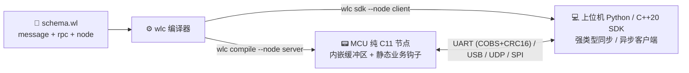

import { Card, CardGrid, Tabs, TabItem } from '@astrojs/starlight/components';

<div class="signal-strip" aria-hidden="true">
  <span></span><i></i><span></span><i></i><span></span>
</div>

<div class="hero-metrics">
  <span>纯 ISO C11 · 核心零堆分配 (0 malloc)</span>
  <span>单文件声明 message + rpc + node</span>
  <span>默认内嵌端口 · 按角色精确裁剪 RAM</span>
  <span>自动生成 Python / C++20 上位机 SDK</span>
</div>

在 MCU 与上位机之间传遥测、下发配置或调 RPC 时，你是否还在手写 `switch-case` 解析字节流、到处填 `has_field = true`、或者为了等待响应而把主循环卡死？

**Wirelink 把“类型安全的二进制编解码”与“确定性容量的 RPC 微内核”合二为一**。它的 C11 核心不依赖任何操作系统、线程、系统时钟或硬件驱动——你只需在主循环里喂入字节并调用 `<node>_step(now_ms)`，就能在 UART、USB Bulk、UDP 或 SPI 上跑通强类型的双向通信。

## 直观感受：从一份 `.wl` 到双端通话

<Tabs>
  <TabItem label="1. 写一份协议 (calculator.wl)">
    在同一份文件里定义数据结构、RPC 配对以及两端各自扮演的角色（`node`）：

    {/* [docs:calculator_schema] */}
    ```wl
    message AddRequest @id(20) {
      int32 left @id(1);
      int32 right @id(2);
    }
    message AddResponse @id(21) { int32 sum @id(1); }
    rpc Add(AddRequest) -> AddResponse;
    node client { call Add; }
    node server { serve Add; }
    ```
    {/* [/docs:calculator_schema] */}
  </TabItem>

  <TabItem label="2. MCU 固件实现服务 (server.c)">
    运行 `wlc compile calculator.wl --node server` 生成一对 `.h/.c`。你不需要注册回调表，直接实现同名 C 函数即可：

    {/* [docs:calculator_server] */}
    ```c
    int32_t server_on_add(server_node_t *self, const add_request_t *request, add_response_t *response) {
      (void)self;
      const int64_t sum = (int64_t)request->left + request->right;
      if (sum < INT32_MIN || sum > INT32_MAX) return 1;
      response->sum = (int32_t)sum;
      return 0;
    }
    ```
    {/* [/docs:calculator_server] */}
  </TabItem>

  <TabItem label="3. 上位机 Python 直接调用">
    运行 `wlc sdk calculator.wl --node client` 生成带完整类型提示的 Python 客户端包，连业务拒绝码（如整数溢出返回 `1`）都会自动映射为异常：

    {/* [docs:python_sdk_client] */}
    ```python
    with Client.connect(Udp(peer=('127.0.0.1', port))) as client:
        saved = client.add(left=20, right=22)
        assert saved.sum == 42
        try:
            client.add(left=2**31 - 1, right=1)
        except RejectedError as error:
            assert error.status == 1
    ```
    {/* [/docs:python_sdk_client] */}
  </TabItem>
</Tabs>

## 端到端工作流架构



## 选择你的学习路径

<CardGrid>
  <Card title="🚀 5 分钟快速上手" icon="rocket">
    无需任何硬件，30 秒在本地跑通内置 C11 双端回环；再花 3 分钟走完从 `.wl` 到 Python 联调的完整闭环。[立即开始 →](/wirelink/zh-cn/overview/quick-start/)
  </Card>
  <Card title="🎓 渐进式互动教程（第 01 ~ 06 课）" icon="open-book">
    参照 Astro 交互式教程设计。每课带你攻克一个真实工程场景，包含源码透视、动手微挑战、思考题与进度检查单。[进入第 01 课 →](/wirelink/zh-cn/learn/01-loopback-endpoint/)
  </Card>
  <Card title="📐 Schema 语法与节点手册" icon="setting">
    为什么字段默认必选没有 `has_*`？`string<31>` 在内存里怎么存？怎么给串口选 `cobs_crc16`？[查看语法与节点指南 →](/wirelink/zh-cn/concepts/schema-language/)
  </Card>
  <Card title="🔌 硬件驱动移植与协议参考" icon="list-format">
    把生成的节点接到你板子上的 UART ISR、DMA 或 FreeRTOS/Zephyr 任务中，或查阅 Wire v2 字节规范与实测 RAM 账本。[查阅驱动与 API 手册 →](/wirelink/zh-cn/how-to/custom-drivers/)
  </Card>
</CardGrid>
