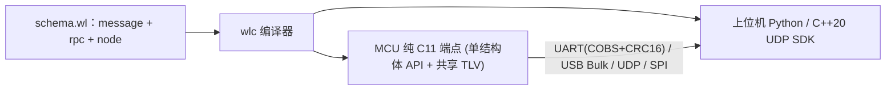

import { Card, CardGrid } from '@astrojs/starlight/components';

  <i></i><i></i>

  ISO C11 · 核心零堆分配
  默认自包含 node · 按角色裁剪
  Wire v2 4B 小端帧头
  4 槽并发 RPC · 8 槽 TX 队列

Wirelink 把类型安全的二进制协议与有界微内核合二为一。核心库完全剥离了 `malloc`、线程、系统时钟与硬件驱动，适用于裸机主循环、Zephyr RTOS 与桌面上位机。

## 端到端工作流架构

<CardGrid>
  <Card title="5 分钟快速上手" icon="rocket">
    从消息定义、代码生成到 C11 与 Python 联调，三步跑通第一个点对点端点。[立即开始](/wirelink/zh-cn/overview/quick-start/)。
  </Card>
  <Card title="渐进式互动课程（01 ~ 06）" icon="open-book">
    每课聚焦一个工程场景，配备时序图、`MultipleChoice` 思考题与 `Checklist` 检查表。[进入第 01 课](/wirelink/zh-cn/learn/01-loopback-endpoint/)。
  </Card>
  <Card title="Schema 与编译器指南" icon="setting">
    系统查阅 `.wl` 类型系统、`node` 角色与分帧以及 `wlc` 与 CMake 集成方式。[查看语法手册](/wirelink/zh-cn/concepts/schema-language/)。
  </Card>
  <Card title="API、Wire v2 与体积账本" icon="list-format">
    查询 `wl_kernel` 核心签名、4B 帧头与 8/12B RPC 子头字节格式及 `-Os` 实测数据。[查阅参考手册](/wirelink/zh-cn/reference/kernel-api/)。
  </Card>
</CardGrid>
