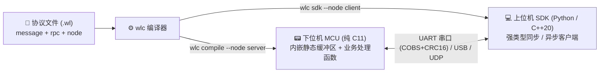

import { Card, CardGrid, Tabs, TabItem } from '@astrojs/starlight/components';

<div class="signal-strip" aria-hidden="true">
  <span></span><i></i><span></span><i></i><span></span>
</div>

<div class="hero-metrics">
  <span>纯 ISO C11 · 核心零堆分配 (0 malloc)</span>
  <span>单文件定义 message + rpc + node</span>
  <span>原生支持双向 RPC 与单向 Telemetry</span>
  <span>一键生成 Python / C++20 上位机 SDK</span>
</div>

在做嵌入式开发时，让下位机（MCU 固件）和上位机（PC 测试脚本、桌面 UI 或边缘主机）稳定通信，往往要自己手写串口粘包断包、CRC 校验、字节序转换以及 RPC 超时重试状态机。

**Wirelink 把“类型安全的二进制编解码”、“串口/数据包分帧器”与“确定性容量的 RPC 微内核”合二为一**。它的 C11 核心不依赖任何操作系统、线程、系统时钟或硬件驱动——你只需在主循环里喂入收到的字节并调用 `<node>_step(now_ms)`，就能在 UART 串口、USB、UDP 或 SPI 上跑通强类型的上下位机通信。

## 三步看懂：从一份 `.wl` 到上下位机通话

<Tabs>
  <TabItem label="1. 定义协议与两端角色 (calculator.wl)">
    在同一份 `.wl` 文件里定义消息字段、RPC 请求/响应配对，以及上位机（`client`）与下位机（`server`）各自扮演的角色：

    {/* [docs:calculator_schema] */}
    ```wl
    message AddRequest @id(20) {
      int32 left @id(1);
      int32 right @id(2);
    }
    message AddResponse @id(21) { int32 sum @id(1); }
    rpc Add(AddRequest) -> AddResponse;
    node client { call Add; }
    node server { serve Add; }
    ```
    {/* [/docs:calculator_schema] */}
  </TabItem>

  <TabItem label="2. 下位机 MCU 实现服务 (server.c)">
    运行 `wlc compile calculator.wl --node server` 生成一对干净的 `.h/.c`。你只需直接实现同名 C 函数：返回 `0` 发送计算结果，返回非零值（如整数溢出时返回 `1`）主动拒绝请求：

    {/* [docs:calculator_server] */}
    ```c
    int32_t server_on_add(server_node_t *self, const add_request_t *request, add_response_t *response) {
      (void)self;
      const int64_t sum = (int64_t)request->left + request->right;
      if (sum < INT32_MIN || sum > INT32_MAX) return 1;
      response->sum = (int32_t)sum;
      return 0;
    }
    ```
    {/* [/docs:calculator_server] */}
  </TabItem>

  <TabItem label="3. 上位机 Python 直接调用">
    运行 `wlc sdk calculator.wl --node client` 生成带完整类型提示的 Python 客户端包。下位机返回的非零业务拒绝码会自动映射为 `RejectedError` 异常：

    {/* [docs:python_sdk_client] */}
    ```python
    with Client.connect(Udp(peer=('127.0.0.1', port))) as client:
        saved = client.add(left=20, right=22)
        assert saved.sum == 42
        try:
            client.add(left=2**31 - 1, right=1)
        except RejectedError as error:
            assert error.status == 1
    ```
    {/* [/docs:python_sdk_client] */}
  </TabItem>
</Tabs>

## 上下位机端到端工作流



## 选择你的学习路径

<CardGrid>
  <Card title="🚀 5 分钟快速上手" icon="rocket">
    从编写第一份 `.wl` 协议开始，3 步生成下位机 C11 节点与上位机客户端，并附带免安装编译器的 30 秒本地验证。[立即开始 →](/wirelink/zh-cn/overview/quick-start/)
  </Card>
  <Card title="🎓 渐进式实战教程（第 01 ~ 06 课）" icon="open-book">
    按真实开发顺序编排：先打通上下位机通信，再深入 Telemetry 与 RPC 的协同模式、字符串内存生命周期、串口/UDP 接入与并发背压。[进入第 01 课 →](/wirelink/zh-cn/learn/01-loopback-endpoint/)
  </Card>
  <Card title="📐 .wl 语法与节点配置手册" icon="setting">
    查阅标量类型、有界字符串 `string<N>`、可选字段 `optional`、多模块 `import` 以及串口 `cobs_crc16` 分帧配置。[查看语法与节点指南 →](/wirelink/zh-cn/concepts/schema-language/)
  </Card>
  <Card title="🔌 硬件驱动移植与 API 参考" icon="list-format">
    把生成的节点接到你板子上的 UART 中断、DMA 或 FreeRTOS/Zephyr 任务中，或查阅 C11 API 速查表与二进制帧规范。[查阅驱动与 API 手册 →](/wirelink/zh-cn/how-to/custom-drivers/)
  </Card>
</CardGrid>
