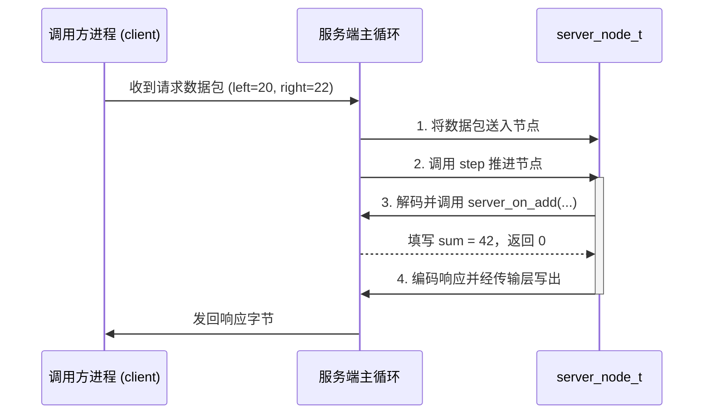

import { Aside, Tabs, TabItem } from '@astrojs/starlight/components';
import LessonHeader from '../../../../components/tutorial/LessonHeader.astro';
import Challenge from '../../../../components/tutorial/Challenge.astro';
import Checklist from '../../../../components/tutorial/Checklist.astro';
import MultipleChoice from '../../../../components/tutorial/MultipleChoice.astro';

<LessonHeader
  unit={1}
  duration="6 分钟"
  examplePath="examples/01_rpc"
  goals={[
    '使用 message、rpc 与 node 定义一份 .wl 协议文件',
    '运行 wlc compile 生成单端 C11 代码，理解生成头文件中的命名规则',
    '实现业务处理函数并运行独立的双进程服务端与客户端',
  ]}
/>

本课以一个远程加法服务为例，演示从编写 `.wl` 协议文件到在下位机 C 代码中运行服务的完整流程。调用方发送两个 32 位整数 `left` 与 `right`，服务方返回它们的和 `sum`；若相加结果超出 `int32` 范围，服务方返回一个非零错误码拒绝该请求。

---

## 第一步：编写协议文件 `calculator.wl`

仓库中的 [`examples/01_rpc/calculator.wl`](https://github.com/starwey604/wirelink/blob/main/examples/01_rpc/calculator.wl) 定义了这份协议：

{/* [docs:calculator_schema] */}
```wl
message AddRequest @id(20) {
  int32 left @id(1);
  int32 right @id(2);
}
message AddResponse @id(21) { int32 sum @id(1); }
rpc Add(AddRequest) -> AddResponse;
node client { call Add; }
node server { serve Add; }
```
{/* [/docs:calculator_schema] */}

这段定义包含三个部分：
- **`message`**：声明请求消息 `AddRequest` 与响应消息 `AddResponse`。`@id(20)`、`@id(21)` 为消息的唯一路由编号，`@id(1)`、`@id(2)` 为字段编号，用于在线缆上唯一标识消息类型与字段。
- **`rpc`**：将 `AddRequest` 与 `AddResponse` 绑定为一次名为 `Add` 的请求/响应调用。
- **`node`**：声明通信两端的角色。`client` 负责发起调用（`call Add;`），`server` 负责提供服务（`serve Add;`）。

---

## 第二步：使用 `wlc` 生成 C 代码并查阅头文件

运行以下命令，只为 `server` 角色生成 C11 代码：

```sh
wlc/target/release/wlc compile examples/01_rpc/calculator.wl \
  --node server --out-dir build/my-server
```

命令执行后，`build/my-server/` 目录中会生成 `calculator.h` 与 `calculator.c`。打开 `build/my-server/calculator.h`，重点关注以下三组声明（它会自动包含 `<wirelink/node.h>`）：

```c
/* 1. 消息结构体：由 AddRequest / AddResponse 转换而来 */
typedef struct add_request add_request_t;
typedef struct add_response add_response_t;

struct add_request {
  int32_t left;
  int32_t right;
};

struct add_response {
  int32_t sum;
};

/* 2. 节点结构体与绑定入口（由 calculator.c 实现） */
struct server_node {
  wl_node_t node; /* 所有生成节点统一的基类成员 */
  /* 其余静态收发缓冲区由编译器按协议大小自动计算 */
};

wl_err_t server_bind(server_node_t *self, wl_transport_t *transport);
wl_err_t server_bind_sync(server_node_t *self, server_tx_write_fn tx_write);

/* 3. 需要由应用层实现的业务处理函数 */
int32_t server_on_add(
    server_node_t *self, const add_request_t *request, add_response_t *response);
```

<Aside type="note" title="如何区分 server_* 与 wl_node_* 前缀？">
Wirelink 将“协议相关”和“通用运行时”清晰分开：
- **`<node>_*`（此处为 `server_*`）**：由 `wlc` 根据 `.wl` 中的节点名生成，只包含节点类型（`server_node_t`）、绑定入口（`server_bind` / `server_bind_sync`）以及业务回调/调用（`server_on_add`）。若协议中写的是 `node motor { serve SetSpeed; }`，就会生成 `motor_node_t`、`motor_bind` 与 `motor_on_set_speed`。
- **`wl_node_*`**：来自核心库 `<wirelink/node.h>`，前缀永远固定。无论节点叫什么名字，驱动主循环、喂入收包和关闭节点都统一操作基类成员 `&server.node`（例如 `wl_node_step(&server.node, now)`、`wl_node_wait(...)`、`wl_node_close(...)`）。
</Aside>

---

## 第三步：实现业务处理函数 `server_on_add`

在服务端源文件 [`examples/01_rpc/server.c`](https://github.com/starwey604/wirelink/blob/main/examples/01_rpc/server.c) 中实现 `server_on_add`：

{/* [docs:calculator_server] */}
```c
int32_t server_on_add(server_node_t *self, const add_request_t *request, add_response_t *response) {
  (void)self;
  const int64_t sum = (int64_t)request->left + request->right;
  if (sum < INT32_MIN || sum > INT32_MAX) return 1;
  response->sum = (int32_t)sum;
  return 0;
}
```
{/* [/docs:calculator_server] */}

`server_on_add` 的返回值决定 Wirelink 如何向调用方回复：
- **返回 `0`**：表示请求执行成功，Wirelink 将编码你填写的 `response` 结构体并发回给调用方。
- **返回非零 `int32_t`（例如 `1`）**：表示业务层拒绝该请求。Wirelink 不会发送 `response`，而是将该状态码原样传回给调用方。

---

## 第四步：接入传输层并驱动主循环

同一个生成节点支持两种接线方式：在嵌入式板卡上可以直接传入一个同步发包函数（`server_bind_sync`），也可以通过 `server_bind` 直接挂载现有的传输适配器（例如桌面端的 UDP 适配器）。

<Tabs>
  <TabItem label="方式 A：自定义同步发送函数（嵌入式裸机常用）">
    把你板子上的发包函数直接传给 `server_bind_sync`，收到数据包时调用 `wl_node_rx_packet`，并在主循环中定期调用 `wl_node_step`：

    ```c
    #include "calculator.h"

    static server_node_t server;

    static wl_err_t my_tx_write(server_node_t *self, const uint8_t *data, size_t length) {
      (void)self;
      return my_hardware_send(data, length);
    }

    int main(void) {
      server_bind_sync(&server, my_tx_write);

      for (;;) {
        /* 硬件收到完整数据包时传入节点：
         * if (has_new_packet) {
         *   wl_node_rx_packet(&server.node, rx_buf, rx_len);
         * }
         */
        wl_node_step(&server.node, board_millis());
      }
    }
    ```
  </TabItem>

  <TabItem label="方式 B：使用官方 UDP 适配器（本系列桌面教程示例）">
    为了让教程中的服务端与客户端能够在电脑上作为两个独立进程直接通信，本系列示例（`00_telemetry`、`01_rpc`、`02_device_info`）使用 Wirelink 提供的 UDP 适配器（`<wirelink/udp.h>`，默认在 `127.0.0.1` 的一对端口上互通），通过 `server_bind` 单向挂载到服务端节点：

    {/* [docs:calculator_udp_server] */}
    ```c
    int main(int argc, char **argv) {
      static server_node_t server;
      wl_udp_config_t config = {
        .bind_address = "127.0.0.1", .bind_port = 50004,
        .peer_address = "127.0.0.1", .peer_port = 50003
      };
      if (!example_udp_args(argc, argv, &config)) return 1;
      wl_udp_t *udp = NULL;
      if (wl_udp_open(&udp, &config, NULL) != WL_OK) return 1;
      if (server_bind(&server, wl_udp_transport(udp)) != WL_OK) {
        wl_udp_close(udp);
        return 1;
      }
      example_install_signals();
      puts("Calculator server ready");
      fflush(stdout);
      int status = 0;
      while (example_running()) {
        if (wl_node_step(&server.node, 0U) != WL_OK ||
            wl_node_wait(&server.node, example_now_ms(), 100U) != WL_OK) {
          status = 1;
          break;
        }
      }
      if (wl_node_close(&server.node, example_now_ms()) != WL_OK) status = 1;
      wl_udp_close(udp);
      return status;
    }
    ```
    {/* [/docs:calculator_udp_server] */}

    这段 `main()` 按顺序完成了 4 件事：
    1. **打开传输**：`wl_udp_open(&udp, &config, NULL)` 绑定本地 UDP 端口 `50004` 并记录对端地址 `50003`。
    2. **绑定节点**：`server_bind(&server, wl_udp_transport(udp))` 将 `server` 单向挂载到 UDP 传输（自动同步收发帧长上限并启动接收）。
    3. **步进与等待**：主循环交替调用 `wl_node_step(&server.node, ...)`（收包、解码、执行 `server_on_add`、发回响应）和 `wl_node_wait(&server.node, ..., 100U)`（在无事件时休眠等待，避免空转占满 CPU）。
    4. **关闭与释放**：退出循环后先通过 `wl_node_close(&server.node, ...)` 停止收发并排空在途状态，再调用 `wl_udp_close(udp)` 释放套接字。

    代码中的符号按前缀可分为四类，便于快速区分职责：

    | 前缀 | 来源 | 职责 |
    | :--- | :--- | :--- |
    | **`wl_udp_*`** | `<wirelink/udp.h>` | 官方 UDP 传输的打开、获取句柄与关闭 |
    | **`wl_node_*`** | `<wirelink/node.h>` | 所有节点通用的步进、等待与关闭接口 |
    | **`server_*`** | `wlc` 生成的 `calculator.h` | 本节点的静态类型、绑定入口与业务回调 |
    | **`example_*`** | 示例公共辅助文件 | 仅用于处理命令行端口覆盖、`Ctrl-C` 退出与系统毫秒时钟 |

    移植到真实硬件时，只需将 `wl_udp_*` 换成对应的板级传输或同步发送函数，上面的 `server_on_add` 业务代码无需改动。
  </TabItem>
</Tabs>

数据在主循环中的流转顺序如下：



<Challenge
  title="检查理解：server_on_add 会在接收中断里执行吗？"
  prompt="如果应用程序在接收中断中调用 wl_node_rx_packet(&server.node, data, len)，server_on_add 会在中断上下文中立即被调用吗？"
>
  不会。

  `wl_node_rx_packet` 只负责将收到的数据拷贝到节点内部缓冲区并立即返回；解码数据包、调用 `server_on_add` 以及写出响应，全部在主循环调用 `wl_node_step(&server.node, now_ms)` 时顺序执行。这使得业务回调始终运行在主循环上下文中。
</Challenge>

---

## 第五步：在两个终端运行服务端与客户端

在仓库根目录编译 [`examples/01_rpc/`](https://github.com/starwey604/wirelink/tree/main/examples/01_rpc) 中的独立服务端与客户端（假设已按[快速开始](/wirelink/zh-cn/overview/quick-start/)配置好 `build/examples`）：

```sh
cmake --build build/examples --target calculator_server calculator_client
```

打开两个终端分别启动两端（无参数时默认在 `127.0.0.1` 的 `50004` 与 `50003` 端口互通）：

```sh
# 终端 1：启动服务端
./build/examples/examples/01_rpc/calculator_server
```

```sh
# 终端 2：运行客户端
./build/examples/examples/01_rpc/calculator_client
```

终端 2 输出以下结果，表示单次调用、并发调用与溢出拒绝均已通过：

```text
20 + 22 = 42
4 concurrent calls returned 42
overflow rejected: status=1
```

---

## 小测验

<MultipleChoice
  id="lesson-01-rpc-return"
  question="在 server_on_add(self, request, response) 中，当发现输入参数会导致整数溢出时，正确的做法是什么？"
  checkLabel="检查答案"
  emptyFeedback="请先选择一个选项。"
  choices={[
  {
    "label": "返回一个非零的 int32_t 状态码（如 return 1;），由 Wirelink 将该状态码传回给调用方。",
    "correct": true,
    "feedback": "正确。返回 0 表示发送 response 结构体；返回非零值表示业务拒绝，该状态码会直接送达调用方。"
  },
  {
    "label": "必须返回 0，并在 AddResponse 中额外定义一个 error_code 字段来传递错误。",
    "correct": false,
    "feedback": "不需要。Wirelink 的 RPC 原生支持通过非零返回值传递业务拒绝码。"
  },
  {
    "label": "在函数内循环等待调用方重新发送合法参数。",
    "correct": false,
    "feedback": "不应阻塞回调。Wirelink 在主循环中步进执行，阻塞回调会阻止后续收发处理。"
  }
]}
/>

<Checklist
  id="checklist-01"
  title="本课检查清单"
  progressTemplate="已完成 {done} / {total} 项"
  items={[
    "能够使用 message、rpc 与 node 编写基础的 .wl 文件。",
    "能够运行 wlc compile --node <name> 生成单端 C 代码，并识别 <node>_node_t、<node>_bind_sync 与 <node>_on_<rpc> 等符号。",
    "理解服务端回调返回 0 与非零值的区别，并能在本地双终端运行 calculator_server 与 calculator_client。"
  ]}
/>

本课实现的是需要一问一答的 RPC 服务。在设备通信中，很多数据只需要单向推送（例如周期性传感器采样或异步状态上报），并不需要每次等待对端回复。下一课将介绍单向消息（Telemetry），并说明它与 RPC 的区别与配合方式。

下一课：[02 单向消息（Telemetry）与 RPC →](/wirelink/zh-cn/learn/02-telemetry/)
