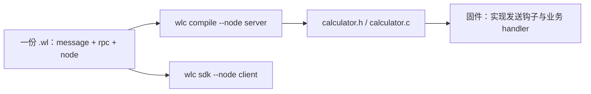

import Checklist from '../../../../components/tutorial/Checklist.astro';
import MultipleChoice from '../../../../components/tutorial/MultipleChoice.astro';

硬件还没到，也可以先验证协议。仓库的本地回环把两个节点放在同一个进程，由主循环推进请求、响应和遥测，最后安全关闭。

## 一份 `.wl` 描述数据与角色

`message` 描述数据，顶层 `rpc` 配对请求与响应，`node` 声明本端真正使用的能力。它们都写在 `.wl` 中；跨模块复用时使用 `import`。



默认节点内嵌端口和精确容量的收发存储；业务 handler 是直接链接的 C 函数。只实现当前角色需要的符号，不必组装回调表，也不用为必选字段填写 `has_*`。

## 先运行现成回环

```sh
cmake -S . -B build/core -DCMAKE_BUILD_TYPE=Release
cmake --build build/core --parallel
./build/core/examples/wirelink_bare_metal_loopback
```

示例使用已生成的 `examples/kernel/generated/demo.h/.c`，不需要先安装 WLC。预期输出：

```text
6 bidirectional RPC completions, 2 telemetry messages; both endpoints quiescent
```

`quiescent` 表示在途租约和调用已经收尾，可以复用存储，不表示内存被清零。

## 看懂高级回环的装配

这个底层回环为了演示端口所有权，显式选择 `io = external; handlers = dynamic;`，因此仍装配外部 port 和 handler 表：

{/* [docs:loopback_setup] */}
```c
wl_packet_config_t config = {.instance = 1001U + side,
    .rx_storage = &receive_storage[side][0][0], .rx_unit_size = 256U,
    .rx_storage_size = sizeof(receive_storage[side]),
    .submit = wl_packet_loopback_submit, .notify = wl_packet_loopback_notify,
    .user = &transport.directions[side]};
require(wl_packet_init(&ports[side], &config) == WL_OK);
demo_handlers_t handlers = {.on_execute = execute, .on_event = received};
require(demo_init(&endpoints[side], &ports[side], &handlers, NULL) == WL_OK);
```
{/* [/docs:loopback_setup] */}

这是高级接入选项，不是入门样板。下一课用默认 embedded/static 节点，只需初始化节点、实现发送钩子和接收函数。

<MultipleChoice
  id="lesson-01-node"
  question="从串口切换到 UDP，应修改什么？"
  checkLabel="检查答案"
  emptyFeedback="请先选择一个选项。"
  choices={[
  {
    "label": "调整 node 的 framing 和物理发送/接收胶水，保留消息字段与 RPC 数据定义。",
    "correct": true,
    "feedback": "正确。数据定义可以复用；链路必须提供所选 framing 需要的边界与发送契约。"
  },
  {
    "label": "必须重新分配所有消息和字段 ID。",
    "correct": false,
    "feedback": "不需要。切换物理介质不要求改变业务数据的 ID。"
  },
  {
    "label": "必须把生成的编解码替换成手写字节数组。",
    "correct": false,
    "feedback": "不需要。生成器仍负责类型化编码与路由。"
  }
]}
/>

<Checklist id="checklist-01" title="本课检查清单" progressTemplate="已完成 {done} / {total} 项" items={["能区分 message、rpc 与 node 的职责。", "运行回环并观察双向 RPC、遥测和 quiescent 退出。"]} />

下一课：[02 定义与收发设备遥测消息](/wirelink/zh-cn/learn/02-telemetry/)。
