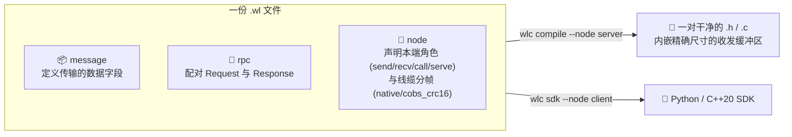

import { Aside, Steps, Tabs, TabItem } from '@astrojs/starlight/components';
import LessonHeader from '../../../../components/tutorial/LessonHeader.astro';
import Challenge from '../../../../components/tutorial/Challenge.astro';
import Checklist from '../../../../components/tutorial/Checklist.astro';
import MultipleChoice from '../../../../components/tutorial/MultipleChoice.astro';

<LessonHeader
  unit={1}
  duration="5 分钟"
  examplePath="examples/bare_metal_loopback.c"
  goals={[
    '理解一份 .wl 文件里 message、rpc、node 三者的分工',
    '在本地编译并跑通无需硬件的纯 C11 双端内存回环',
    '看懂 Wirelink 的单线程 step(now) 驱动心跳与 quiescent（静止）安全停机',
  ]}
/>

硬件板子还没画好，或者串口线不在手边，能先开发和验证通信协议吗？

当然可以。因为 Wirelink 的核心**完全不绑死硬件外设**，我们可以把两个节点放在同一个进程的内存里，让节点 A 发出的字节直接塞进节点 B 的接收口——这就是**本地内存回环（Loopback）**。

---

## 第一步：认识 `.wl` 里的三个主角

在动手跑代码前，先看一眼 Wirelink 协议文件（`.wl`）是如何组织的。

在传统方案里，你往往需要在一个文件里写数据结构（比如 `.proto`），再在另一堆 C 代码里手写“谁发谁收、用什么分帧、超时多少毫秒”。而在 Wirelink 0.14 中，**数据结构和节点角色声明在同一份 `.wl` 文件里**：



- **`message`（消息）**：描述数据包里有哪些字段（如温度值、设备名）。
- **`rpc`（远程调用）**：声明“发 `AddRequest` 过去，应该回 `AddResponse`”。
- **`node`（节点角色）**：声明某一个固件或客户端真正用到的能力。例如传感器节点写 `node sensor { send Telemetry; }`，接收端写 `node host { recv Telemetry; }`。

<Aside type="tip" title="为什么把 node 写进 .wl 里这么爽？">
当你用 `wlc compile app.wl --node sensor` 为传感器生成代码时，编译器知道它**只发普通遥测、不调 RPC**，于是生成的 `sensor_node_t` 会自动把 RPC 请求槽和回复槽的 RAM 裁剪为 **0 字节**，并且只生成 `sensor_send_telemetry()` 函数，多一个多余符号都没有！
</Aside>

---

## 第二步：动手跑通内置的裸机回环

为了让你不用先编译 Rust 编译器（`wlc`）就能立刻体验，仓库里已经放好了一对预生成的节点代码（`examples/kernel/generated/demo.h` 与 `demo.c`）。

<Steps>

1. **配置并编译核心与回环示例**

   在仓库根目录下打开终端，运行以下三条命令：

   ```sh
   cmake -S . -B build/core -DCMAKE_BUILD_TYPE=Release
   cmake --build build/core --parallel
   ./build/core/examples/wirelink_bare_metal_loopback
   ```

2. **观察运行输出**

   程序会在几毫秒内跑完并打印：

   ```text
   6 bidirectional RPC completions, 2 telemetry messages; both endpoints quiescent
   ```

</Steps>

### 刚才这一瞬间发生了什么？

在这个回环程序里，我们创建了两个端点（Endpoint 0 和 Endpoint 1），并通过一个模拟的内存管道把它们连在一起：

1. **并发与双向 RPC**：两端互相发起了 **6 次 RPC 调用**（涵盖了正常返回、主动取消 `CANCELLED`、超时 `TIMED_OUT` 和业务拒绝 `REJECTED`）。
2. **单向遥测推送**：两端互相发送了 **2 条单向遥测消息（Event）**。
3. **安全停机（`quiescent`）**：通信结束后，两端调用 `close()` 并继续推进 `step()`，直到所有在途请求和物理缓冲区租约全部收尾归还，进入 **`quiescent`（静止）** 状态。

<Aside type="note" title="什么是 quiescent（静止）？">
在嵌入式系统中，当你准备关闭串口、休眠或复用节点内存时，不能直接暴力清零结构体——因为可能还有未触发的取消回调，或者底层 DMA 还在读取发送缓冲区。
当 `<node>_quiescent(&node)` 返回 `true` 时，代表**所有在途调用的终态回调都已派发完毕、所有缓冲区借用都已归还**，此时你可以安全地销毁或重新初始化节点。
</Aside>

---

## 第三步：两种节点装配模式（入门默认 vs 底层进阶）

Wirelink 的 `node` 支持两种 I/O 与回调装配模式。**90% 的嵌入式场景只需要用最简单的默认模式**：

<Tabs>
  <TabItem label="🌟 默认模式 (embedded + static) — 推荐入门">
    当你写 `node pub { send Telemetry; }` 且不写额外配置时，默认就是 `io = embedded; handlers = static;`：
    - **零样板初始化**：节点结构体自己内嵌了 `port` 和收发缓冲，初始化只需一行 `pub_init(&publisher)`。
    - **静态函数直连**：收到消息或需要物理发包时，直接调用你写的同名 C 函数（如 `pub_tx_write`、`sub_on_telemetry`），完全不需要组装函数指针表！
    - **我们将在下一课（第 02 课）详细用这种模式写代码。**
  </TabItem>

  <TabItem label="⚙️ 底层高级模式 (external + dynamic)">
    刚才跑的 `wirelink_bare_metal_loopback` 是专门用来测试底层端口租约与动态回调表的内核级 demo，因此它在 `examples/kernel/demo.wl` 中显式声明了 `io = external; handlers = dynamic;`。

    在这种高级模式下，应用需要自己初始化外部的 `wl_packet_port_t` 并传入 `demo_handlers_t` 回调表：

    {/* [docs:loopback_setup] */}
    ```c
    wl_packet_config_t config = {.instance = 1001U + side,
        .rx_storage = &receive_storage[side][0][0], .rx_unit_size = 256U,
        .rx_storage_size = sizeof(receive_storage[side]),
        .submit = wl_packet_loopback_submit, .notify = wl_packet_loopback_notify,
        .user = &transport.directions[side]};
    require(wl_packet_init(&ports[side], &config) == WL_OK);
    demo_handlers_t handlers = {.on_execute = execute, .on_event = received};
    require(demo_init(&endpoints[side], &ports[side], &handlers, NULL) == WL_OK);
    ```
    {/* [/docs:loopback_setup] */}

    **什么时候才需要用 `external`？** 当你的底层是**异步零拷贝 DMA 驱动**（比如 UART DMA 发送期间需要长时间借用节点缓冲区指针，发完才在中断里通过 token 归还租约），或者在对接现有的 Zephyr/Host 异步适配器时。初学者可以先忽略这段底层装配！
  </TabItem>
</Tabs>

<Challenge
  title="思考一下"
  prompt="如果明天你的硬件团队把两块板子之间的连线从 UART 串口换成了 UDP 网口（或者 USB Bulk），你的 .wl 文件和业务代码需要重写吗？"
>
  **业务数据结构和业务处理函数一行都不用改！**

  在 Wirelink 中，业务数据（`message` / `rpc`）与传输分帧（`node` 里的 `framing`）是解耦的：
  1. 你只需要在 `node` 里把 `framing = cobs_crc16;`（串口字节流分帧）改成 `framing = native;`（天然带包边界的 UDP/包通道）。
  2. 替换底层的物理收发胶水函数（比如把串口的 `rx_feed` 换成收 UDP 包的 `rx_packet`），上层的 `on_add`、`send_telemetry` 业务代码完全保持原样。
</Challenge>

---

## 本课小测验

<MultipleChoice
  id="lesson-01-node"
  question="当你的通信链路从 UART 串口切换到 UDP 时，应该修改什么？"
  checkLabel="检查答案"
  emptyFeedback="请先选择一个选项。"
  choices={[
  {
    "label": "只调整 node 的 framing 配置和底层的物理收发胶水代码，保留所有 message 字段与 RPC 业务代码。",
    "correct": true,
    "feedback": "完全正确！数据结构和 RPC 逻辑与物理介质无关，你只需切换 node 的 framing 并把新驱动接上即可。"
  },
  {
    "label": "必须重新分配所有 message 和字段的 @id(N) 编号。",
    "correct": false,
    "feedback": "不需要。切换物理传输介质不会影响协议层的数据字段 ID。"
  },
  {
    "label": "必须把生成的类型化函数替换成手写的字节数组拼接。",
    "correct": false,
    "feedback": "不需要。无论底层走什么线，WLC 生成的类型安全编解码和路由 API 都是一样的。"
  }
]}
/>

<Checklist
  id="checklist-01"
  title="本课掌握清单"
  progressTemplate="已完成 {done} / {total} 项"
  items={[
    "能分清 .wl 文件中 message（数据结构）、rpc（请求响应配对）与 node（本端角色与分帧）各自的职责。",
    "在本地成功编译并运行了 wirelink_bare_metal_loopback，观察到 quiescent 安全退出。",
    "知道日常开发优先使用默认的 embedded + static 节点，无需手写底层 port 与回调表装配。"
  ]}
/>

准备好看真正极简的默认节点代码了吗？下一课我们自己写一个温度遥测节点：[02 定义与收发设备遥测消息 →](/wirelink/zh-cn/learn/02-telemetry/)
