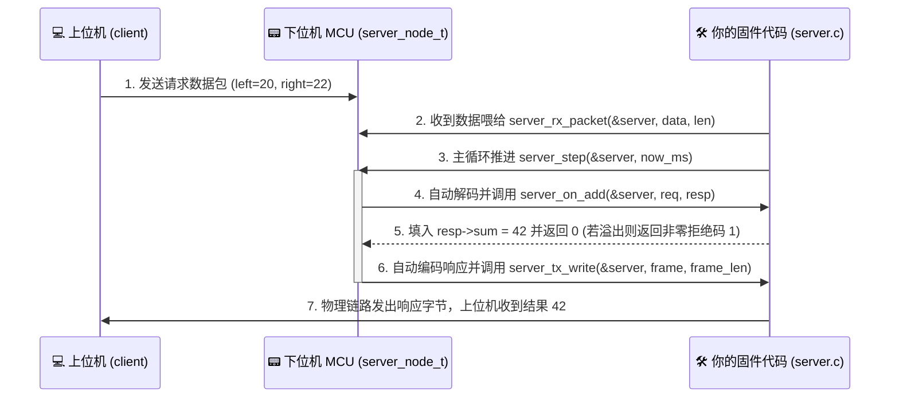

import { Aside, Steps, Tabs, TabItem, FileTree } from '@astrojs/starlight/components';
import LessonHeader from '../../../../components/tutorial/LessonHeader.astro';
import Challenge from '../../../../components/tutorial/Challenge.astro';
import Checklist from '../../../../components/tutorial/Checklist.astro';
import MultipleChoice from '../../../../components/tutorial/MultipleChoice.astro';

<LessonHeader
  unit={1}
  duration="7 分钟"
  examplePath="examples/01_rpc"
  goals={[
    '在一份 .wl 文件中定义消息 (message)、远程调用 (rpc) 与通信两端角色 (node)',
    '使用 wlc 分别为下位机生成纯 C11 节点代码、为上位机生成 Python / C++20 客户端 SDK',
    '看懂生成的 C 头文件，实现 2 个函数并驱动 step(now_ms) 跑通上下位机通话',
  ]}
/>

当你拿到一个新的嵌入式通信需求（比如让上位机控制 MCU 执行动作、或者读取设备数据）时，使用 Wirelink 的第一步永远是：**写一份 `.wl` 协议文件**。

在这一课里，我们不讲枯燥的底层理论，直接动手写一个“远程加法计算器”协议（源自 [`examples/01_rpc/`](https://github.com/starwey604/wirelink/tree/main/examples/01_rpc)），让你看清从 `.wl` 到下位机 C 代码和上位机 Python 调用的每一个环节。

---

## 第一步：编写 `calculator.wl`

在一份 `.wl` 文件里，我们同时描述三件事：**传什么数据（`message`）**、**一问一答怎么配对（`rpc`）**，以及**通信双方各自扮演什么角色（`node`）**：

{/* [docs:calculator_schema] */}
```wl
message AddRequest @id(20) {
  int32 left @id(1);
  int32 right @id(2);
}
message AddResponse @id(21) { int32 sum @id(1); }
rpc Add(AddRequest) -> AddResponse;
node client { call Add; }
node server { serve Add; }
```
{/* [/docs:calculator_schema] */}

这短短 9 行代码定下了上下位机之间的全部契约：
- **`@id(20)` 与 `@id(21)`**：每条消息在线缆上的唯一路由编号（`1 .. 65535`）。
- **`int32 left @id(1);`**：消息内的字段类型、名称与编号。
- **`rpc Add(AddRequest) -> AddResponse;`**：定义一次名为 `Add` 的远程调用，发 `AddRequest` 过去，收 `AddResponse` 回来。
- **`node client` 与 `node server`**：
  - 上位机（或调用方）是 `client`，只声明了 `call Add;`（发起调用）；
  - 下位机（MCU 固件）是 `server`，只声明了 `serve Add;`（提供服务）。

<Aside type="tip" title="为什么要把 node 角色写进 .wl 里？">
因为下位机 MCU 的 RAM 非常宝贵！当编译器知道 `server` 只做服务端（`serve Add`）而不主动发起调用（没有 `call`）时，生成的 `server_node_t` 会自动把客户端专用的请求缓存池裁剪为 **0 字节**，而且绝不会生成任何客户端函数。
</Aside>

---

## 第二步：生成下位机 C11 代码与上位机 SDK

接下来，我们用编译器 `wlc` 把这份 `.wl` 变成可直接编译的代码。请点击下方标签页，查看下位机生成命令、生成的 C 头文件长什么样，以及上位机 SDK 生成命令：

<Tabs>
  <TabItem label="1. 生成命令 (wlc compile & sdk)">
    在仓库根目录下构建 `wlc` 后，可以分别针对下位机固件和上位机生成代码：

    ```sh
    # 构建本地 wlc 编译器
    cargo build --release --locked --manifest-path wlc/Cargo.toml

    # A. 为下位机 MCU 固件生成纯 C11 服务端代码（--node server）
    wlc/target/release/wlc compile examples/01_rpc/calculator.wl \
      --node server --out-dir build/server

    # B. 为上位机生成 Python / C++20 客户端 SDK（--node client）
    wlc/target/release/wlc sdk examples/01_rpc/calculator.wl \
      --node client --name calculator --out-dir build/calculator-sdk

    # C. 若想在同一个 C 程序里同时跑 client 和 server 做本地回环测试：
    wlc/target/release/wlc compile examples/01_rpc/calculator.wl \
      --all-nodes --out-dir build/loopback
    ```
  </TabItem>

  <TabItem label="2. 透视生成的下位机头文件 (calculator.h)">
    打开 `build/server/calculator.h`，你会发现生成的 C11 接口非常清爽（以下为核心声明摘录）：

    ```c
    /* 1. 消息结构体：字段直接对应 C 结构体成员 */
    typedef struct add_request_s {
      int32_t left;
      int32_t right;
    } add_request_t;

    typedef struct add_response_s {
      int32_t sum;
    } add_response_t;

    /* 2. 你在主循环里调用的节点生命周期与收包函数 */
    wl_err_t server_init(server_node_t *self);
    wl_err_t server_step(server_node_t *self, uint32_t now_ms);
    wl_err_t server_rx_packet(server_node_t *self, const uint8_t *data, size_t length);

    /* 3. 需要你在固件里实现的 2 个函数（1 个业务处理 + 1 个物理发包） */
    extern int32_t server_on_add(
        server_node_t *self, const add_request_t *request, add_response_t *response);
    extern wl_err_t server_tx_write(
        server_node_t *self, const uint8_t *data, size_t length);
    ```
  </TabItem>
</Tabs>

---

## 第三步：在下位机实现业务与收发，从上位机发起调用

默认生成的节点自带内部收发缓冲区（`io = embedded`），并且通过静态函数名直接链接你的业务代码（`handlers = static`）——你不需要组装任何函数指针表，只需写好 `server_on_add` 和 `server_tx_write` 两个函数！



来看看下位机和上位机的真实代码是怎么写的：

<Tabs>
  <TabItem label="1. 下位机业务函数 (server.c)">
    在 [`examples/01_rpc/server.c`](https://github.com/starwey604/wirelink/blob/main/examples/01_rpc/server.c) 中，服务端实现 `server_on_add`：

    {/* [docs:calculator_server] */}
    ```c
    int32_t server_on_add(server_node_t *self, const add_request_t *request, add_response_t *response) {
      (void)self;
      const int64_t sum = (int64_t)request->left + request->right;
      if (sum < INT32_MIN || sum > INT32_MAX) return 1;
      response->sum = (int32_t)sum;
      return 0;
    }
    ```
    {/* [/docs:calculator_server] */}

    **记住 `on_<rpc>` 的返回值规则**：
    - **返回 `0`**：代表业务执行成功，节点会自动把你填好的 `response->sum` 打包发回给调用方。
    - **返回非零 `int32_t`（例如 `1`）**：代表**业务层主动拒绝**（比如参数越界、整数溢出、设备正忙）。此时节点不会发送 `response`，而是发回一个紧凑的 16 字节拒绝帧，把状态码 `1` 原封不动地传给上位机！
  </TabItem>

  <TabItem label="2. 下位机主循环接入模板">
    除了上面的 `server_on_add`，你的固件只需要再提供一个物理发送函数 `server_tx_write`，并在主循环里周期性调用 `server_step`：

    ```c
    static server_node_t server;

    /* 当节点需要往外发包时，会自动调用你写的这个函数： */
    wl_err_t server_tx_write(server_node_t *self, const uint8_t *data, size_t length) {
      (void)self;
      return my_link_send_frame(data, length); /* 写到你的 UDP / USB / 串口驱动 */
    }

    int main(void) {
      server_init(&server);
      for (;;) {
        /* 如果底层收到了数据包，喂给节点：
         * server_rx_packet(&server, rx_buf, rx_len); */

        /* 周期性传入当前毫秒时间戳，驱动解包、回调与发包： */
        server_step(&server, board_millis());
      }
    }
    ```
    *(注：如果底层走的是 UART 串口连续字节流，只需在 `node` 里加一行 `framing = cobs_crc16;`，接收入口就会变成自动处理粘包断包的 `server_rx_feed`，我们将在第 04 课详细实战！)*
  </TabItem>

  <TabItem label="3. 上位机 Python 调用">
    使用 `wlc sdk` 生成的 Python 客户端包（详见 [`examples/06_bindings/`](https://github.com/starwey604/wirelink/tree/main/examples/06_bindings)），在上位机里直接调用 `client.add(...)`。当传入 `2**31 - 1` 和 `1` 触发下位机整数溢出（返回 `1`）时，Python 端会直接捕获到带 `status == 1` 的 `RejectedError`：

    {/* [docs:python_sdk_client] */}
    ```python
    with Client.connect(Udp(peer=('127.0.0.1', port))) as client:
        saved = client.add(left=20, right=22)
        assert saved.sum == 42
        try:
            client.add(left=2**31 - 1, right=1)
        except RejectedError as error:
            assert error.status == 1
    ```
    {/* [/docs:python_sdk_client] */}
  </TabItem>
</Tabs>

<Challenge
  title="动手思考：为什么下位机所有的回调都在 server_step() 里触发？"
  prompt="当你在接收中断或收包函数里调用 server_rx_packet(&server, data, len) 时，它会当场在中断栈上直接调用你的 server_on_add 业务函数吗？"
>
  **绝对不会！**

  1. `server_rx_packet`（以及串口的 `server_rx_feed`）**只负责把收到的字节存入节点内部的接收槽（RX 槽）**，不会立刻执行耗时解码，更不会当场调用你的业务函数。
  2. 真正的消息解码、调用 `server_on_add` 以及调用 `server_tx_write` 发回响应，**100% 都在你的主循环（Single Owner）调用 `server_step(&server, now_ms)` 时顺序执行**。
  3. 这样设计的好处是：你的业务函数永远运行在干净、可预测的主循环上下文中，不用担心中断重入或加锁问题！
</Challenge>

---

## 在本地编译并运行本课示例

你可以在本地直接编译并运行 `examples/01_rpc` 的完整测试套件：

```sh
cmake -S . -B build/examples -DCMAKE_BUILD_TYPE=Release \
  -DWIRELINK_BUILD_WLC_EXAMPLES=ON \
  -DWIRELINK_WLC_EXECUTABLE="$PWD/wlc/target/release/wlc"
cmake --build build/examples --target wirelink_rpc_demo
ctest --test-dir build/examples -R wirelink_rpc_demo --output-on-failure
```

---

## 本课小测验

<MultipleChoice
  id="lesson-01-rpc-return"
  question="在下位机服务端的 server_on_add(self, request, response) 函数中，如果发现上位机传来的参数不合法，应该怎么做？"
  checkLabel="检查答案"
  emptyFeedback="请先选择一个选项。"
  choices={[
  {
    "label": "直接返回一个非零的 int32_t 状态码（例如 return 1;），节点会自动向上位机发回携带该状态码的业务拒绝响应。",
    "correct": true,
    "feedback": "完全正确！返回 0 代表成功并发送 response 结构体；返回非零值代表业务拒绝，上位机 C 客户端会收到 WL_KERNEL_REJECTED，Python 客户端会收到 RejectedError。"
  },
  {
    "label": "只能返回 0，必须在 AddResponse 结构体里每次都手工加一个 error_code 字段。",
    "correct": false,
    "feedback": "不需要。Wirelink 的 RPC 原生内置了非零 int32_t 业务拒绝通道，被拒绝时连响应消息体都不用编码，只发 16 字节紧凑拒绝帧。"
  },
  {
    "label": "直接卡在函数里死循环等待上位机重发。",
    "correct": false,
    "feedback": "千万不要！Wirelink 采用单线程 step 驱动，阻塞业务回调会直接卡死整个主循环。"
  }
]}
/>

<Checklist
  id="checklist-01"
  title="本课掌握清单"
  progressTemplate="已完成 {done} / {total} 项"
  items={[
    "会写包含 message、rpc 与 node client / server 的 .wl 协议文件。",
    "知道用 wlc compile --node <name> 为单端固件生成 C11 代码，用 wlc sdk 为上位机生成 Python / C++20 客户端。",
    "掌握服务端 on_<rpc> 返回 0 发送响应、返回非零值触发业务拒绝的规则，并理解 step(now_ms) 的驱动流程。"
  ]}
/>

现在我们已经打通了上下位机的一问一答（RPC）！但在实际设备里，除了上位机主动发指令，MCU 还经常需要**主动高频上报传感器数据（Telemetry）**，或者执行**耗时几百毫秒的硬件任务**。这两种通信方式是什么关系？怎么配合使用？

下一课：[02 单向遥测（Telemetry）与双向 RPC 的协同 →](/wirelink/zh-cn/learn/02-telemetry/)
