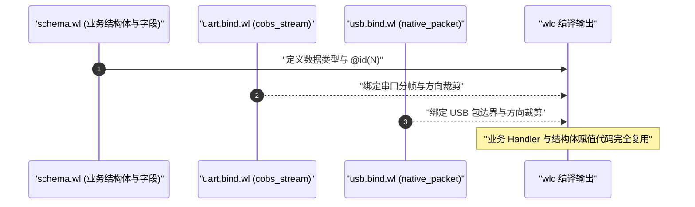

import Checklist from '../../../../components/tutorial/Checklist.astro';
import MultipleChoice from '../../../../components/tutorial/MultipleChoice.astro';

假设一台传感采集节点需要把指令响应和事件推给上位机，但硬件板卡还在打样。Wirelink 内置的双端内存回环（`wl_packet_loopback_t`）允许你在 PC 本机用同一个 `main()` 同时驱动两个端点，验证完整状态机、编码和回调生命周期。

## 为什么要拆分 `.wl` 与 `.bind.wl`

新接触 Wirelink 的工程师常疑惑：为什么不把传输协议、消息 ID 和业务结构体全写在一个文件里？答案是**为了把「业务数据资产」与「物理链路部署」解耦**：



- **`.wl`（Schema 文件）**：定义跨端共享的消息体、字段类型、静态容量上限（例如 `bytes<9>`）以及全局 `@id(...)`。
- **`.bind.wl`（绑定 Profile v2）**：声明当前固件实际启用哪些路由（`rpc` / `send` / `direct`），并选择物理传输包封（`native_packet`、`cobs_stream` 或 `bus_length16`）。

## 运行本地回环示例

仓库的 [`examples/bare_metal_loopback.c`](https://github.com/starwey604/wirelink/blob/main/examples/bare_metal_loopback.c) 使用预生成的 `demo.h/.c` 和 `demo_kernel.h/.c`，在单线程中初始化两套独立的端口与端点：

{/* [docs:loopback_setup] */}
```c
wl_packet_config_t config = {.instance = 1001U + side,
    .rx_storage = &receive_storage[side][0][0], .rx_unit_size = 256U,
    .rx_storage_size = sizeof(receive_storage[side]),
    .submit = wl_packet_loopback_submit, .notify = wl_packet_loopback_notify,
    .user = &transport.directions[side]};
require(wl_packet_init(&ports[side], &config) == WL_OK);
demo_kernel_handlers_t handlers = {.on_rpc_execute = execute, .on_message_event = received};
require(demo_kernel_init(&endpoints[side], &ports[side], &handlers, NULL, NULL) == WL_OK);
```
{/* [/docs:loopback_setup] */}

在仓库根目录执行构建并运行：

```sh
cmake -S . -B build/core -DCMAKE_BUILD_TYPE=Release
cmake --build build/core --parallel
./build/core/examples/wirelink_bare_metal_loopback
```

输出 `6 bidirectional RPC completions, 2 telemetry messages; both endpoints quiescent` 即表示双向 RPC 与单向消息均已闭环且静态区完全归零。

## 思考题

<MultipleChoice
  id="lesson-01-decouple"
  question="当产品硬件从串口 (cobs_stream) 升级为高速 USB Bulk (native_packet) 时，以下哪项改动是最合理的？"
  checkLabel="检查答案"
  emptyFeedback="请先选择一个选项。"
  choices={[
    {
      label: "修改 .wl 消息定义中的每个字段 @id，重新编写全部 C 业务结构体赋值代码",
      correct: false,
      feedback: "不需要。.wl 描述业务数据结构，与底层传输是否带包边界无关。",
    },
    {
      label: "仅调整 .bind.wl 中的 endpoint envelope 与底层驱动胶水，重新用 wlc 编译即可",
      correct: true,
      feedback: "正确。物理传输边界属于部署层配置，业务结构体、字段赋值和 RPC Handler 代码可原样保留。",
    },
    {
      label: "必须把业务消息从单结构体 API 改写为手写字节数组打包函数",
      correct: false,
      feedback: "不需要。单结构体编码由 wlc 和共享 Wire v2 内核统一完成。",
    },
  ]}
/>

<Checklist
  id="checklist-01"
  title="本课检查清单"
  progressTemplate="已完成 {done} / {total} 项"
  items={[
    "能够区分 .wl（数据结构）与 .bind.wl（传输包封和路由声明）的职责边界。",
    "在本地成功编译并运行 wirelink_bare_metal_loopback，观察到 quiescent 退出输出。",
  ]}
/>

下一课：[02 定义与收发设备遥测消息](/wirelink/zh-cn/learn/02-telemetry/)。
