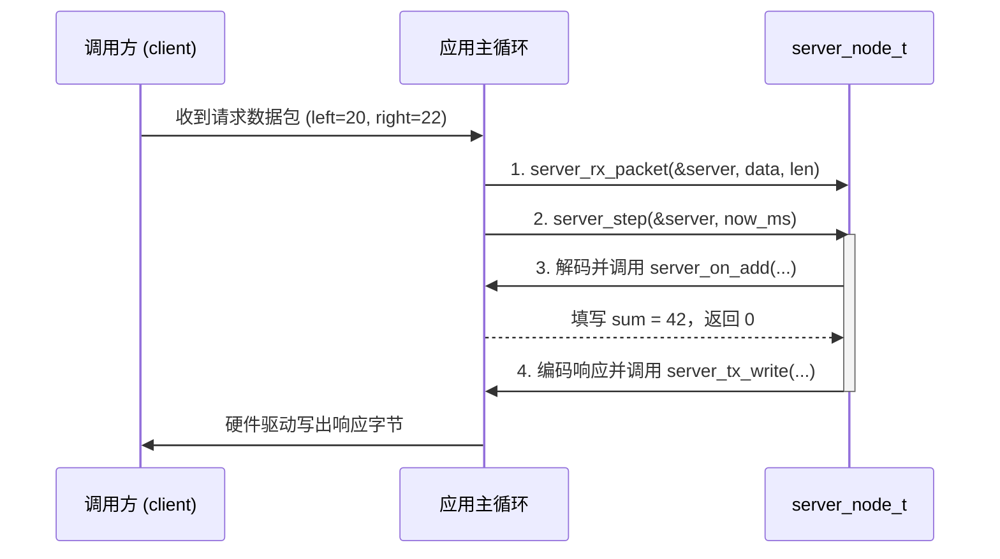

import { Aside } from '@astrojs/starlight/components';
import LessonHeader from '../../../../components/tutorial/LessonHeader.astro';
import Challenge from '../../../../components/tutorial/Challenge.astro';
import Checklist from '../../../../components/tutorial/Checklist.astro';
import MultipleChoice from '../../../../components/tutorial/MultipleChoice.astro';

<LessonHeader
  unit={1}
  duration="6 分钟"
  examplePath="examples/01_rpc"
  goals={[
    '使用 message、rpc 与 node 定义一份 .wl 协议文件',
    '运行 wlc compile 生成单端 C11 代码，理解生成头文件中的命名规则',
    '实现业务处理函数与主循环驱动，完成一次远程调用与错误返回',
  ]}
/>

本课以一个远程加法服务为例，演示从编写 `.wl` 协议文件到在下位机 C 代码中运行服务的完整流程。调用方发送两个 32 位整数 `left` 与 `right`，服务方返回它们的和 `sum`；若相加结果超出 `int32` 范围，服务方返回一个非零错误码拒绝该请求。

---

## 第一步：编写协议文件 `calculator.wl`

仓库中的 [`examples/01_rpc/calculator.wl`](https://github.com/starwey604/wirelink/blob/main/examples/01_rpc/calculator.wl) 定义了这份协议：

{/* [docs:calculator_schema] */}
```wl
message AddRequest @id(20) {
  int32 left @id(1);
  int32 right @id(2);
}
message AddResponse @id(21) { int32 sum @id(1); }
rpc Add(AddRequest) -> AddResponse;
node client { call Add; }
node server { serve Add; }
```
{/* [/docs:calculator_schema] */}

这段定义包含三个部分：
- **`message`**：声明请求消息 `AddRequest` 与响应消息 `AddResponse`。`@id(20)`、`@id(21)` 为消息的唯一路由编号，`@id(1)`、`@id(2)` 为字段编号，用于在线缆上唯一标识消息类型与字段。
- **`rpc`**：将 `AddRequest` 与 `AddResponse` 绑定为一次名为 `Add` 的请求/响应调用。
- **`node`**：声明通信两端的角色。`client` 负责发起调用（`call Add;`），`server` 负责提供服务（`serve Add;`）。

---

## 第二步：使用 `wlc` 生成 C 代码并查阅头文件

运行以下命令，为 `server` 角色生成 C11 代码：

```sh
wlc/target/release/wlc compile examples/01_rpc/calculator.wl \
  --node server --out-dir build/my-server
```

命令执行后，`build/my-server/` 目录中会生成 `calculator.h` 与 `calculator.c`。打开 `build/my-server/calculator.h`，重点关注以下三组声明：

```c
/* 1. 消息结构体：由 AddRequest / AddResponse 转换而来 */
typedef struct add_request_s {
  int32_t left;
  int32_t right;
} add_request_t;

typedef struct add_response_s {
  int32_t sum;
} add_response_t;

/* 2. 节点类型与调用入口（已生成在 calculator.c 中） */
wl_err_t server_init(server_node_t *self);
wl_err_t server_rx_packet(server_node_t *self, const uint8_t *data, size_t length);
wl_err_t server_step(server_node_t *self, uint32_t now_ms);

/* 3. 需要由应用层实现的两个回调函数 */
extern int32_t server_on_add(
    server_node_t *self, const add_request_t *request, add_response_t *response);
extern wl_err_t server_tx_write(
    server_node_t *self, const uint8_t *data, size_t length);
```

<Aside type="note" title="生成符号的命名规则">
所有节点类型与函数前缀均来自 `.wl` 中的节点名 `server`：
- 节点类型为 `<node>_node_t`（此处为 `server_node_t`）。
- 生命周期与驱动函数为 `<node>_init`、`<node>_rx_packet`、`<node>_step`，由 `calculator.c` 提供实现。
- 业务处理函数为 `<node>_on_<rpc>`（此处为 `server_on_add`），物理发送函数为 `<node>_tx_write`，这两者需要由你的应用程序提供实现。

例如，如果协议中声明的是 `node motor { serve SetSpeed; }`，对应的类型与回调则会生成为 `motor_node_t` 与 `motor_on_set_speed`。
</Aside>

---

## 第三步：实现业务处理函数 `server_on_add`

在业务源文件中实现 `server_on_add`（摘自 [`examples/01_rpc/server.c`](https://github.com/starwey604/wirelink/blob/main/examples/01_rpc/server.c)）：

{/* [docs:calculator_server] */}
```c
int32_t server_on_add(server_node_t *self, const add_request_t *request, add_response_t *response) {
  (void)self;
  const int64_t sum = (int64_t)request->left + request->right;
  if (sum < INT32_MIN || sum > INT32_MAX) return 1;
  response->sum = (int32_t)sum;
  return 0;
}
```
{/* [/docs:calculator_server] */}

`server_on_add` 的返回值决定 Wirelink 如何向调用方回复：
- **返回 `0`**：表示请求执行成功，Wirelink 将编码你填写的 `response` 结构体并发回给调用方。
- **返回非零 `int32_t`（例如 `1`）**：表示业务层拒绝该请求。Wirelink 不会发送 `response`，而是将该状态码原样传回给调用方。

---

## 第四步：接入主循环

完成 `server_on_add` 后，再实现物理发送函数 `server_tx_write`，并在主循环中定期调用 `server_step` 即可驱动整个节点：

```c
#include "calculator.h"

static server_node_t server;

/* 当节点需要发送响应帧时，会调用此函数输出字节 */
wl_err_t server_tx_write(server_node_t *self, const uint8_t *data, size_t length) {
  (void)self;
  return my_hardware_send(data, length);
}

int main(void) {
  server_init(&server);

  for (;;) {
    /* 当硬件收到完整数据包时，将数据传入节点：
     * if (has_new_packet) {
     *   server_rx_packet(&server, rx_buf, rx_len);
     * }
     */

    /* 传入当前毫秒时间戳，推进解包、回调派发与发送 */
    server_step(&server, board_millis());
  }
}
```

数据在主循环中的流转顺序如下：



<Challenge
  title="检查理解：server_on_add 会在接收中断里执行吗？"
  prompt="如果应用程序在接收中断中调用 server_rx_packet(&server, data, len)，server_on_add 会在中断上下文中立即被调用吗？"
>
  不会。

  `server_rx_packet` 只负责将收到的数据拷贝到节点内部缓冲区并立即返回；解码数据包、调用 `server_on_add` 以及通过 `server_tx_write` 发送响应，全部在主循环调用 `server_step(&server, now_ms)` 时顺序执行。这使得业务回调始终运行在主循环上下文中。
</Challenge>

---

## 第五步：构建并运行完整示例

仓库中的 [`examples/01_rpc/`](https://github.com/starwey604/wirelink/tree/main/examples/01_rpc) 将上述服务端与一个本地客户端编译在同一个程序中，通过内存回环直接交换数据，便于在没有硬件外设的环境下验证行为。

在仓库根目录执行：

```sh
cmake -S . -B build/examples -DCMAKE_BUILD_TYPE=Release \
  -DWIRELINK_BUILD_WLC_EXAMPLES=ON \
  -DWIRELINK_WLC_EXECUTABLE="$PWD/wlc/target/release/wlc"
cmake --build build/examples --target wirelink_calculator_demo
./build/examples/examples/01_rpc/wirelink_calculator_demo
```

终端输出以下内容表示正常加法与溢出拒绝流程均已通过：

```text
four concurrent copied requests and business rejection passed
```

---

## 小测验

<MultipleChoice
  id="lesson-01-rpc-return"
  question="在 server_on_add(self, request, response) 中，当发现输入参数会导致整数溢出时，正确的做法是什么？"
  checkLabel="检查答案"
  emptyFeedback="请先选择一个选项。"
  choices={[
  {
    "label": "返回一个非零的 int32_t 状态码（如 return 1;），由 Wirelink 将该状态码传回给调用方。",
    "correct": true,
    "feedback": "正确。返回 0 表示发送 response 结构体；返回非零值表示业务拒绝，该状态码会直接送达调用方。"
  },
  {
    "label": "必须返回 0，并在 AddResponse 中额外定义一个 error_code 字段来传递错误。",
    "correct": false,
    "feedback": "不需要。Wirelink 的 RPC 原生支持通过非零返回值传递业务拒绝码。"
  },
  {
    "label": "在函数内循环等待调用方重新发送合法参数。",
    "correct": false,
    "feedback": "不应阻塞回调。Wirelink 在主循环中步进执行，阻塞回调会阻止后续收发处理。"
  }
]}
/>

<Checklist
  id="checklist-01"
  title="本课检查清单"
  progressTemplate="已完成 {done} / {total} 项"
  items={[
    "能够使用 message、rpc 与 node 编写基础的 .wl 文件。",
    "能够运行 wlc compile --node <name> 生成单端 C 代码，并识别 <node>_node_t 与 <node>_on_<rpc> 等符号。",
    "理解服务端回调返回 0 与非零值的区别，以及通过 step(now_ms) 驱动节点的流程。"
  ]}
/>

本课实现的是需要一问一答的 RPC 服务。然而在设备通信中，很多数据只需要单向推送（例如周期性传感器采样或异步状态上报），并不需要每次等待对端回复。下一课将介绍单向消息（Telemetry），并说明它与 RPC 的区别与配合方式。

下一课：[02 单向消息（Telemetry）与 RPC →](/wirelink/zh-cn/learn/02-telemetry/)
