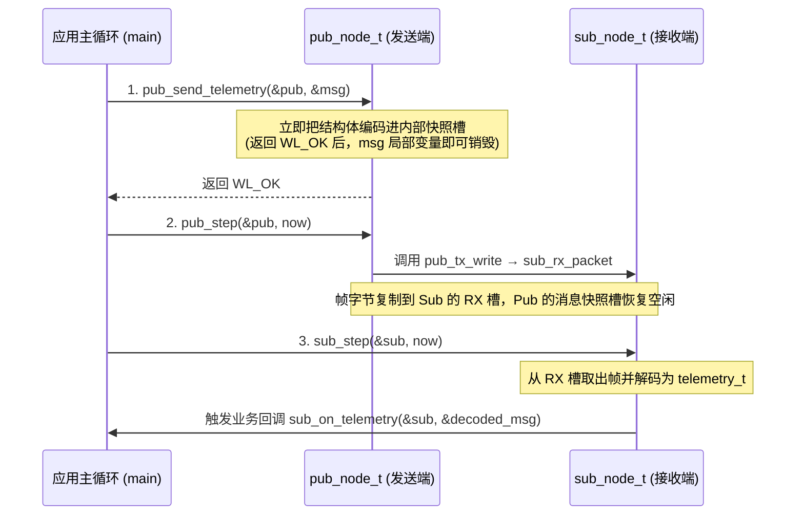

import { Aside, Steps, Tabs, TabItem } from '@astrojs/starlight/components';
import LessonHeader from '../../../../components/tutorial/LessonHeader.astro';
import Challenge from '../../../../components/tutorial/Challenge.astro';
import Checklist from '../../../../components/tutorial/Checklist.astro';
import MultipleChoice from '../../../../components/tutorial/MultipleChoice.astro';

<LessonHeader
  unit={2}
  duration="7 分钟"
  examplePath="examples/00_telemetry"
  goals={[
    '编写带 pub（发布端）和 sub（订阅端）两个角色的 telemetry.wl',
    '透视 WLC 生成的 C11 头文件，理解为什么默认必选字段没有 has_*',
    '实现 2 个静态钩子函数完成收发，并掌握“输入快照”与“单槽背压 (WOULD_BLOCK)”',
  ]}
/>

很多嵌入式场景（比如传感器周期上报温度、电机上报当前转速）只需要**单向高频推送**，不需要对端每次都回复确认（ACK）。

在 Wirelink 中，这类单向消息通过节点里的 `send <Message>;`（发送端）和 `recv <Message>;`（接收端）来声明。这一课我们以 [`examples/00_telemetry/`](https://github.com/starwey604/wirelink/tree/main/examples/00_telemetry) 为例，手把手看清从 `.wl` 到 C 代码的每一个细节。

---

## 第一步：编写 `telemetry.wl` 并透视生成的 C 头文件

假设我们要发送一条编号为 `@id(10)` 的 `Telemetry` 消息，包含采样序号 `sample` 和以 0.01°C 为单位的温度值 `temperature_centi_c`。

请点击下方标签页，对比 **你写的 `.wl`** 与 **WLC 自动生成的 `telemetry.h` 核心内容**：

<Tabs>
  <TabItem label="1. 你写的协议 (telemetry.wl)">
    {/* [docs:telemetry_schema] */}
    ```wl
    message Telemetry @id(10) {
      uint32 sample @id(1);
      int32 temperature_centi_c @id(2);
    }
    node pub { send Telemetry; }
    node sub { recv Telemetry; }
    ```
    {/* [/docs:telemetry_schema] */}

    **两个关键细节**：
    1. **字段默认必选（Required by default）**：你不需要写 `required uint32 sample`（虽然写了也完全等价）。只有当某个字段在协议升级时可能不传，你才需要写 `optional int32 ...`。
    2. **角色职责分明**：`pub` 节点只声明了 `send Telemetry;`，`sub` 节点只声明了 `recv Telemetry;`。
  </TabItem>

  <TabItem label="2. 生成的 C11 头文件透视 (telemetry.h)">
    当你运行 `wlc compile telemetry.wl --all-nodes` 后，生成的 `telemetry.h` 里与你打交道的核心声明只有下面这几行（已简化排版便于阅读）：

    ```c
    /* 1. 干净的业务结构体：必选字段直接读写，没有 bool has_sample! */
    typedef struct telemetry_s {
      uint32_t sample;
      int32_t temperature_centi_c;
    } telemetry_t;

    /* 2. 发布端 (pub) 节点 API —— 只有发送和步进，没有接收回调！ */
    wl_err_t pub_init(pub_node_t *self);
    wl_err_t pub_step(pub_node_t *self, uint32_t now_ms);
    wl_err_t pub_send_telemetry(pub_node_t *self, const telemetry_t *value);
    /* 纯标量必选字段还会额外附赠一个按值传参的快捷函数： */
    wl_err_t pub_send_telemetry_val(pub_node_t *self, uint32_t sample, int32_t temperature_centi_c);
    /* 需要你实现的物理发送钩子： */
    extern wl_err_t pub_tx_write(pub_node_t *self, const uint8_t *data, size_t length);

    /* 3. 订阅端 (sub) 节点 API —— 只有喂包和步进，没有发送存储池！ */
    wl_err_t sub_init(sub_node_t *self);
    wl_err_t sub_step(sub_node_t *self, uint32_t now_ms);
    wl_err_t sub_rx_packet(sub_node_t *self, const uint8_t *data, size_t length);
    /* 需要你实现的业务接收函数： */
    extern void sub_on_telemetry(sub_node_t *self, const telemetry_t *message);
    ```
  </TabItem>

  <TabItem label="3. 生成命令 (--node vs --all-nodes)">
    在实际项目中，如果传感器和接收板是两份独立的 MCU 固件，你应该用 `--node` **只生成各自的角色**；如果像本课示例一样在同一个进程里做双端测试，则用 `--all-nodes`：

    ```sh
    # 场景 A：分别为两块板子的固件生成（各自只包含本端的函数和缓冲区）
    wlc compile examples/00_telemetry/telemetry.wl --node pub --out-dir generated/pub
    wlc compile examples/00_telemetry/telemetry.wl --node sub --out-dir generated/sub

    # 场景 B：同进程回环测试，一次生成 pub 和 sub 两个节点
    wlc compile examples/00_telemetry/telemetry.wl --all-nodes --out-dir generated/loopback
    ```
    无论哪种方式，输出目录里都只有清爽的一对 `telemetry.h`、`telemetry.c` 和一份 `telemetry_manifest.json`。
  </TabItem>
</Tabs>

---

## 第二步：实现 2 个静态钩子函数（物理发送 + 业务接收）

因为默认节点采用 `io = embedded; handlers = static;`，我们不需要初始化任何端口结构体，也不用注册回调函数指针。只需要把 `telemetry.h` 里声明的两个 `extern` 函数写出来，链接器就会把一切接好：

<Steps>

1. **在发送端实现物理发包钩子 `pub_tx_write`**

   当 `pub_step()` 准备把编码好的协议帧发出去时，它会调用你实现的 `pub_tx_write`。在我们的内存回环示例（[`examples/00_telemetry/publisher.c`](https://github.com/starwey604/wirelink/blob/main/examples/00_telemetry/publisher.c)）里，我们直接把这帧字节塞进订阅端的接收口 `sub_rx_packet`：

   {/* [docs:telemetry_tx_write] */}
   ```c
   wl_err_t pub_tx_write(pub_node_t *self, const uint8_t *data, size_t length) {
     (void)self;
     return sub_rx_packet(&subscriber, data, length);
   }
   ```
   {/* [/docs:telemetry_tx_write] */}

   <Aside type="caution" title="物理发送钩子的铁律：整帧接受或整帧拒绝">
   `pub_tx_write` 必须**在返回前把整帧字节全部发完（或复制进你自己的驱动队列）并返回 `WL_OK`**，返回后不能再继续保留 `data` 指针！如果硬件此刻忙（或对端接收槽满了），必须**一个字节都不收**，直接返回 `WL_ERR_WOULD_BLOCK`；等硬件恢复可写时调用 `pub_tx_ready(&publisher)` 通知节点重试。
   </Aside>

2. **在接收端实现业务回调 `sub_on_telemetry`**

   当 `sub_step()` 解码出一帧完整的 `Telemetry` 消息时，会自动调用你写的 `sub_on_telemetry`（位于 [`examples/00_telemetry/subscriber.c`](https://github.com/starwey604/wirelink/blob/main/examples/00_telemetry/subscriber.c)）：

   {/* [docs:telemetry_receive] */}
   ```c
   unsigned telemetry_received;
   void sub_on_telemetry(sub_node_t *self, const telemetry_t *message) {
     (void)self;
     EXAMPLE_REQUIRE(message->sample == telemetry_received);
     EXAMPLE_REQUIRE(message->temperature_centi_c == -1234);
     ++telemetry_received;
   }
   ```
   {/* [/docs:telemetry_receive] */}

</Steps>

---

## 第三步：在主循环里初始化、发送并推进 `step`

现在万事俱备！看看 `main()` 函数里是如何连发 12 条遥测消息的：

{/* [docs:telemetry_publish] */}
```c
EXAMPLE_REQUIRE(pub_init(&publisher) == WL_OK);
EXAMPLE_REQUIRE(sub_init(&subscriber) == WL_OK);
for (unsigned sample = 0; sample < 12; ++sample) {
  EXAMPLE_REQUIRE(pub_send_telemetry(&publisher, &(telemetry_t){
      .sample = sample, .temperature_centi_c = -1234}) == WL_OK);
  EXAMPLE_REQUIRE(pub_step(&publisher, sample) == WL_OK);
  EXAMPLE_REQUIRE(sub_step(&subscriber, sample) == WL_OK);
  EXAMPLE_REQUIRE(telemetry_received == sample + 1);
}
```
{/* [/docs:telemetry_publish] */}

结合下面这张时序图，仔细体会 `send` 和 `step` 之间的分工：



### 两个必须记住的工程特性

1. **输入立即快照（Input Snapshot）**：
   注意看代码里我们直接传了一个C99 复合字面量 `&(telemetry_t){.sample = sample, ...}`。为什么不怕函数返回后栈变量失效？因为 `pub_send_telemetry` **在返回 `WL_OK` 之前，就已经把结构体编码成二进制字节、复制进节点内部的缓冲区了**。调用一返回，你的输入结构体就可以立刻复用或销毁。
2. **普通消息只有 1 个快照槽（显式背压）**：
   为了严控 MCU 的 RAM 占用，节点内部虽然有 8 项 TX 调度队列（用来排 RPC 请求、RPC 回复和普通消息），但专门留给**出站普通消息的编码存储槽只有 1 个**！

<Challenge
  title="动手微挑战：如果连发两条消息却不调 step 会怎样？"
  prompt="假设你在主循环里连续调用两次 pub_send_telemetry(&publisher, &msg)，中间没有调用 pub_step(&publisher, now)，第二次调用会返回什么？数据会丢吗？"
>
  **第二次调用会立即返回 `WL_ERR_WOULD_BLOCK`，并且第二次传入的数据不会被节点保存！**

  原因很简单：
  - 第一次 `pub_send_telemetry` 占用了唯一的**普通消息快照槽**，此时帧还没通过 `pub_step()` 里的 `pub_tx_write` 发出去，槽位还处于占用状态。
  - 第二次调用时，节点发现快照槽已满，直接返回 `WL_ERR_WOULD_BLOCK`（背压）。
  - **正确做法**：始终检查 `send` 的返回值。对于高频周期传感器采样，如果遇到 `WOULD_BLOCK`，可以跳过旧采样、等下一周期发最新值；对于不能丢的状态通知（如任务完成报告），则保留应用层的 `pending` 标志，等 `step` 推进槽位释放后再重试（我们在第 05 课会看到实战代码）。
</Challenge>

---

## 本地运行本课示例

如果你想在本地亲自编译并运行 `examples/00_telemetry`，只需开启 `WIRELINK_BUILD_WLC_EXAMPLES=ON` 并指向刚才构建的 `wlc`：

```sh
cmake -S . -B build/examples -DCMAKE_BUILD_TYPE=Release \
  -DWIRELINK_BUILD_WLC_EXAMPLES=ON \
  -DWIRELINK_WLC_EXECUTABLE="$PWD/wlc/target/release/wlc"
cmake --build build/examples --target wirelink_telemetry_demo
ctest --test-dir build/examples -R wirelink_telemetry_demo --output-on-failure
```

---

## 本课小测验

<MultipleChoice
  id="lesson-02-snapshot"
  question="当 pub_send_telemetry(&publisher, &msg) 返回 WL_OK 后，下列哪项判断是正确的？"
  checkLabel="检查答案"
  emptyFeedback="请先选择一个选项。"
  choices={[
  {
    "label": "你可以立即修改或销毁传入的 msg 结构体；但 WL_OK 只代表本端节点接纳了编码快照，不代表对端已经收到。",
    "correct": true,
    "feedback": "完全正确！send 返回 WL_OK 说明数据已安全编码进本端快照槽；真正的物理发送和对端接收要等后续 step 推进，且普通消息没有内置 ACK。"
  },
  {
    "label": "必须等对端收到并回复 ACK 后，才能修改传入的 msg 结构体。",
    "correct": false,
    "feedback": "不对。普通单向消息没有内置 ACK，而且输入结构体在 send 返回 WL_OK 前就已经完成了编码复制。"
  }
]}
/>

<MultipleChoice
  id="lesson-02-capacity"
  question="连续发送两条普通遥测消息，第二条返回了 WL_ERR_WOULD_BLOCK，应该如何处理？"
  checkLabel="检查答案"
  emptyFeedback="请先选择一个选项。"
  choices={[
  {
    "label": "说明唯一的普通消息快照槽还没发空；应保留待发业务数据（或等待下一采样周期），推进 step 后再重试。",
    "correct": true,
    "feedback": "正确！普通消息只有 1 个快照槽，返回 WOULD_BLOCK 时节点没有接纳你的数据，推进 step 把上一条发出去后即可再次发送。"
  },
  {
    "label": "直接忽略返回值即可，因为节点有 8 个普通消息缓冲区会自动帮你排队。",
    "correct": false,
    "feedback": "不对。8 是内核 TX 调度队列的总项数（供 4 个 RPC 请求 + 3 个 RPC 回复 + 1 个普通消息共享），普通消息本身只有 1 个字节存储槽。"
  }
]}
/>

<Checklist
  id="checklist-02"
  title="本课掌握清单"
  progressTemplate="已完成 {done} / {total} 项"
  items={[
    "知道 .wl 字段默认必选，生成的 C 结构体没有繁琐的 has_* 布尔位。",
    "掌握默认 embedded/static 节点只需实现 <node>_tx_write 与 <node>_on_<msg> 两个函数。",
    "理解 send 返回 WL_OK 代表已完成输入快照，以及单消息槽满时返回 WL_ERR_WOULD_BLOCK 的背压机制。"
  ]}
/>

单向广播已经拿下了！如果我们需要下发控制指令，并且**必须知道对端是执行成功、拒绝还是超时**呢？下一课：[03 请求与响应：实现第一个 RPC 服务 →](/wirelink/zh-cn/learn/03-rpc-basics/)
