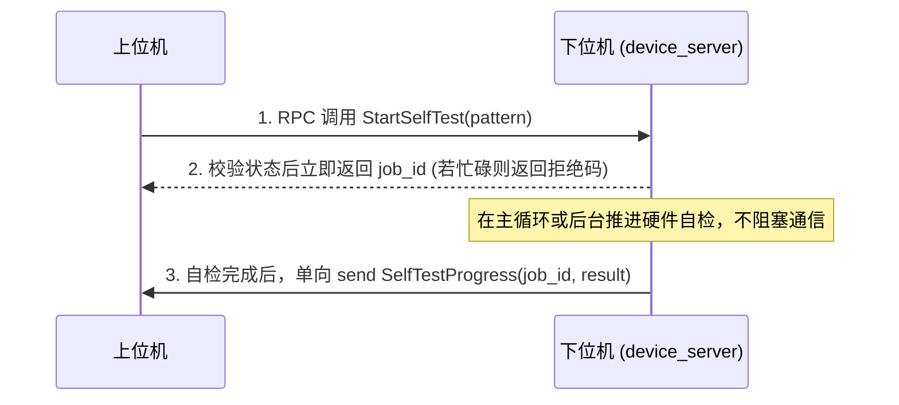

import { Aside, Tabs, TabItem } from '@astrojs/starlight/components';
import LessonHeader from '../../../../components/tutorial/LessonHeader.astro';
import Challenge from '../../../../components/tutorial/Challenge.astro';
import Checklist from '../../../../components/tutorial/Checklist.astro';
import MultipleChoice from '../../../../components/tutorial/MultipleChoice.astro';

<LessonHeader
  unit={2}
  duration="7 分钟"
  examplePath="examples/00_telemetry"
  goals={[
    '使用 send 与 recv 定义并运行单向遥测消息（Telemetry）',
    '厘清 Telemetry 与 RPC 的适用边界',
    '掌握“短 RPC 启动任务 + 单向消息上报进度”的组合模式',
  ]}
/>

第 01 课实现了需要请求与响应配对的 RPC 服务。然而在设备通信中，很多数据属于单向推送——例如传感器以固定频率上报温度、姿态或电压——发送端并不需要每次都等待对端回复。

Wirelink 通过**单向消息（Telemetry）**支持这类场景。本课先通过一个温度上报示例演示单向消息的写法，再对照 RPC 说明两者的分工与配合方式。

---

## 第一步：编写单向消息协议 `telemetry.wl`

查看仓库中的 [`examples/00_telemetry/telemetry.wl`](https://github.com/starwey604/wirelink/blob/main/examples/00_telemetry/telemetry.wl)：

{/* [docs:telemetry_schema] */}
```wl
message Telemetry @id(10) {
  uint32 sample @id(1);
  int32 temperature_centi_c @id(2);
}
node pub { send Telemetry; }
node sub { recv Telemetry; }
```
{/* [/docs:telemetry_schema] */}

与第 01 课的 `calculator.wl` 相比，这里没有 `rpc` 声明，而是直接在节点中指定消息方向：
- `node pub { send Telemetry; }`：发送端声明可以主动发送 `Telemetry` 消息，编译器会生成发送函数 `pub_send_telemetry`。
- `node sub { recv Telemetry; }`：接收端声明可以接收 `Telemetry` 消息，编译器会要求你实现接收回调 `sub_on_telemetry`。

如果需要在同一个 C 程序里同时使用 `pub` 和 `sub`（例如编写本地回环测试），生成代码时将 `--node <name>` 替换为 `--all-nodes` 即可：

```sh
wlc/target/release/wlc compile examples/00_telemetry/telemetry.wl \
  --all-nodes --out-dir build/telemetry
```

---

## 第二步：实现发送与接收

在 [`examples/00_telemetry/`](https://github.com/starwey604/wirelink/tree/main/examples/00_telemetry) 中，`pub` 和 `sub` 位于同一个 C 程序。`pub_tx_write` 将整帧交给 `sub_rx_packet`，在内存中模拟链路。

<Tabs>
  <TabItem label="1. 连接收发 (publisher.c)">
    发送端的物理发送钩子将字节直接送入接收端：

    {/* [docs:telemetry_tx_write] */}
    ```c
    wl_err_t pub_tx_write(pub_node_t *self, const uint8_t *data, size_t length) {
      (void)self;
      return sub_rx_packet(&subscriber, data, length);
    }
    ```
    {/* [/docs:telemetry_tx_write] */}
  </TabItem>

  <TabItem label="2. 接收回调 (subscriber.c)">
    `sub_on_telemetry` 在接收端解码消息后运行，并按值保存最新采样。单向消息的回调返回 `void`。

    {/* [docs:telemetry_receive] */}
    ```c
    unsigned telemetry_received;
    telemetry_t latest_telemetry;

    void sub_on_telemetry(sub_node_t *self, const telemetry_t *message) {
      (void)self;
      latest_telemetry = *message;
      ++telemetry_received;
    }
    ```
    {/* [/docs:telemetry_receive] */}
  </TabItem>

  <TabItem label="3. 发送采样 (publisher.c)">
    初始化两端后，调用 `pub_send_telemetry` 提交采样，再用 `pub_step` 和 `sub_step` 分别推进发送与接收。两个节点都没有出站 RPC，`step` 的时间参数传 `0`。

    {/* [docs:telemetry_publish] */}
    ```c
    static wl_err_t publish_sample(uint32_t sample) {
      wl_err_t error = pub_send_telemetry(&publisher, &(telemetry_t){
          .sample = sample, .temperature_centi_c = -1234});
      if (error != WL_OK) return error;
      error = pub_step(&publisher, 0);
      if (error != WL_OK) return error;
      return sub_step(&subscriber, 0);
    }
    ```
    {/* [/docs:telemetry_publish] */}
  </TabItem>
</Tabs>

注意 `pub_send_telemetry` 中传入的是一个栈上临时结构体 `&(telemetry_t){ ... }`。调用 `pub_send_telemetry` 返回 `WL_OK` 时，数据已经被编码并复制到节点内部缓冲区，因此调用结束后无需再维持该临时变量的生命周期。

在仓库根目录构建并运行该示例：

```sh
cmake --build build/examples --target wirelink_telemetry_demo
./build/examples/examples/00_telemetry/wirelink_telemetry_demo
```

预期输出：

```text
12 ordinary telemetry messages received; both endpoints quiescent
```

---

## 第三步：何时选择单向消息，何时选择 RPC？

单向消息与 RPC 可以在同一个节点上共存。设计协议时，可以按是否需要明确的“调用结果”来区分：

| 对比维度 | 单向消息（Telemetry / Event） | 双向调用（RPC） |
| :--- | :--- | :--- |
| **节点声明关键字** | 发送方 `send` / 接收方 `recv` | 调用方 `call` / 服务方 `serve` |
| **是否有应答** | 无内置应答，发出后即完成 | 必有明确终态：成功响应、业务拒绝码或超时 |
| **接收回调签名** | `void <node>_on_<msg>(...)` | `int32_t <node>_on_<rpc>(..., response)` |
| **适用场景** | 传感器周期上报（温度、转速、姿态）、状态变更通知、异步任务进度推送 | 下发控制命令、修改配置参数、查询设备信息、需要确认执行结果的动作 |

---

## 第四步：组合使用——用短 RPC 启动耗时任务，用单向消息推送结果

实际硬件中经常存在耗时较长的操作，例如需要运行几百毫秒的硬件自检或电机回零。由于 Wirelink 的 `on_<rpc>` 回调运行在主循环中，**不能在 RPC 回调里阻塞等待硬件完成**。

更合理的做法是在同一个节点上组合使用 `serve`（RPC）与 `send`（单向消息），将一次长操作拆成两步（摘自 [`examples/03_device_service/self_test.c`](https://github.com/starwey604/wirelink/blob/main/examples/03_device_service/self_test.c)）：



<Tabs>
  <TabItem label="1. 短 RPC 校验并立即返回任务号">
    收到 `StartSelfTest` 请求时，先检查设备是否正在执行其他任务；若忙碌则直接返回拒绝码 `DEVICE_BUSY`，否则登记任务参数与计划完成时间，并将 `job_id` 填回响应结构体立即返回 `0`：

    {/* [docs:device_job_start] */}
    ```c
    int32_t device_server_on_start_self_test(device_server_node_t *self, const start_self_test_request_t *request,
                         start_self_test_response_t *response) {
      device_service_t *state = self->user;
      if (state->job_pending || state->next_job == UINT32_MAX) return DEVICE_BUSY;
      state->job_id = ++state->next_job;
      state->pattern = request->pattern;
      state->due = state->now + 20U;
      state->job_pending = true;
      response->job_id = state->job_id;
      return 0;
    }
    ```
    {/* [/docs:device_job_start] */}
  </TabItem>

  <TabItem label="2. 主循环完成后发送单向进度消息">
    主循环每次轮询 `self_test_poll`，待硬件任务到达完成条件后，调用 `device_server_send_self_test_progress` 将结果推送给上位机。如果此时发送缓冲区暂满（返回 `WL_ERR_WOULD_BLOCK`），则保留 `job_pending` 标志，留待下一轮主循环继续发送：

    {/* [docs:device_job_poll] */}
    ```c
    wl_err_t self_test_poll(device_service_t *state, device_server_node_t *endpoint) {
      if (!state->job_pending || (int32_t)(state->now - state->due) < 0) return WL_OK;
      self_test_progress_t progress = {.job_id = state->job_id,
        .observed = state->pattern ^ UINT32_C(0xa5a5)};
      const wl_err_t error = device_server_send_self_test_progress(endpoint, &progress);
      if (error == WL_ERR_WOULD_BLOCK) return WL_OK;
      if (error != WL_OK) return error;
      state->job_pending = false;
      return WL_OK;
    }
    ```
    {/* [/docs:device_job_poll] */}
  </TabItem>
</Tabs>

*(注：关于 `WL_ERR_WOULD_BLOCK` 的完整处理策略，将在第 05 课详细展开。)*

<Challenge
  title="检查理解：为什么自检任务不直接在 RPC 回调里等待完成？"
  prompt="如果硬件自检需要 300 毫秒，直接在 device_server_on_start_self_test 中延迟 300 毫秒再填写结果并返回，会带来什么问题？"
>
  在 RPC 回调中阻塞等待会导致主循环停在当前 `step()` 调用内：在这 300 毫秒期间，节点无法接收其他控制命令（如急停指令），也无法继续上报周期遥测，且容易触发调用方的 RPC 超时。

  采用“短 RPC 返回任务号 + 单向消息推送结果”的组合，可以保证每次回调都在微秒级内返回，让通信始终保持响应。
</Challenge>

---

## 小测验

<MultipleChoice
  id="lesson-02-telemetry-vs-rpc"
  question="设备需要以 50Hz 频率向上位机上报电机电流与温度，同时支持上位机下发“设置目标转速”指令。这两种需求在 .wl 节点中应如何声明？"
  checkLabel="检查答案"
  emptyFeedback="请先选择一个选项。"
  choices={[
  {
    "label": "电流与温度上报使用单向消息（设备端 send / 上位机 recv）；设置目标转速使用 RPC（上位机 call / 设备端 serve）。",
    "correct": true,
    "feedback": "正确。高频周期采样不需要每次等待应答，适合用单向消息；设置转速需要确认设备是否接受或拒绝，适合用 RPC。"
  },
  {
    "label": "两者都定义成单向消息，因为单向消息开销更小。",
    "correct": false,
    "feedback": "控制指令通常需要知道设备是否成功接收或因参数越界被拒绝，使用 RPC 能够获得明确的终态反馈。"
  },
  {
    "label": "两者都定义成 RPC，让设备每 20ms 等上位机回复一次采样确认。",
    "correct": false,
    "feedback": "高频遥测使用 RPC 会增加不必要的往返开销；一旦上位机处理稍慢，还会造成请求堆积。"
  }
]}
/>

<Checklist
  id="checklist-02"
  title="本课检查清单"
  progressTemplate="已完成 {done} / {total} 项"
  items={[
    "能够使用 send 与 recv 定义单向消息，并实现接收端 on_<message> 回调。",
    "理解单向消息与 RPC 的区别，能为不同业务场景选择合适的通信模式。",
    "掌握“短 RPC 返回任务号 + 单向消息上报结果”的组合方式，避免阻塞主循环。"
  ]}
/>

前两课分别演示了 RPC 服务端与单向消息的收发。在 C 语言中，如果当前设备需要作为**调用方**主动发起一次 RPC，该如何传入请求并区分成功响应与服务端拒绝？

下一课：[03 C 语言客户端调用与错误处理 →](/wirelink/zh-cn/learn/03-rpc-basics/)
