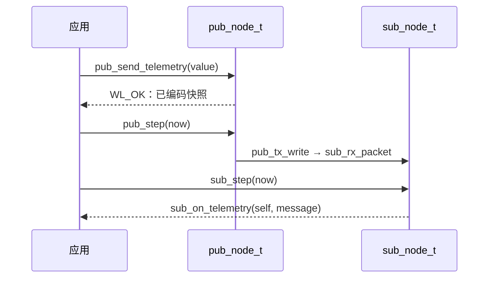

import Checklist from '../../../../components/tutorial/Checklist.astro';
import MultipleChoice from '../../../../components/tutorial/MultipleChoice.astro';

周期温度读数只需要单向推送。用 `send` 声明发布端能力，用 `recv` 声明订阅端能力；普通消息不自动确认或重传。

## 定义两个角色

{/* [docs:telemetry_schema] */}
```wl
message Telemetry @id(10) {
  uint32 sample @id(1);
  int32 temperature_centi_c @id(2);
}
node pub { send Telemetry; }
node sub { recv Telemetry; }
```
{/* [/docs:telemetry_schema] */}

字段默认必选，`required` 是可省略的同义词；生成的 `telemetry_t` 没有 `has_sample`。只有显式 `optional` 字段有存在标记。

```sh
# 分别为两份固件生成；只需本端的 handler/物理钩子
wlc compile examples/00_telemetry/telemetry.wl --node pub --out-dir generated/pub
wlc compile examples/00_telemetry/telemetry.wl --node sub --out-dir generated/sub
# 同进程回环则一次生成两个节点
wlc compile examples/00_telemetry/telemetry.wl --all-nodes --out-dir generated/loopback
```

每个输出目录只有一对 `telemetry.h/.c` 加部署清单。名字来自 schema 文件，节点符号来自 `pub` / `sub`。

## 实现发送钩子和静态接收函数

默认 native 节点的发送钩子必须整帧接受或整帧拒绝。教学回环把一帧直接复制到对端：

```c
wl_err_t pub_tx_write(pub_node_t *self, const uint8_t *data, size_t length) {
  (void)self;
  return sub_rx_packet(&subscriber, data, length);
}
```

`subscriber` 是程序持有的 `sub_node_t`；完整声明与反向空角色钩子见 `examples/00_telemetry/`。接收业务函数直接按约定命名，无需运行期注册：

{/* [docs:telemetry_receive] */}
```c
unsigned telemetry_received;
void sub_on_telemetry(sub_node_t *self, const telemetry_t *message) {
  (void)self;
  EXAMPLE_REQUIRE(message->sample == telemetry_received);
  EXAMPLE_REQUIRE(message->temperature_centi_c == -1234);
  ++telemetry_received;
}
```
{/* [/docs:telemetry_receive] */}

## 初始化、发送、推进

{/* [docs:telemetry_publish] */}
```c
EXAMPLE_REQUIRE(pub_init(&publisher) == WL_OK);
EXAMPLE_REQUIRE(sub_init(&subscriber) == WL_OK);
for (unsigned sample = 0; sample < 12; ++sample) {
  EXAMPLE_REQUIRE(pub_send_telemetry(&publisher, &(telemetry_t){
      .sample = sample, .temperature_centi_c = -1234}) == WL_OK);
  EXAMPLE_REQUIRE(pub_step(&publisher, sample) == WL_OK);
  EXAMPLE_REQUIRE(sub_step(&subscriber, sample) == WL_OK);
  EXAMPLE_REQUIRE(telemetry_received == sample + 1);
}
```
{/* [/docs:telemetry_publish] */}

`pub_send_telemetry` 返回 `WL_OK` 前已完成编码快照，复合字面量可立即结束生命周期。也可调用生成的标量快捷函数 `pub_send_telemetry_val(&publisher, sample, -1234)`。

普通消息只有 **1 个消息快照槽**，不是 8 个普通消息槽。连续发送时检查返回值并推进 `step`；暂满返回 `WL_ERR_WOULD_BLOCK`。若物理钩子返回背压，待硬件有空间后调用 `pub_tx_ready(&publisher)` 唤醒重试。



完整教程构建需开启 `WIRELINK_BUILD_WLC_EXAMPLES=ON` 并指定匹配的 `WIRELINK_WLC_EXECUTABLE`；运行 `ctest -R wirelink_telemetry_demo`。

<MultipleChoice
  id="lesson-02-snapshot"
  question="send 返回 WL_OK 后，哪项判断正确？"
  checkLabel="检查答案"
  emptyFeedback="请先选择一个选项。"
  choices={[
  {
    "label": "可以修改输入结构体；这只证明本端接纳了快照，不证明对端已收到。",
    "correct": true,
    "feedback": "正确。后续物理发送和接收回调由 step 与链路推进。"
  },
  {
    "label": "必须等对端 ACK 才能修改输入结构体。",
    "correct": false,
    "feedback": "不需要。普通消息没有内置 ACK；输入已经被编码到节点存储。"
  }
]}
/>

<MultipleChoice
  id="lesson-02-capacity"
  question="连续发送两条普通消息，第二条返回 WOULD_BLOCK，应该怎么办？"
  checkLabel="检查答案"
  emptyFeedback="请先选择一个选项。"
  choices={[
  {
    "label": "保留待发业务数据，推进节点并在有空间时重试。",
    "correct": true,
    "feedback": "正确。普通消息只有一个快照槽，不能把 8 项 TX 调度队列当作消息容量。"
  },
  {
    "label": "直接忽略返回值，因为节点会自动缓存所有消息。",
    "correct": false,
    "feedback": "不对。未接纳的消息不会被节点保存。"
  }
]}
/>

<Checklist id="checklist-02" title="本课检查清单" progressTemplate="已完成 {done} / {total} 项" items={["知道必选字段没有 has_*。", "实现 sub_on_telemetry 与 pub_tx_write。", "检查 send 返回值并处理单消息槽背压。"]} />

下一课：[03 请求与响应](/wirelink/zh-cn/learn/03-rpc-basics/)。
