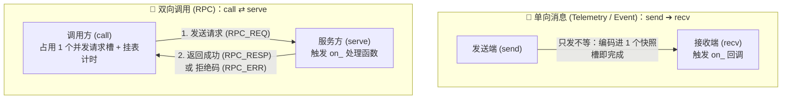
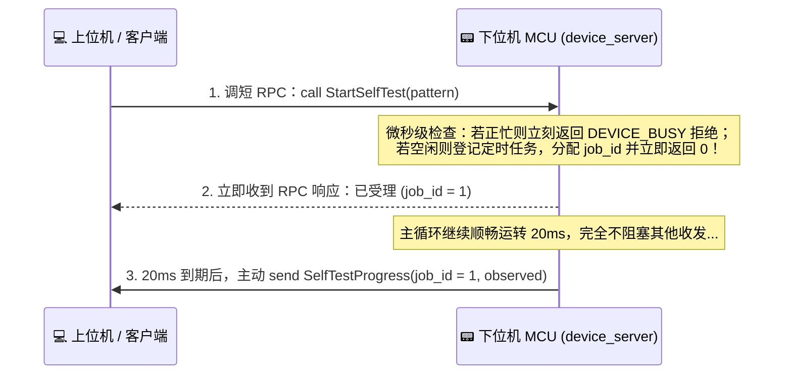

import { Aside, Steps, Tabs, TabItem } from '@astrojs/starlight/components';
import LessonHeader from '../../../../components/tutorial/LessonHeader.astro';
import Challenge from '../../../../components/tutorial/Challenge.astro';
import Checklist from '../../../../components/tutorial/Checklist.astro';
import MultipleChoice from '../../../../components/tutorial/MultipleChoice.astro';

<LessonHeader
  unit={2}
  duration="8 分钟"
  examplePath="examples/00_telemetry"
  goals={[
    '理解单向消息 (send / recv) 与双向调用 (call / serve) 的本质区别与选型原则',
    '编写单向遥测节点，掌握 send 的“输入立即快照”特性与 C 客户端调用 RPC 的回调处理',
    '学会将两者结合：用“短 RPC 立即领任务号 + 主循环推送单向进度消息”解决耗时硬件任务',
  ]}
/>

在上一课中，我们用 `rpc`（`call` / `serve`）实现了一问一答的加法调用。但在设计一套完整的上下位机协议时，你很快会遇到这样一个架构问题：

> **“哪些数据应该定义成单向消息（Telemetry / Event，用 `send`/`recv`），哪些操作应该定义成双向 RPC（用 `call`/`serve`）？它们俩在一个设备里怎么配合？”**

这一课我们就把这个问题彻底讲透。

---

## 第一部分：一张表看懂 Telemetry 与 RPC 的分工

在 Wirelink 中，单向消息和双向 RPC 共享同一套二进制类型系统和线缆通道，但它们的**交互生命周期**完全不同：



| 对比维度 | 单向消息（`send` / `recv`） | 双向 RPC（`call` / `serve`） |
| :--- | :--- | :--- |
| **有没有回包确认？** | **没有**。发出去就释放槽位，不等待对端回复 | **必有终态**：成功响应（`SUCCESS`）、业务拒绝（`REJECTED`）或超时（`TIMED_OUT`） |
| **线缆帧头开销** | 仅 **4 字节**帧头 + 消息体 | **12 字节**（4B 帧头 + 8B 会话/操作子头）+ 消息体 |
| **适用场景** | • 传感器周期上报（温度、电机转速、姿态）<br/>• 异步事件通知（按键触发、后台任务完成进度） | • 下发控制指令（必须知道设备有没有收下并执行）<br/>• 查询设备参数、触发自检并获取任务 ID |

---

## 第二部分：单向遥测（`send` / `recv`）怎么写？

当传感器每 10ms 向上位机推一次温度采样时，如果每次都要等上位机回一个 ACK，不仅带宽浪费一倍，一旦上位机稍微卡顿还会把 MCU 的请求槽堵满。这时候就该用 `send` 和 `recv`。

来看看 [`examples/00_telemetry/`](https://github.com/starwey604/wirelink/tree/main/examples/00_telemetry) 的完整实现：

<Tabs>
  <TabItem label="1. 协议定义 (telemetry.wl)">
    发布端 `pub` 声明 `send Telemetry;`，接收端 `sub` 声明 `recv Telemetry;`：

    {/* [docs:telemetry_schema] */}
    ```wl
    message Telemetry @id(10) {
      uint32 sample @id(1);
      int32 temperature_centi_c @id(2);
    }
    node pub { send Telemetry; }
    node sub { recv Telemetry; }
    ```
    {/* [/docs:telemetry_schema] */}
  </TabItem>

  <TabItem label="2. 发送与接收钩子">
    在内存回环示例 [`examples/00_telemetry/publisher.c`](https://github.com/starwey604/wirelink/blob/main/examples/00_telemetry/publisher.c) 与 [`subscriber.c`](https://github.com/starwey604/wirelink/blob/main/examples/00_telemetry/subscriber.c) 中，发送端的 `pub_tx_write` 把打包好的帧交给接收端，接收端在 `sub_on_telemetry` 中直接拿到解码好的结构体：

    {/* [docs:telemetry_tx_write] */}
    ```c
    wl_err_t pub_tx_write(pub_node_t *self, const uint8_t *data, size_t length) {
      (void)self;
      return sub_rx_packet(&subscriber, data, length);
    }
    ```
    {/* [/docs:telemetry_tx_write] */}

    {/* [docs:telemetry_receive] */}
    ```c
    unsigned telemetry_received;
    void sub_on_telemetry(sub_node_t *self, const telemetry_t *message) {
      (void)self;
      EXAMPLE_REQUIRE(message->sample == telemetry_received);
      EXAMPLE_REQUIRE(message->temperature_centi_c == -1234);
      ++telemetry_received;
    }
    ```
    {/* [/docs:telemetry_receive] */}
  </TabItem>

  <TabItem label="3. 主循环连发 12 条遥测">
    初始化两端后，每次调用 `pub_send_telemetry` 放入一条采样，接着推进两端的 `step`：

    {/* [docs:telemetry_publish] */}
    ```c
    EXAMPLE_REQUIRE(pub_init(&publisher) == WL_OK);
    EXAMPLE_REQUIRE(sub_init(&subscriber) == WL_OK);
    for (unsigned sample = 0; sample < 12; ++sample) {
      EXAMPLE_REQUIRE(pub_send_telemetry(&publisher, &(telemetry_t){
          .sample = sample, .temperature_centi_c = -1234}) == WL_OK);
      EXAMPLE_REQUIRE(pub_step(&publisher, sample) == WL_OK);
      EXAMPLE_REQUIRE(sub_step(&subscriber, sample) == WL_OK);
      EXAMPLE_REQUIRE(telemetry_received == sample + 1);
    }
    ```
    {/* [/docs:telemetry_publish] */}
  </TabItem>
</Tabs>

<Aside type="note" title="为什么 pub_send_telemetry 可以直接传栈上的临时复合字面量？">
因为 `pub_send_telemetry`（以及 RPC 的 `client_call_xxx`）采用**输入立即快照（Input Snapshot）**机制：**在函数返回 `WL_OK` 之前，它就已经把你的 C 结构体编码成二进制字节、复制进节点内部的发送槽里了**！函数一旦返回 `WL_OK`，你传入的局部变量就可以立刻销毁或复用。
</Aside>

---

## 第三部分：C 语言客户端怎么接收 RPC 结果？

在第一课里我们看了 Python 客户端调 RPC，那如果调用方也是用 C 语言写的（比如主控 MCU 调从控 MCU，见 [`examples/01_rpc/client.c`](https://github.com/starwey604/wirelink/blob/main/examples/01_rpc/client.c)），它是怎么拿到响应或拒绝码的？

因为 C11 节点是**单线程非阻塞**的，`client_call_add` 不会卡住主循环死等回包，而是接收一个完成回调函数（如这里的 `rejected`）：

{/* [docs:calculator_sync_rpc] */}
```c
EXAMPLE_REQUIRE(client_call_add(&caller, &(add_request_t){
    .left = INT32_MAX, .right = 1}, rejected) == WL_OK);
for (unsigned pass = 0; pass < 100 && !completed; ++pass) advance(100 + pass);
EXAMPLE_REQUIRE(completed == 1 && result.outcome == WL_KERNEL_REJECTED && result.status == 1);
```
{/* [/docs:calculator_sync_rpc] */}

当服务端返回响应（或超时到期）时，`client_step` 会调用你传入的完成回调：

{/* [docs:calculator_rejected_callback] */}
```c
static void rejected(client_node_t *self, wl_kernel_result_t outcome, const add_response_t *response) {
  (void)self;
  EXAMPLE_REQUIRE(response == NULL);
  result = outcome;
  ++completed;
}
```
{/* [/docs:calculator_rejected_callback] */}

- **成功时**：`outcome.outcome == WL_KERNEL_SUCCESS`，此时 `response` 指针非空，可以直接读取 `response->sum`。
- **被拒绝、超时或取消时**：`outcome.outcome` 为 `WL_KERNEL_REJECTED`（`outcome.status` 即服务端返回的非零错误码 `1`）、`WL_KERNEL_TIMED_OUT` 或 `WL_KERNEL_CANCELLED`，此时 **`response` 一律为 `NULL`**！

---

## 第四部分：强强联手——“短 RPC 启动 + 单向消息推进度”

现在，假设上位机要让 MCU 执行一次**硬件自检（Self-Test）**、**电机归零**或 **Flash 擦写**，这个动作在硬件上需要耗时 **20 毫秒甚至几秒钟**。

如果你只用 RPC，或者只用单向消息，都会很难受：
- ❌ **如果只用单向消息启动**：上位机发了 `StartSelfTest` 消息过去，如果此刻 MCU 正忙着做上一次自检，上位机根本不知道这次请求被忽略了！
- ❌ **如果在 RPC 服务函数里死等 20ms 做完再返回**：因为在单线程主循环里，`on_start_self_test` 卡住 20ms，这 20ms 内你的整个固件主循环和其他串口收发就全都卡死了！

**Wirelink 的标准工程模式是把 RPC 和单向消息组合起来**（源自 [`examples/03_device_service/`](https://github.com/starwey604/wirelink/tree/main/examples/03_device_service)）：



看看 [`examples/03_device_service/self_test.c`](https://github.com/starwey604/wirelink/blob/main/examples/03_device_service/self_test.c) 里的 `device_server_on_start_self_test` 是多么干净利落：

{/* [docs:device_job_start] */}
```c
int32_t device_server_on_start_self_test(device_server_node_t *self, const start_self_test_request_t *request,
                     start_self_test_response_t *response) {
  device_service_t *state = self->user;
  if (state->job_pending || state->next_job == UINT32_MAX) return DEVICE_BUSY;
  state->job_id = ++state->next_job;
  state->pattern = request->pattern;
  state->due = state->now + 20U;
  state->job_pending = true;
  response->job_id = state->job_id;
  return 0;
}
```
{/* [/docs:device_job_start] */}

1. **短 RPC 负责“准入确认”**：如果已经有任务在进行（`state->job_pending`），当场返回非零拒绝码 `DEVICE_BUSY`；如果空闲，登记到期时间 `state->due = state->now + 20U`，把分配好的 `job_id` 填进 `response` 并立刻 `return 0`，耗时不到 1 微秒！
2. **单向消息负责“异步结果交付”**：主循环照常跑，等 20ms 到期后，通过 `device_server_send_self_test_progress` 把带有 `job_id` 的结果单向推给客户端（我们将在第 05 课进一步看到轮询发送时如何处理队列背压）。

<Challenge
  title="架构设计思考"
  prompt="当客户端调用某次 RPC 后收到了 WL_KERNEL_REJECTED (status = DEVICE_BUSY) vs 收到了 WL_KERNEL_TIMED_OUT，这两种失败在业务层有什么本质区别？"
>
  - **`WL_KERNEL_REJECTED`（业务拒绝）**：代表请求**100% 已经到达了下位机**，且下位机明确告诉你“我没执行这个操作，原因码是 `DEVICE_BUSY`”。
  - **`WL_KERNEL_TIMED_OUT`（等待超时）**：代表客户端在规定时间内没收到回包。但**超时无法证明下位机没有执行过该请求**——有可能是去程的请求包丢了（下位机没收到），也有可能是下位机其实已经执行了、但回程的响应包在路上丢了！因此，对于非幂等的控制动作，携带 `job_id` 或提供状态查询 RPC 是非常好的工程习惯。
</Challenge>

---

## 本课小测验

<MultipleChoice
  id="lesson-02-pattern"
  question="在单线程主循环驱动的 MCU 上，当上位机请求执行一个耗时 500ms 的电机校准动作时，最合理的协议设计是什么？"
  checkLabel="检查答案"
  emptyFeedback="请先选择一个选项。"
  choices={[
  {
    "label": "用短 RPC 检查设备状态并立即返回 job_id（若忙则返回非零码拒绝），再由主循环在校准完成后通过 send 单向消息推送校准结果。",
    "correct": true,
    "feedback": "完全正确！这样既能让上位机立刻获知指令是否被受理，又不会阻塞 MCU 的单线程主循环。"
  },
  {
    "label": "在 RPC 处理函数 on_calibrate 里直接调用 delay_ms(500) 等电机走完再 return 0。",
    "correct": false,
    "feedback": "不对。在 on_<rpc> 中长时间阻塞会导致整个单线程主循环停摆，期间无法处理任何其他收发和心跳。"
  }
]}
/>

<MultipleChoice
  id="lesson-02-snapshot"
  question="当调用 pub_send_telemetry(&publisher, &msg) 返回 WL_OK 后，关于传入的 msg 结构体，下列说法正确的是？"
  checkLabel="检查答案"
  emptyFeedback="请先选择一个选项。"
  choices={[
  {
    "label": "msg 的数据在函数返回 WL_OK 前已经编码复制进节点内部的快照槽，调用方可以立即修改或销毁 msg。",
    "correct": true,
    "feedback": "正确！所有 send 和 call 接口在返回 WL_OK 时都已完成输入编码快照，不会在返回后继续引用调用方的输入结构体指针。"
  },
  {
    "label": "必须把 msg 声明为全局变量并一直保持不变，直到对端收到为止。",
    "correct": false,
    "feedback": "不需要。输入结构体在 send 返回 WL_OK 前就已经完成了编码复制。"
  }
]}
/>

<Checklist
  id="checklist-02"
  title="本课掌握清单"
  progressTemplate="已完成 {done} / {total} 项"
  items={[
    "能根据业务需求选择单向消息（send/recv，高频状态与异步通知）或双向 RPC（call/serve，需确认执行结果或拒绝码）。",
    "理解 send 与 call 返回 WL_OK 代表已完成输入快照，以及在 C 客户端完成回调中先检查 outcome 再访问 response。",
    "掌握“短 RPC 立即领 job_id + 主循环推送单向进度消息”的长耗时任务协同模式。"
  ]}
/>

前两课里，我们的消息字段都是简单的 `int32` 和 `uint32`。但在真实产品里，你一定需要传**设备名称字符串（`string`）**、**原始采样字节块（`bytes`）**、**可选扩展字段（`optional`）**，甚至把大项目拆成多个 `.wl` 文件！在零 `malloc` 的 C11 里，变长字符串存在哪？回调结束后怎么安全保存数据？

下一课：[03 打造真实协议：字符串、可选字段与内存生命周期 →](/wirelink/zh-cn/learn/03-rpc-basics/)
