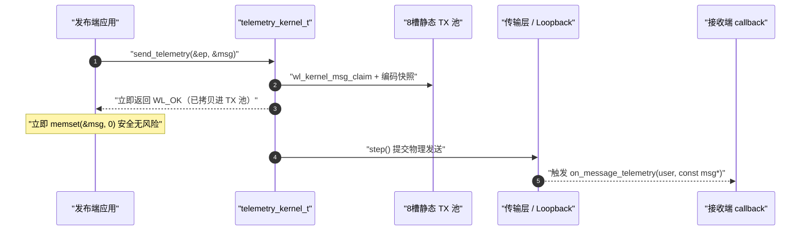

import Checklist from '../../../../components/tutorial/Checklist.astro';
import MultipleChoice from '../../../../components/tutorial/MultipleChoice.astro';

温度采集任务每隔固定周期就会产生一组 `sample` 与 `temperature_centi_c` 读数，不需要对端回复确认，只希望以最低开销把状态推给对端显示或记录。这种高频单向推送正是 Wirelink 中 `send` / `direct` 普通路由的典型场景。

## 遥测工作流时序

调用生成 API `telemetry_kernel_send_telemetry` 时，编码与加帧全部在返回 `WL_OK` 之前完成，调用方随即可安全复用局部栈变量：



## Schema 与 C11 发送/接收代码

定义遥测消息和单向绑定（来自 `examples/00_telemetry/`）：

{/* [docs:telemetry_schema] */}
```wl
message Telemetry @id(10) {
  required uint32 sample @id(1);
  required int32 temperature_centi_c @id(2);
}
```
{/* [/docs:telemetry_schema] */}

{/* [docs:telemetry_bind] */}
```wl
profile version 2;
endpoint { envelope=native_packet; }

direct Telemetry {
  delivery = unreliable;
}

send Telemetry { delivery=unreliable; }
```
{/* [/docs:telemetry_bind] */}

发送端在栈上构造 `telemetry_t` 并传入 `telemetry_kernel_send_telemetry`；接收端在 `on_message_telemetry` 回调中直接读取解码后的只读指针：

{/* [docs:telemetry_publish] */}
```c
const telemetry_kernel_handlers_t handlers = {.on_message_telemetry = telemetry_receive};
for (unsigned side = 0; side < 2; ++side)
  EXAMPLE_REQUIRE(telemetry_kernel_init(&endpoints[side], &pair.ports[side], &handlers, NULL, NULL) == WL_OK);
for (unsigned sample = 0; sample < 12; ++sample) {
  telemetry_t message = {.has_sample = true, .sample = sample,
    .has_temperature_centi_c = true, .temperature_centi_c = -1234};
  EXAMPLE_REQUIRE(telemetry_kernel_send_telemetry(&endpoints[0], &message) == WL_OK);
  memset(&message, 0, sizeof(message)); /* Admission copied the source. */
  example_pair_wait(&pair, &telemetry_received, sample + 1);
}
```
{/* [/docs:telemetry_publish] */}

{/* [docs:telemetry_receive] */}
```c
unsigned telemetry_received;
void telemetry_receive(void *user, const telemetry_t *message) {
  (void)user;
  EXAMPLE_REQUIRE(message->sample == telemetry_received);
  EXAMPLE_REQUIRE(message->temperature_centi_c == -1234);
  ++telemetry_received;
}
```
{/* [/docs:telemetry_receive] */}

> 要编译运行本课完整例程，配置 CMake 时开启 `-DWIRELINK_BUILD_WLC_EXAMPLES=ON -DWIRELINK_WLC_EXECUTABLE=...`，执行 `ctest -R wirelink_telemetry_demo`。

## 思考题

<MultipleChoice
  id="lesson-02-snapshot"
  question="当 telemetry_kernel_send_telemetry(&ep, &msg) 返回 WL_OK 后，立即修改或清空局部变量 msg 是否安全？"
  checkLabel="检查答案"
  emptyFeedback="请先选择一个选项。"
  choices={[
    {
      label: "安全。接纳返回前已完成序列编码并快照进端点内部静态 TX 缓冲，后续物理发送不再读取原变量。",
      correct: true,
      feedback: "正确。这也意味着你不需要为单向消息长期持有局部结构体或堆内存。",
    },
    {
      label: "不安全。必须等待对端返回 ACK 之后才能释放或覆盖局部结构体 msg。",
      correct: false,
      feedback: "不对。Wirelink 的普通 send 接口采用入口即快照策略，绝不跨函数返回借用调用方的局部栈变量。",
    },
  ]}
/>

<MultipleChoice
  id="lesson-02-wire-delivery"
  question="send 返回 WL_OK 是否等同于「对端已经收到了物理串口或网口上的字节」？"
  checkLabel="检查答案"
  emptyFeedback="请先选择一个选项。"
  choices={[
    {
      label: "是的，返回 WL_OK 代表对端回调已经执行完成。",
      correct: false,
      feedback: "不是。send 只把已编码报文放入本端 8 槽 TX 队列；真正发送由后续 step() 和物理驱动推进，且单向 unreliable 链路不保证对端必达。",
    },
    {
      label: "不是，仅代表报文已通过校验并进入本端待发 TX 队列，物理发送将在后续 step() 中推进。",
      correct: true,
      feedback: "正确。接纳只保证进入本地待发队列；是否发出依赖后续 owner step()，是否送达取决于物理链路特性。",
    },
  ]}
/>

<Checklist
  id="checklist-02"
  title="本课检查清单"
  progressTemplate="已完成 {done} / {total} 项"
  items={[
    "理解单结构体 <name>_t 的 has_<field> 存在标记与赋值规范。",
    "清楚区分「send 入口编码快照成功」与「物理链路真正发送/对端收到」。",
  ]}
/>

下一课：[03 请求与响应：实现第一个 RPC 服务](/wirelink/zh-cn/learn/03-rpc-basics/)。
