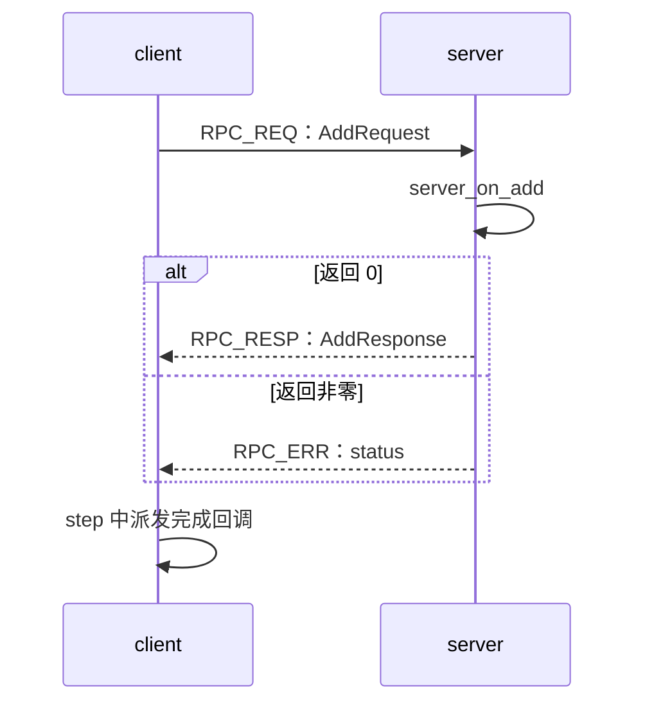

import Checklist from '../../../../components/tutorial/Checklist.astro';
import MultipleChoice from '../../../../components/tutorial/MultipleChoice.astro';

需要知道对端是否完成配置或计算时，用 RPC。客户端声明 `call Add`，服务端声明 `serve Add`；角色不会隐式对称。

## 定义与生成

{/* [docs:calculator_schema] */}
```wl
message AddRequest @id(20) {
  int32 left @id(1);
  int32 right @id(2);
}
message AddResponse @id(21) { int32 sum @id(1); }
rpc Add(AddRequest) -> AddResponse;
node client { call Add; }
node server { serve Add; }
```
{/* [/docs:calculator_schema] */}

```sh
wlc compile examples/01_rpc/calculator.wl --node server --out-dir generated/server
wlc compile examples/01_rpc/calculator.wl --node client --out-dir generated/client
```

仅生成 client 时，不需要提供 `server_on_add`，也不依赖链接器 GC 删除服务端符号。

## 实现静态服务函数

{/* [docs:calculator_server] */}
```c
int32_t server_on_add(server_node_t *self, const add_request_t *request, add_response_t *response) {
  (void)self;
  const int64_t sum = (int64_t)request->left + request->right;
  if (sum < INT32_MIN || sum > INT32_MAX) return 1;
  response->sum = (int32_t)sum;
  return 0;
}
```
{/* [/docs:calculator_server] */}

返回 `0` 时发送响应；返回非零 `int32_t` 时发送业务拒绝。拒绝帧有 12 B RPC payload，加 4 B 规范帧头共 16 B，没有业务消息体。

## 简化调用：不传 now、timeout 或 user

{/* [docs:calculator_sync_rpc] */}
```c
EXAMPLE_REQUIRE(client_call_add(&caller, &(add_request_t){
    .left = INT32_MAX, .right = 1}, rejected) == WL_OK);
for (unsigned pass = 0; pass < 100 && !completed; ++pass) advance(100 + pass);
EXAMPLE_REQUIRE(completed == 1 && result.outcome == WL_KERNEL_REJECTED && result.status == 1);
```
{/* [/docs:calculator_sync_rpc] */}

完成回调接收节点指针、结果和响应：

```c
static void rejected(client_node_t *self, wl_kernel_result_t result,
                     const add_response_t *response) {
  (void)self;
  if (result.outcome == WL_KERNEL_SUCCESS) {
    /* 在本次回调内使用 response->sum，或复制响应。 */
  }
}
```

默认 `timeout_ms = 500`，从**下一次 `client_step(now)`** 开始计时，不使用旧的隐式时间。需要把排队时间计入预算、独立 user 或取消句柄时，使用：

```c
client_call_add_ex(&caller, &request, now, 500, done, user, &handle);
```

`done` 的首参是 `void *user`；不需要取消时最后一参可传 `NULL`。两种调用都需持续推进节点，完成回调只在 `step` 中触发。



<MultipleChoice
  id="lesson-03-result"
  question="业务拒绝与超时有什么区别？"
  checkLabel="检查答案"
  emptyFeedback="请先选择一个选项。"
  choices={[
  {
    "label": "REJECTED 携带服务端 status；TIMED_OUT 不能说明对端是否执行过请求。",
    "correct": true,
    "feedback": "正确。超时后是否重试取决于业务幂等性，而非仅看链路状态。"
  },
  {
    "label": "两者都表示服务端没有收到请求。",
    "correct": false,
    "feedback": "不对。业务拒绝证明服务端处理并明确拒绝；超时无法确定。"
  }
]}
/>

<MultipleChoice
  id="lesson-03-timeout"
  question="免 now 的 client_call_add 何时开始计时？"
  checkLabel="检查答案"
  emptyFeedback="请先选择一个选项。"
  choices={[
  {
    "label": "下一次 owner 调用 step(now) 时。",
    "correct": true,
    "feedback": "正确。长期空闲后的首个调用不会使用陈旧时间戳。"
  },
  {
    "label": "从节点最近一次 step 的时间开始。",
    "correct": false,
    "feedback": "不对。节点不保存 last_now 来推断这次调用时间。"
  }
]}
/>

<Checklist id="checklist-03" title="本课检查清单" progressTemplate="已完成 {done} / {total} 项" items={["显式选择 call 与 serve 角色。", "实现 server_on_add 并区分成功、拒绝和超时。", "知道简化调用与 _ex 调用的计时差异。"]} />

下一课：[04 字符串与生命周期](/wirelink/zh-cn/learn/04-strings-and-lifetime/)。
