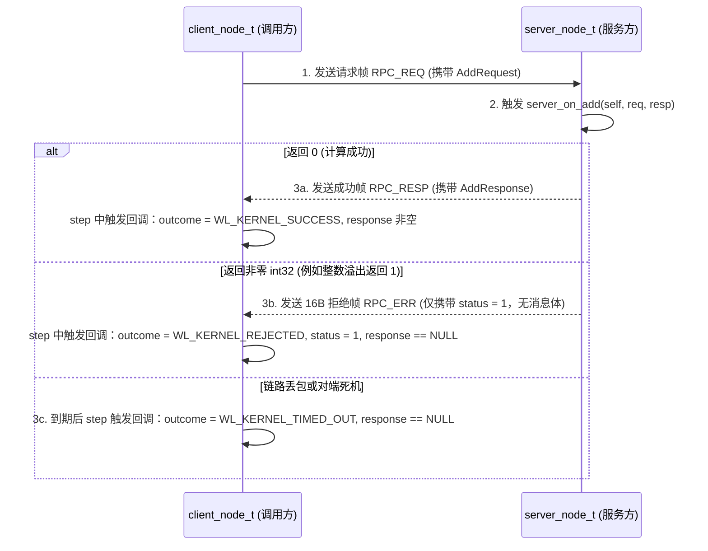

import { Aside, Steps, Tabs, TabItem } from '@astrojs/starlight/components';
import LessonHeader from '../../../../components/tutorial/LessonHeader.astro';
import Challenge from '../../../../components/tutorial/Challenge.astro';
import Checklist from '../../../../components/tutorial/Checklist.astro';
import MultipleChoice from '../../../../components/tutorial/MultipleChoice.astro';

<LessonHeader
  unit={3}
  duration="8 分钟"
  examplePath="examples/01_rpc"
  goals={[
    '在 .wl 中用 rpc 配对请求与响应，并在 node 中显式区分 call 与 serve',
    '编写服务端处理函数：返回 0 发送响应，返回非 0 触发业务拒绝 (WL_KERNEL_REJECTED)',
    '分清简化调用 client_call_add 与显式调用 client_call_add_ex 的超时起算时机',
  ]}
/>

在上一课中，单向消息（`send`/`recv`）发出去就不管了。但在修改设备参数、请求计算结果或触发动作时，调用方必须得到一个确切的结果：**对方算完了吗？参数是不是越界被拒绝了？还是线断了超时没回？**

这就是 **RPC（远程过程调用）** 的用武之地。本课我们基于 [`examples/01_rpc/`](https://github.com/starwey604/wirelink/tree/main/examples/01_rpc)，实现一个能自动检测 32 位有符号整数溢出的远程加法服务。

---

## 第一步：在 `.wl` 中配对 `rpc` 并分配 `call` / `serve` 角色

先看 [`examples/01_rpc/calculator.wl`](https://github.com/starwey604/wirelink/blob/main/examples/01_rpc/calculator.wl)：

{/* [docs:calculator_schema] */}
```wl
message AddRequest @id(20) {
  int32 left @id(1);
  int32 right @id(2);
}
message AddResponse @id(21) { int32 sum @id(1); }
rpc Add(AddRequest) -> AddResponse;
node client { call Add; }
node server { serve Add; }
```
{/* [/docs:calculator_schema] */}

注意看 `node` 里的关键字：
- **`call Add;`（客户端能力）**：只生成发起调用的函数 `client_call_add` / `client_call_add_ex` 和 4 个出站请求槽。
- **`serve Add;`（服务端能力）**：只生成服务端处理钩子 `server_on_add` 和 3 个待发回复槽。
- **方向绝不隐式对称**：如果你单独为客户端编译（`wlc compile calculator.wl --node client`），生成的代码里根本不会出现 `server_on_add`，你完全不需要写空的桩函数去应付链接器！

---

## 第二步：服务端视角 vs 客户端视角

当一次 RPC 发生时，在线缆上其实有三种可能的走向：**成功响应（`RPC_RESP`）**、**业务拒绝（`RPC_ERR`）** 或 **迟迟收不到回复导致本地超时（`TIMED_OUT`）**。



让我们通过下方标签页，分别看看**服务端**和**客户端**的 C 代码怎么写：

<Tabs>
  <TabItem label="1. 服务端实现 (server.c)">
    在 [`examples/01_rpc/server.c`](https://github.com/starwey604/wirelink/blob/main/examples/01_rpc/server.c) 中，服务端只需实现 `server_on_add`：

    {/* [docs:calculator_server] */}
    ```c
    int32_t server_on_add(server_node_t *self, const add_request_t *request, add_response_t *response) {
      (void)self;
      const int64_t sum = (int64_t)request->left + request->right;
      if (sum < INT32_MIN || sum > INT32_MAX) return 1;
      response->sum = (int32_t)sum;
      return 0;
    }
    ```
    {/* [/docs:calculator_server] */}

    **返回值契约一目了然**：
    - **返回 `0`**：代表业务执行成功。Wirelink 会把你填好的 `response->sum` 编码成 `RPC_RESP` 帧发回给客户端。
    - **返回非零 `int32_t`（例如 `1` 或自定义错误码）**：代表**业务层主动拒绝**。此时 Wirelink **不会编码 `response` 结构体**，而是直接发回一个固定 16 字节（4B 帧头 + 12B RPC 错误子头）的紧凑 `RPC_ERR` 帧，把你的非零返回值原封不动带给客户端！
  </TabItem>

  <TabItem label="2. 客户端发起调用 (client.c)">
    在 [`examples/01_rpc/client.c`](https://github.com/starwey604/wirelink/blob/main/examples/01_rpc/client.c) 中，我们故意传入 `INT32_MAX + 1` 来测试服务端的溢出拒绝：

    {/* [docs:calculator_sync_rpc] */}
    ```c
    EXAMPLE_REQUIRE(client_call_add(&caller, &(add_request_t){
        .left = INT32_MAX, .right = 1}, rejected) == WL_OK);
    for (unsigned pass = 0; pass < 100 && !completed; ++pass) advance(100 + pass);
    EXAMPLE_REQUIRE(completed == 1 && result.outcome == WL_KERNEL_REJECTED && result.status == 1);
    ```
    {/* [/docs:calculator_sync_rpc] */}

    当请求完成（无论成功、被拒还是超时）时，`client_step` 都会调用我们传入的完成回调 `rejected`：

    {/* [docs:calculator_rejected_callback] */}
    ```c
    static void rejected(client_node_t *self, wl_kernel_result_t outcome, const add_response_t *response) {
      (void)self;
      EXAMPLE_REQUIRE(response == NULL);
      result = outcome;
      ++completed;
    }
    ```
    {/* [/docs:calculator_rejected_callback] */}

    <Aside type="caution" title="先查 outcome，再解引用 response 指针！">
    只有在 `outcome.outcome == WL_KERNEL_SUCCESS` 时，`response` 指针才是非空的！当结果是 `WL_KERNEL_REJECTED`、`WL_KERNEL_TIMED_OUT` 或 `WL_KERNEL_CANCELLED` 时，`response` 一律为 `NULL`。
    </Aside>
  </TabItem>
</Tabs>

---

## 第三步：深挖一个精妙设计——简化调用 vs `_ex` 显式调用

你可能注意到了，上面调用 `client_call_add(&caller, &req, callback)` 时，**我们根本没有传当前时间 `now_ms`，也没有传超时时间 `timeout_ms`！**

既然 Wirelink 核心从不自己读取系统时钟，那它是怎么知道什么时候超时的？

| 调用方式 | 函数签名与参数 | 超时时间从哪来？何时开始倒计时？ | 适用场景 |
| :--- | :--- | :--- | :--- |
| **简化调用**（默认推荐） | `client_call_add(self, &req, cb)`<br/>*(回调首参为 `client_node_t *self`)* | 使用节点默认 `timeout_ms`（默认 500ms），从**下一次 `client_step(self, now)`** 传入的 `now` 开始挂表计时！ | 绝大多数常规业务调用，代码最简 |
| **显式扩展调用 (`_ex`)** | `client_call_add_ex(self, &req, now, timeout, cb, user, &handle)`<br/>*(回调首参为独立的 `void *user`)* | 从你调用时显式传入的 **`now`** 立即开始计时（排队等待 step 的时间也算进超时预算），并可拿到取消句柄 `handle` | 需要自定义单次超时、传入独立上下文 `user` 或后续主动取消 (`cancel`) |

<Aside type="tip" title="为什么简化调用要从“下一次 step(now)”开始计时？">
想象一下：你的设备在休眠了 10 分钟后被某个按键触发，调用了 `client_call_add()`。如果节点傻傻地拿 10 分钟前最后一次 `step` 的旧时间戳来算超时，这个请求刚放进去就会在第一次 `step` 时被误判为“已超时 10 分钟”！
因此，Wirelink 的简化调用会把请求标记为“待挂表”，等到主循环下一次执行 `client_step(&caller, now)` 拿到新鲜的 `now` 时才正式启动倒计时。
</Aside>

<Challenge
  title="工程思考：收到 REJECTED 和收到 TIMED_OUT，重试策略有什么本质不同？"
  prompt="当客户端回调收到 WL_KERNEL_REJECTED (status = 1) vs 收到 WL_KERNEL_TIMED_OUT 时，客户端能不能无脑自动重发一次相同的请求？"
>
  - **`WL_KERNEL_REJECTED`（业务拒绝）**：说明请求**100% 已经到达了服务端**，并且服务端明确告诉你“这个请求不合法或当前不接受（比如参数溢出、设备正忙）”。如果你用完全相同的参数立刻无脑重发，只会再被拒绝一次。
  - **`WL_KERNEL_TIMED_OUT`（等待超时）**：说明本端在规定时间内没收到回包。但**超时无法证明服务端没执行过该请求**——有可能是请求包丢了（服务端没执行），也有可能是服务端已经执行完了、但回来的响应包在半路丢了！因此，只有当该 RPC 是**业务幂等**的（如读取状态、查询计算、或者携带了业务 `job_id`），超时后才可以安全重试。
</Challenge>

---

## 本课小测验

<MultipleChoice
  id="lesson-03-result"
  question="在 RPC 完成回调中，业务拒绝 (WL_KERNEL_REJECTED) 与超时 (WL_KERNEL_TIMED_OUT) 有什么本质区别？"
  checkLabel="检查答案"
  emptyFeedback="请先选择一个选项。"
  choices={[
  {
    "label": "REJECTED 证明服务端已收到并明确返回了非零拒绝码 (result.status)；而 TIMED_OUT 无法确定远端是否已经执行过该请求。",
    "correct": true,
    "feedback": "完全正确！超时后能否安全重试取决于你的业务操作是否具有幂等性。"
  },
  {
    "label": "两者都代表服务端没有收到请求，客户端都可以放心重发。",
    "correct": false,
    "feedback": "不对。REJECTED 是服务端主动发回的拒绝响应；而 TIMED_OUT 也可能是回程响应包丢失，服务端其实已经执行过了。"
  }
]}
/>

<MultipleChoice
  id="lesson-03-timeout"
  question="不传时间戳的简化调用 client_call_add(&caller, &req, done) 是从什么时候开始计算超时的？"
  checkLabel="检查答案"
  emptyFeedback="请先选择一个选项。"
  choices={[
  {
    "label": "从下一次主循环调用 client_step(&caller, now) 时传入的 now 开始计时。",
    "correct": true,
    "feedback": "正确！这样即使节点在长期休眠或空闲后发起首个调用，也不会被陈旧的时间戳误判超时。"
  },
  {
    "label": "从节点上一次执行 step 时保存的旧时间戳开始计时。",
    "correct": false,
    "feedback": "不对。节点不会用上一次 step 的陈旧时间来推断新调用的发起时刻。"
  }
]}
/>

<Checklist
  id="checklist-03"
  title="本课掌握清单"
  progressTemplate="已完成 {done} / {total} 项"
  items={[
    "在 .wl 中为客户端声明 call，为服务端声明 serve，按角色生成独立代码。",
    "在服务端 on_<rpc> 中返回 0 发送响应，返回非零 int32_t 发送 16 字节紧凑拒绝帧。",
    "在客户端完成回调中先检查 result.outcome，并理解简化调用与 _ex 调用的计时差异。"
  ]}
/>

到目前为止，我们传的都是 `int32`、`uint32` 这样的定长数字。如果要传**设备名称字符串（`string`）**或**变长采样字节块（`bytes`）**，在零 `malloc` 的 C11 里它是怎么存储的？回调结束后指针还能用吗？

下一课：[04 字符串、字节数组与生命周期 →](/wirelink/zh-cn/learn/04-strings-and-lifetime/)
