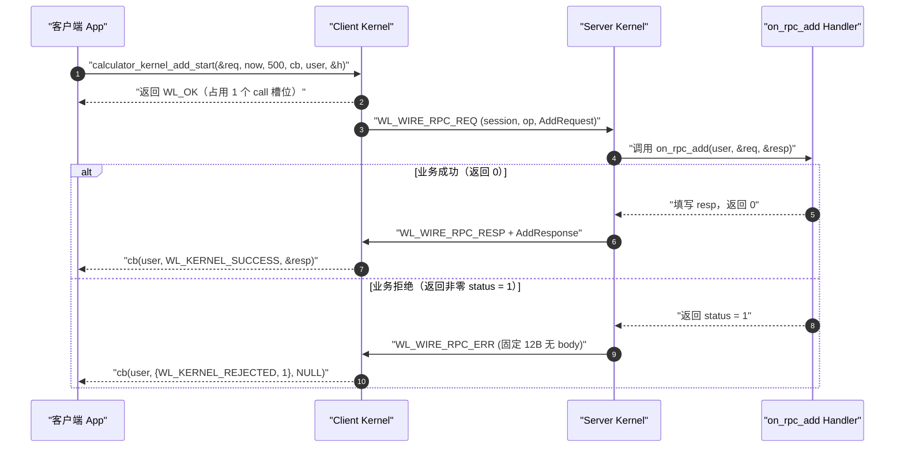

import Checklist from '../../../../components/tutorial/Checklist.astro';
import MultipleChoice from '../../../../components/tutorial/MultipleChoice.astro';

当设备需要接收配置指令或计算请求、并要求明确知道「执行成功了还是因为参数非法被拒绝」时，就需要双向 RPC。在 Wirelink 的 Profile v2 中，同一条链路的双方默认对称，均可主动发起或响应 RPC。

## RPC 调用与业务拒绝流程



## Schema、服务端实现与发起调用

以下源码片段直接对应 `examples/01_rpc/` 编译测试：

{/* [docs:calculator_schema] */}
```wl
message AddRequest @id(20) {
  required int32 left @id(1);
  required int32 right @id(2);
}

message AddResponse @id(21) {
  required int32 sum @id(1);
}
```
{/* [/docs:calculator_schema] */}

{/* [docs:calculator_bind] */}
```wl
profile version 2;
endpoint { envelope=native_packet; }

rpc Add {
  request = AddRequest;
  response = AddResponse;
}
```
{/* [/docs:calculator_bind] */}

服务端回调返回 `0` 表示处理成功并发送 `response`；返回任意非零 `int32_t`（例如整数溢出时返回 `1`）则会向客户端回传精简的 12 字节 `WL_WIRE_RPC_ERR` 包：

{/* [docs:calculator_server] */}
```c
int32_t calculator_add(void *user, const add_request_t *request, add_response_t *response) {
  (void)user;
  const int64_t sum = (int64_t)request->left + request->right;
  if (sum < INT32_MIN || sum > INT32_MAX) return 1;
  response->has_sum = true; response->sum = (int32_t)sum;
  return 0;
}
```
{/* [/docs:calculator_server] */}

客户端发起调用并等待触发终态回调，注意 `WL_KERNEL_REJECTED` 时的 `result.status` 精确等于服务端返回的业务码 `1`：

{/* [docs:calculator_sync_rpc] */}
```c
add_request_t request = {.has_left = true, .left = INT32_MAX, .has_right = true, .right = 1};
wl_kernel_call_handle_t handle;
EXAMPLE_REQUIRE(calculator_kernel_add_start(&endpoints[1], &request, pair.now, 500,
  add_completed, NULL, &handle) == WL_OK);
example_pair_wait(&pair, &add_count, 1);
EXAMPLE_REQUIRE(add_result.outcome == WL_KERNEL_REJECTED && add_result.status == 1);
```
{/* [/docs:calculator_sync_rpc] */}

## 思考题

<MultipleChoice
  id="lesson-03-rejected-vs-timeout"
  question="在完成回调中，服务端返回业务拒绝码（如 status = 1）与底层链路断连超时，在客户端判定上有何本质差异？"
  checkLabel="检查答案"
  emptyFeedback="请先选择一个选项。"
  choices={[
    {
      label: "没有差异，两者都会把 outcome 设为 WL_KERNEL_LOCAL_ERROR。",
      correct: false,
      feedback: "不是。两者语义完全分离，业务层的拒绝不会混淆成通信故障。",
    },
    {
      label: "业务拒绝的 outcome 为 WL_KERNEL_REJECTED（携带对端返回的非零 status，且证明对端已收到并明确拒绝请求）；底层超时则是 WL_KERNEL_TIMED_OUT（无法确认对端是否执行过该请求）。",
      correct: true,
      feedback: "正确！收到 WL_KERNEL_REJECTED 代表通信成功到达且对端主动拒绝；而 WL_KERNEL_TIMED_OUT 说明未收到响应，是否重试需结合指令幂等性判断。",
    },
  ]}
/>

<Checklist
  id="checklist-03"
  title="本课检查清单"
  progressTemplate="已完成 {done} / {total} 项"
  items={[
    "理解 RPC Handler 返回 0 与非零业务状态码对应的底层帧类型（RPC_RESP vs 12B RPC_ERR）。",
    "掌握如何通过 result.outcome 区分成功、远程业务拒绝与本地超时/错误。",
  ]}
/>

下一课：[04 变长字符串、字节数组与回调生命周期](/wirelink/zh-cn/learn/04-strings-and-lifetime/)。
