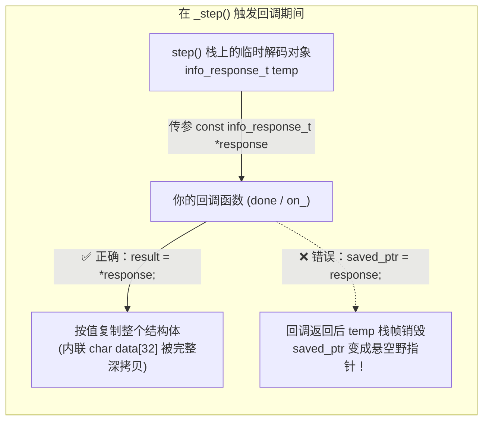

import { Aside, Steps, Tabs, TabItem } from '@astrojs/starlight/components';
import LessonHeader from '../../../../components/tutorial/LessonHeader.astro';
import Challenge from '../../../../components/tutorial/Challenge.astro';
import Checklist from '../../../../components/tutorial/Checklist.astro';
import MultipleChoice from '../../../../components/tutorial/MultipleChoice.astro';

<LessonHeader
  unit={3}
  duration="7 分钟"
  examplePath="examples/02_device_info"
  goals={[
    '使用有界 string<N> 与 bytes<N> 在零动态内存分配 (0 malloc) 下传输变长字符串和字节数组',
    '掌握接收回调中 const response_t * 指针的生命周期：按值赋值结构体 (*saved = *response)，绝不保存临时指针',
    '学会用 optional 声明可选字段，并用 import 将多个子模块的 .wl 组合成完整产品协议',
  ]}
/>

在 C 语言嵌入式开发里，只要协议里出现**变长字符串**（比如设备序列号、固件版本号）或**变长字节块**（比如一段传感器波形或加密签名），开发者往往会头疼两件事：
1. **不敢用 `malloc/free`**：跑了几天后堆内存碎片化，或者在某个错误分支漏了 `free` 导致内存耗尽死机。
2. **悬空野指针（Dangling Pointer）**：在接收回调函数里顺手把 `response->name.data` 指针存到了全局变量里，结果回调一返回，底层缓冲区被复用，读出来的全成了乱码！

这一课我们结合 [`examples/02_device_info/`](https://github.com/starwey604/wirelink/tree/main/examples/02_device_info) 和 [`examples/04_composed_services/`](https://github.com/starwey604/wirelink/tree/main/examples/04_composed_services)，看看 Wirelink 是如何用**有界内联存储**彻底消灭这两个隐患的。

---

## 第一步：用 `string<N>` 与 `bytes<N>` 实现零 `malloc` 变长传输

在供节点（`node`）使用的消息中，所有字符串和字节数组都使用 `<N>` 声明最大字节上限（例如 `string<31>`、`bytes<64>`）。这样编译器不仅能在编译期精确算出整条消息的最大帧长，还能直接把数组**内联（Inline）嵌进生成的 C 结构体内部**！

点击下方标签页，对比 [`examples/02_device_info/device_info.wl`](https://github.com/starwey604/wirelink/blob/main/examples/02_device_info/device_info.wl) 与它生成的 C11 结构体：

<Tabs>
  <TabItem label="1. 协议定义 (device_info.wl)">
    {/* [docs:device_info_schema] */}
    ```wl
    version 1;

    message InfoRequest @id(30) {}

    message InfoResponse @id(31) {
      string<31> name @id(1);
      string<15> firmware @id(2);
      uint32 query_count @id(3);
    }

    rpc GetInfo(InfoRequest) -> InfoResponse;
    node info_client { call GetInfo; }
    node info_server { serve GetInfo; }
    ```
    {/* [/docs:device_info_schema] */}
  </TabItem>

  <TabItem label="2. 生成的 C11 结构体与安全 Setter (device_info.h)">
    看生成的 `info_response_t`，里面没有任何指向外部堆内存的 `char *` 指针，全部是定长内联数组：

    ```c
    typedef struct info_response_s {
      struct {
        size_t length;
        char data[32]; /* string<31> 自动分配 31 + 1 = 32 字节，末尾始终补 '\0' */
      } name;
      struct {
        size_t length;
        char data[16]; /* string<15> 自动分配 15 + 1 = 16 字节 */
      } firmware;
      uint32_t query_count;
    } info_response_t;

    /* 自动生成的安全 setter：检查长度 <= N、复制内容并补 '\0'，超长返回 false */
    bool info_response_set_name(info_response_t *self, const char *value);
    bool info_response_set_firmware(info_response_t *self, const char *value);
    ```
  </TabItem>
</Tabs>

### 常用丰富数据类型速览

除了整数和 `string<N>`，你在写 `.wl` 时还可以自由搭配以下类型：

| 你想表达的数据 | `.wl` 写法示例 | 生成的 C11 结构体成员 |
| :--- | :--- | :--- |
| **有界 UTF-8 字符串** | `string<31> name @id(1);` | `struct { size_t length; char data[32]; } name;`（在线缆上只传实际 `length` 个字节，解码后自动在 `data[length]` 补 `'\0'`） |
| **有界原始字节块** | `bytes<64> payload @id(2);` | `struct { size_t length; uint8_t data[64]; } payload;`（可存放任意二进制数据） |
| **定长紧凑数组** | `packed float32 accel[3] @id(3);` | `float accel[3];`（如三轴传感器数据、RGB 通道） |
| **枚举类型** | `enum Mode @id(1) { IDLE = 0; RUN = 1; }` | 强类型 C `enum`，解码时自动拦截未定义的非法枚举值 |
| **可选字段** | `optional int32 temp @id(4);` | `bool has_temp;` + `int32_t temp;`（允许对端不传该字段，适合协议后续升级加新字段） |

---

## 第二步：掌握回调中的内存生命周期（按值拷贝结构体！）

既然 `info_response_t` 里的字符串是内联数组，这给我们带来了一个巨大的工程便利：**在 C 语言里直接写一句 `result = *response;`，就能把整个结构体连同里面的所有字符串完完整整地深拷贝下来！**

让我们看看 [`examples/02_device_info/server.c`](https://github.com/starwey604/wirelink/blob/main/examples/02_device_info/server.c) 与 [`client.c`](https://github.com/starwey604/wirelink/blob/main/examples/02_device_info/client.c) 的配合：

<Tabs>
  <TabItem label="1. 服务端填充字符串 (server.c)">
    在服务端，我们可以通过 `self->user` 挂载自己的业务状态（如查询计数器 `queries`），并填充 `name` 和 `firmware`：

    {/* [docs:device_info_server] */}
    ```c
    int32_t info_server_on_get_info(info_server_node_t *self, const info_request_t *request, info_response_t *response) {
      (void)request;
      unsigned *queries = self->user;
      response->name.length = 11; memcpy(response->name.data, "workbench\0x", 11);
      response->firmware.length = 6; memcpy(response->firmware.data, "0.0.99", 6);
      response->query_count = ++*queries;
      return 0;
    }
    ```
    {/* [/docs:device_info_server] */}

    普通 C 字符串可以用 `info_response_set_firmware(response, "0.0.99")` 写入。`"workbench\0x"` 含内嵌零字节，显式设置 `length = 11` 会传输全部 11 个字节。
  </TabItem>

  <TabItem label="2. 客户端回调按值保存 (client.c)">
    客户端的完成回调 `done` 在调用成功时保存响应的副本。

    {/* [docs:device_info_done] */}
    ```c
    static void done(info_client_node_t *self, wl_rpc_result_t outcome, const info_response_t *response) {
      (void)self;
      if (outcome.outcome != WL_RPC_SUCCESS || response == NULL) return;
      result = *response;
      ++completed;
    }
    ```
    {/* [/docs:device_info_done] */}

    响应指针在回调期间有效。`result = *response;` 会复制结构体及其内联字符串，关闭节点后仍可读取 `result`。下例在同一进程中分别推进请求、服务端和响应。客户端的 `now` 用于出站 RPC 超时，服务端可以传 `0`。

    {/* [docs:device_info_client] */}
    ```c
    static wl_err_t read_device_info(uint32_t now) {
      wl_err_t error = info_client_call_get_info(&caller, &(info_request_t){0}, done);
      if (error != WL_OK) return error;
      error = info_client_step(&caller, now);
      if (error != WL_OK) return error;
      error = info_server_step(&callee, 0);
      if (error != WL_OK) return error;
      return info_client_step(&caller, now);
    }
    ```
    {/* [/docs:device_info_client] */}
  </TabItem>
</Tabs>



---

## 第三步：用 `import` 组合多模块大型产品协议

当你的设备越来越复杂——比如既有底盘/机械臂控制模块（`arm.wl`），又有固件升级与系统管理模块（`upgrade.wl`）——你不需要把几百行定义全塞进同一个文件里。

你可以按功能拆分成多个子 `.wl` 文件，然后在顶层产品协议（如 [`examples/04_composed_services/product.wl`](https://github.com/starwey604/wirelink/blob/main/examples/04_composed_services/product.wl)）中用 `import` 将它们组装到同一个节点上：

{/* [docs:composed_product_schema] */}
```wl
version 1;
import "arm.wl";
import "upgrade.wl";

node product {
  io = external;
  send Telemetry; recv Telemetry;
  send BulkCommand; recv BulkCommand;
  send BulkStatus; recv BulkStatus;
  call Query; serve Query;
  call Reboot; serve Reboot;
}
```
{/* [/docs:composed_product_schema] */}

编译器 `wlc` 会自动解析整个 `import` 依赖树，并确保所有模块之间的消息 `@id(N)` 没有冲突！

<Challenge
  title="生命周期双向上手自测"
  prompt="请用一句话总结 Wirelink 中“发数据（send / call）”和“收数据回调（on_xxx / done）”两个方向的结构体指针生命周期规则。"
>
  - **发数据时（`send_xxx` / `call_xxx`）**：**输入即快照**——只要函数返回了 `WL_OK`，数据已经编码进节点内部缓冲区，你传入的请求结构体在下一行就可以立刻销毁或复用。
  - **收数据回调时（`on_xxx` / `done`）**：**指针仅在回调内有效**——参数里的 `const <msg>_t *` 指向 `step()` 的栈上临时对象，若想在回调返回后继续使用，只需在回调内写 `*saved = *msg;` 按值复制整个结构体。
</Challenge>

---

## 本课小测验

<MultipleChoice
  id="lesson-03-lifetime"
  question="在 RPC 完成回调 done(self, outcome, response) 或消息接收回调 on_<msg>(self, msg) 中，如果想把含 string<31> 的数据保存下来供主循环后续使用，应该怎么做？"
  checkLabel="检查答案"
  emptyFeedback="请先选择一个选项。"
  choices={[
  {
    "label": "在回调函数内部直接按值复制结构体（例如 my_saved_info = *response;）。",
    "correct": true,
    "feedback": "完全正确！因为 string<31> 在结构体内部是内联定长数组 char data[32]，按值赋值结构体就会把字符串内容一并深拷贝过来。"
  },
  {
    "label": "把 response 指针赋值给一个全局指针变量 global_ptr = response，等回调结束后再通过 global_ptr->name.data 读取。",
    "correct": false,
    "feedback": "错误！response 指向的是 step() 栈上的临时解码对象，回调函数一旦返回，该指针立即失效。"
  },
  {
    "label": "用完之后必须手动调用 free(response->name.data) 释放内存。",
    "correct": false,
    "feedback": "不需要也不能 free！Wirelink 是零堆分配的，data 是结构体内部的内联数组，不是 malloc 出来的。"
  }
]}
/>

<Checklist
  id="checklist-03"
  title="本课掌握清单"
  progressTemplate="已完成 {done} / {total} 项"
  items={[
    "会用 string<N> 和 bytes<N> 定义有界变长字段，理解它们在 C 结构体中是零 malloc 的内联定长数组。",
    "牢记回调参数中的消息结构体指针只在回调返回前有效，跨回调保存数据只需按值赋值结构体（result = *response）。",
    "知道如何用 optional 声明可选字段，并用 import 组合多模块 .wl 协议。"
  ]}
/>

学会了写丰富的 `.wl` 协议和处理数据生命周期，接下来就是最激动人心的一步：**告别内存回环，把节点真正接到 UART 串口字节流和 UDP 网络上，与上位机 Python / C++20 SDK 实机联调！**

下一课：[04 接上真实物理链路：UART 串口与 UDP 上位机联调 →](/wirelink/zh-cn/learn/04-strings-and-lifetime/)
