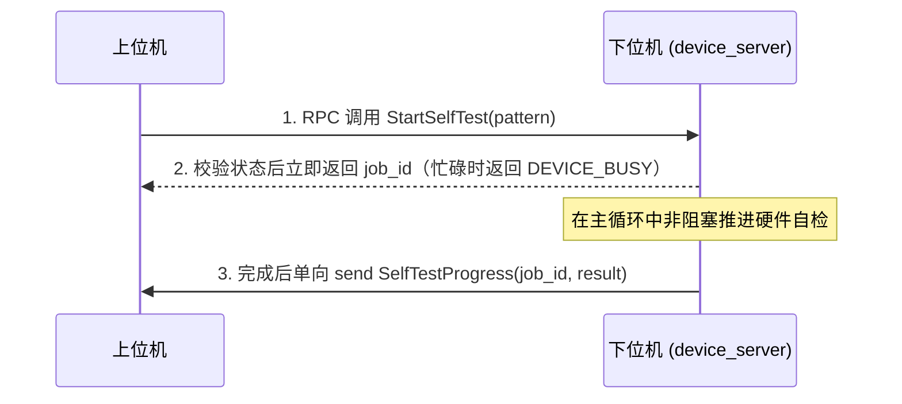

import { Aside, Tabs, TabItem } from '@astrojs/starlight/components';
import LessonHeader from '../../../../components/tutorial/LessonHeader.astro';
import Challenge from '../../../../components/tutorial/Challenge.astro';
import Checklist from '../../../../components/tutorial/Checklist.astro';
import MultipleChoice from '../../../../components/tutorial/MultipleChoice.astro';

<LessonHeader
  unit={4}
  duration="8 分钟"
  examplePath="examples/03_device_service"
  goals={[
    '了解节点的编译期固定槽位上限，编写多路并发 RPC 调用',
    '掌握在同一个节点上组合“短 RPC 启动任务 + 单向消息上报结果”的长任务模式',
    '针对 WL_ERR_WOULD_BLOCK 区分关键事件（重试）与高频采样（跳过），并掌握 _ex 显式超时与主动取消',
  ]}
/>

由于 Wirelink 不使用动态内存分配，节点的收发缓冲区在编译期即已固定大小；同时，所有业务回调都串行运行在单线程 `wl_node_step` 中。这两项特性决定了真实设备上必须掌握的三个实践模式：并发与流控、非阻塞长任务、显式超时与取消。

---

## 第一步：多路并发 RPC 与固定容量上限

每个声明了 `call` 角色的节点在编译期分配 **4 个并发出站 RPC 槽位**（另按需分配 3 个待发回复槽与 1 个单向消息缓冲槽，未声明的角色占 0 字节）。

因此，客户端无需等待前一次调用返回，即可连续提交最多 4 路并发 RPC（摘自 [`examples/01_rpc/client_async.c`](https://github.com/starwey604/wirelink/blob/main/examples/01_rpc/client_async.c)）：

{/* [docs:calculator_async_rpc] */}
```c
wl_err_t calculator_async_example(client_node_t *client) {
  /* Four accepted calls coexist; request values are copied during admission. */
  for (int32_t i = 0; i < 4; ++i) {
    const wl_err_t error = client_call_add(client, &(add_request_t){
        .left = i, .right = 42 - i}, done);
    if (error != WL_OK) return error;
  }
  return WL_OK;
}
```
{/* [/docs:calculator_async_rpc] */}

当 4 个请求槽均在途时，第 5 次提交会立即返回 **`WL_ERR_WOULD_BLOCK`**，且**不会**触发 `done` 回调。在单线程主循环中，**切勿在原地写死循环等待**——必须让主循环继续运行 `wl_node_step`，已发出的请求完成后槽位才会释放。

---

## 第二步：组合模式——用短 RPC 启动耗时任务，用单向消息推送结果

实际硬件中经常存在耗时数百毫秒的操作，例如硬件自检或电机回零。由于 `on_<rpc>` 回调运行在 `wl_node_step` 内部，**绝不能在 RPC 回调里阻塞等待硬件完成**——否则主循环会被卡住，期间既无法响应急停等其他命令，又容易导致调用方超时。

标准解法是在同一个设备节点上同时声明 `serve`（RPC）和 `send`（单向消息），把耗时操作拆成两步（摘自 [`examples/03_device_service/self_test.c`](https://github.com/starwey604/wirelink/blob/main/examples/03_device_service/self_test.c)）：



<Tabs>
  <TabItem label="1. 短 RPC 登记任务并立即返回">
    收到 `StartSelfTest` 请求时，先检查设备是否忙碌；若忙碌返回业务拒绝码 `DEVICE_BUSY`，否则登记任务参数与预期完成时间，填回 `job_id` 立即返回 `0`：

    {/* [docs:device_job_start] */}
    ```c
    int32_t device_server_on_start_self_test(device_server_node_t *self, const start_self_test_request_t *request,
                         start_self_test_response_t *response) {
      device_service_t *state = self->node.user;
      if (state->job_pending || state->next_job == UINT32_MAX) return DEVICE_BUSY;
      state->job_id = ++state->next_job;
      state->pattern = request->pattern;
      state->due = state->now + 20U;
      state->job_pending = true;
      response->job_id = state->job_id;
      return 0;
    }
    ```
    {/* [/docs:device_job_start] */}
  </TabItem>

  <TabItem label="2. 主循环轮询并单向推送结果">
    主循环每次调用 `self_test_poll`，待硬件任务到达完成条件后发送单向进度消息 `SelfTestProgress`。如果此刻单向消息槽暂满（`WL_ERR_WOULD_BLOCK`），保留 `job_pending = true`，待下一轮主循环 `wl_node_step` 写出旧消息后再补发：

    {/* [docs:device_job_poll] */}
    ```c
    wl_err_t self_test_poll(device_service_t *state, device_server_node_t *endpoint) {
      if (!state->job_pending || (int32_t)(state->now - state->due) < 0) return WL_OK;
      self_test_progress_t progress = {.job_id = state->job_id,
        .observed = state->pattern ^ UINT32_C(0xa5a5)};
      const wl_err_t error = device_server_send_self_test_progress(endpoint, &progress);
      if (error == WL_ERR_WOULD_BLOCK) return WL_OK;
      if (error != WL_OK) return error;
      state->job_pending = false;
      return WL_OK;
    }
    ```
    {/* [/docs:device_job_poll] */}
  </TabItem>
</Tabs>

### 如何处理 `WL_ERR_WOULD_BLOCK`（两种策略）

单向消息（`send`）拥有 1 个发送缓冲槽；如果上一条消息尚未经 `wl_node_step` 写出，紧接着再发会返回 `WL_ERR_WOULD_BLOCK`。处理策略取决于数据语义：

| 数据语义 | 遇到 `WL_ERR_WOULD_BLOCK` 时的推荐做法 | 典型例子 |
| :--- | :--- | :--- |
| **关键事件 / 任务完成通知** | **保留待发标志，下轮主循环重试**（如上方 `self_test_poll` 保留 `job_pending = true`） | 自检结果、故障告警、状态机切换通知 |
| **高频周期传感器采样** | **跳过本轮，下个采样周期发最新读数**（将 `WL_ERR_WOULD_BLOCK` 视为正常背压忽略） | 50Hz 电机电流、IMU 姿态、温度采样 |

---

## 第三步：独立超时与主动取消（`_ex` 接口）

简化版 `client_call_add(&client, &req, done)` 适合常规调用；如果某次调用需要指定**独立超时时间**、传入独立 `void *user` 上下文，或获取取消句柄 `wl_call_handle_t`，可以使用编译器同步生成的 **`_ex`** 版本：

```c
wl_call_handle_t handle;
wl_err_t err = client_call_add_ex(
    &client, &request, now_ms, /*timeout_ms=*/2000, done_ex, user_ctx, &handle);
```

### 简化调用与 `_ex` 的超时起算差异

| 调用方式 | 超时时间 | 超时起算时刻 |
| :--- | :--- | :--- |
| `<node>_call_<rpc>(self, &req, cb)` | 节点默认 `timeout_ms`（默认 500ms） | **下一次调用 `wl_node_step(&self->node, now)`** 时开始计时 |
| `<node>_call_<rpc>_ex(self, &req, now, timeout, cb, user, &handle)` | 参数 `timeout`（传 `0` 回退默认） | 从传入的 **`now`** 时刻立即开始计时 |

### 主动取消与防重入规则

当业务状态切换、不再需要某个在途请求的结果时，调用 `wl_node_cancel(&client->node, handle)`（摘自 [`examples/01_rpc/client_async.c`](https://github.com/starwey604/wirelink/blob/main/examples/01_rpc/client_async.c)）：

{/* [docs:calculator_cancel_timeout] */}
```c
wl_err_t calculator_cancel_example(client_node_t *client, wl_call_handle_t handle) {
  return wl_node_cancel(&client->node, handle);
}
```
{/* [/docs:calculator_cancel_timeout] */}

使用取消接口时需注意两点：
1. **绝不重入回调**：`wl_node_cancel` 只在内部标记取消，**不会**在返回前同步调用你的完成回调；`WL_RPC_CANCELLED` 通知统一推迟到下一次 `wl_node_step` 中顺序派发。
2. **不撤回远端副作用**：如果请求帧已经发到对端，本地取消只会放弃本地等待结果，无法撤回服务端已经执行的操作。

---

## 第四步：运行生命周期确定性测试

[`tests/core/node_lifecycle.c`](https://github.com/starwey604/wirelink/blob/main/tests/core/node_lifecycle.c) 使用可控的虚拟时钟完整验证了“4 路并发、第 5 路返回 `WL_ERR_WOULD_BLOCK`、主动取消、3 路超时与恢复”全流程。配置好 `wlc` 后可直接运行该核心测试：

```sh
cmake --build build/examples --target wirelink_rpc_lifecycle
ctest --test-dir build/examples -R '^wirelink_rpc_lifecycle$' --output-on-failure
```

<Challenge
  title="检查理解：为什么 wl_node_cancel 不当场执行完成回调？"
  prompt="当你在业务代码或另一个回调里调用 wl_node_cancel(&client.node, handle) 时，为什么 Wirelink 把 WL_RPC_CANCELLED 回调推迟到下一次 wl_node_step，而不是在 cancel 内部直接调用？"
>
  为了防止函数重入导致状态错乱。如果调用方正在更新本地状态结构时调用 `wl_node_cancel`，立即同步触发回调可能会在状态更新到一半时再次读写同一份数据。推迟到下一次 `wl_node_step` 统一派发，能保证所有业务回调始终以清晰、线性的顺序执行。
</Challenge>

---

## 小测验

<MultipleChoice
  id="lesson-04-backpressure"
  question="在单线程主循环中，连续发起第 5 路并发 RPC 时返回了 WL_ERR_WOULD_BLOCK，应该如何处理？"
  checkLabel="检查答案"
  emptyFeedback="请先选择一个选项。"
  choices={[
  {
    "label": "记录该操作待重试或延后提交，继续推进主循环中的 wl_node_step，等前面在途请求完成释放槽位后再发。",
    "correct": true,
    "feedback": "正确。只有继续推进 wl_node_step，已发出的请求才能收到响应并释放并发槽位。"
  },
  {
    "label": "写一个 while (client_call_add(...) == WL_ERR_WOULD_BLOCK) {} 循环直到返回 WL_OK。",
    "correct": false,
    "feedback": "在单线程模型中，原地死循环会阻止 wl_node_step 运行，导致在途请求永远无法完成，程序死锁。"
  },
  {
    "label": "忽略返回值，节点内部会自动开后台线程排队并稍后触发 done 回调。",
    "correct": false,
    "feedback": "返回 WL_ERR_WOULD_BLOCK 表示请求未被受理，节点不会保存数据，也不会触发任何回调。"
  }
]}
/>

<Checklist
  id="checklist-04"
  title="本课检查清单"
  progressTemplate="已完成 {done} / {total} 项"
  items={[
    "清楚单节点固定 4 路并发 RPC 与 1 个单向消息槽的容量边界。",
    "掌握“短 RPC 返回任务号 + 单向消息推送结果”的组合模式，避免阻塞主循环。",
    "能够区分关键事件（保留标志重试）与周期采样（跳过旧值）两种 WL_ERR_WOULD_BLOCK 应对方式，并掌握 _ex 与 wl_node_cancel 的非重入规则。"
  ]}
/>

至此，你已经掌握了 Wirelink 在 C 语言端的核心编程模型。最后一课将把这些能力接到真实物理链路与上位机工具链上：如何在 `.wl` 中一行启用 UART 串口分帧、如何编写同时处理 RPC 与遥测的 UDP 服务，以及如何生成 Python 与 C++20 上位机客户端 SDK。

下一课：[05 接入串口、UDP 混合节点与上位机 SDK →](/wirelink/zh-cn/learn/05-transports-and-host-sdk/)
