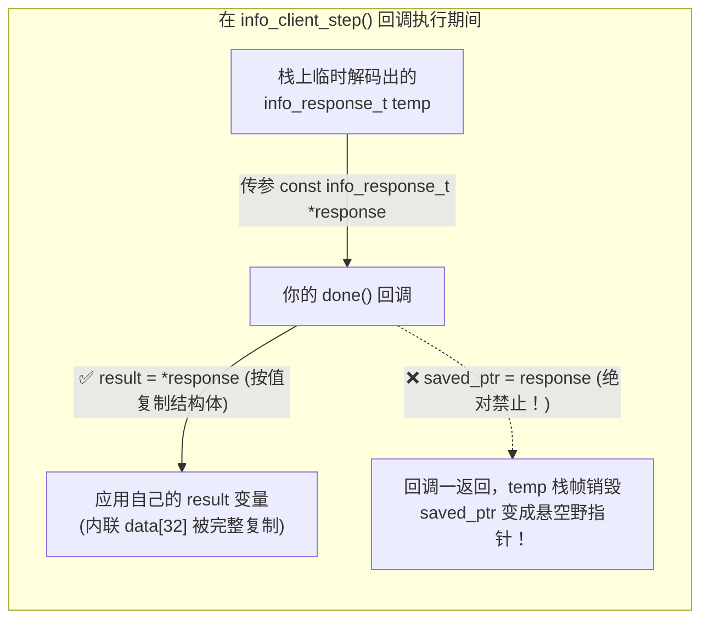

import { Aside, Steps, Tabs, TabItem } from '@astrojs/starlight/components';
import LessonHeader from '../../../../components/tutorial/LessonHeader.astro';
import Challenge from '../../../../components/tutorial/Challenge.astro';
import Checklist from '../../../../components/tutorial/Checklist.astro';
import MultipleChoice from '../../../../components/tutorial/MultipleChoice.astro';

<LessonHeader
  unit={4}
  duration="7 分钟"
  examplePath="examples/02_device_info"
  goals={[
    '在 .wl 中用 string<N> 和 bytes<N> 定义有界内联字段，实现零堆分配存变长数据',
    '使用生成的安全 setter 函数填充字符串，并知道如何正确处理内含 \\0 的二进制/UTF-8 数据',
    '掌握接收回调中 const response_t * 指针的生命周期：按值复制结构体，绝不保存临时指针',
  ]}
/>

在 C 语言里处理变长字符串（比如设备名称、固件版本号）和原始字节块（如 ADC 采样帧），最容易踩两个坑：**要么动用 `malloc/free` 导致内存碎片和泄漏，要么在回调结束后不小心保存了一个已经失效的缓冲区指针（悬空指针）**。

Wirelink 用非常优雅的**有界内联存储（Bounded Inline Storage）**彻底解决了这个问题。本课我们跟随 [`examples/02_device_info/`](https://github.com/starwey604/wirelink/tree/main/examples/02_device_info)，看看它是怎么做的。

---

## 第一步：看懂 `string<N>` 与 `bytes<N>` 的内存布局

当我们定义节点路由消息时，所有变长字段都必须用 `<N>` 指定最大字节容量（这样编译器才能在编译期算出整帧的最大字节数，分配静态缓冲区）。

来看看 [`examples/02_device_info/device_info.wl`](https://github.com/starwey604/wirelink/blob/main/examples/02_device_info/device_info.wl) 以及它生成的 C 结构体：

<Tabs>
  <TabItem label="1. 协议定义 (device_info.wl)">
    {/* [docs:device_info_schema] */}
    ```wl
    version 1;

    message InfoRequest @id(30) {}

    message InfoResponse @id(31) {
      string<31> name @id(1);
      string<15> firmware @id(2);
      uint32 query_count @id(3);
    }

    rpc GetInfo(InfoRequest) -> InfoResponse;
    node info_client { call GetInfo; }
    node info_server { serve GetInfo; }
    ```
    {/* [/docs:device_info_schema] */}
  </TabItem>

  <TabItem label="2. 生成的 C11 结构体透视 (device_info.h)">
    `wlc` 直接把字符数组**内联（Inline）**嵌进了 `info_response_t` 结构体内部，没有任何外部堆指针：

    ```c
    typedef struct info_response_s {
      struct {
        size_t length;
        char data[32]; /* string<31> 自动分配 N + 1 = 32 字节，末尾始终补 '\0' */
      } name;
      struct {
        size_t length;
        char data[16]; /* string<15> 自动分配 N + 1 = 16 字节 */
      } firmware;
      uint32_t query_count;
    } info_response_t;

    /* 自动生成的安全 setter：检查容量、复制内容并自动补 '\0'，超长返回 false */
    bool info_response_set_name(info_response_t *self, const char *value);
    bool info_response_set_firmware(info_response_t *self, const char *value);
    ```
  </TabItem>
</Tabs>

### 有界内联 vs 无界借用视图一览表

| Schema 类型 | 生成的 C 存储结构 | 适用范围 | 怎么跨回调保存数据？ |
| :--- | :--- | :--- | :--- |
| **`string<N>`** | `size_t length;` + `char data[N + 1];` | **所有节点路由消息（推荐）** | 直接**按值赋值整个结构体**（`saved = *msg;`），数组内容自动跟着完整拷贝！ |
| **`bytes<N>`** | `size_t length;` + `uint8_t data[N];` | **所有节点路由消息（推荐）** | 同上，结构体按值赋值即可完整拷贝全部字节 |
| 无界 `string` / `bytes` | `wl_codec_string_t` / `wl_codec_bytes_t`（仅含 `{data*, length}` 指针视图） | 仅用于不含 `node` 的**独立纯编解码器（Codec-only）** | 指针借用自底层解码输入缓冲，必须在缓冲释放前手动 `memcpy` 出来 |

<Aside type="tip" title="安全细节：用 setter 还是手动 memcpy？">
- 如果你的字符串是普通 C 字符串（以 `\0` 结尾），直接调生成的 `info_response_set_firmware(&resp, "0.14.0")` 最省心：它会先检查长度是否 $\le 15$，超长会返回 `false` 且不破坏原字段。
- 如果你的 UTF-8 字符串**中间故意包含零字节 `\0`**（就像本课示例里的 `"workbench\0x"`，共 11 字节），Wirelink 在线缆上是**严格按 `length` 传输全部 11 个字节**的（且解码后仍会在 `data[length]` 处补一个额外的终止符 `'\0'`）。但注意：读取这种含 `\0` 的字符串时，要按 `resp.name.length` 用 `memcmp` 或 `fwrite`，不要直接丢给遇到第一个 `\0` 就停的 `printf("%s")`！
</Aside>

---

## 第二步：服务端填充响应，客户端在回调中按值保存

让我们看看 [`examples/02_device_info/`](https://github.com/starwey604/wirelink/tree/main/examples/02_device_info) 的服务端和客户端是怎么配合的：

<Tabs>
  <TabItem label="1. 服务端填充字符串 (server.c)">
    在 [`examples/02_device_info/server.c`](https://github.com/starwey604/wirelink/blob/main/examples/02_device_info/server.c) 中，服务端甚至可以通过 `self->user` 挂载自己的业务计数状态：

    {/* [docs:device_info_server] */}
    ```c
    int32_t info_server_on_get_info(info_server_node_t *self, const info_request_t *request, info_response_t *response) {
      (void)request;
      unsigned *queries = self->user;
      response->name.length = 11; memcpy(response->name.data, "workbench\0x", 11);
      response->firmware.length = 6; memcpy(response->firmware.data, "0.14.0", 6);
      response->query_count = ++*queries;
      return 0;
    }
    ```
    {/* [/docs:device_info_server] */}
  </TabItem>

  <TabItem label="2. 客户端回调按值拷贝 (client.c)">
    在 [`examples/02_device_info/client.c`](https://github.com/starwey604/wirelink/blob/main/examples/02_device_info/client.c) 中，看 `done` 回调函数是如何把响应保留下来的：

    {/* [docs:device_info_done] */}
    ```c
    static void done(info_client_node_t *self, wl_kernel_result_t outcome, const info_response_t *response) {
      (void)self;
      EXAMPLE_REQUIRE(outcome.outcome == WL_KERNEL_SUCCESS && response);
      result = *response;
      ++completed;
    }
    ```
    {/* [/docs:device_info_done] */}

    **重点看第 5 行：`result = *response;`**！
    因为 `info_response_t` 里的 `name.data[32]` 和 `firmware.data[16]` 都是内联数组，这一句简单的 C 语言结构体赋值，就把两个字符串和 `query_count` 完完整整地深拷贝到了全局变量 `result` 里！
  </TabItem>
</Tabs>

---

## 第三步：验证节点关闭后，拷贝出来的数据依然完好

在 `client.c` 的主循环里，我们连续发起 8 次查询，然后**关闭两个节点（`close` → `quiescent`）**，最后再来读取刚才保存在 `result` 里的字符串：

{/* [docs:device_info_client] */}
```c
for (unsigned call = 0; call < 8; ++call) {
  EXAMPLE_REQUIRE(info_client_call_get_info(&caller, &(info_request_t){0}, done) == WL_OK);
  EXAMPLE_REQUIRE(info_client_step(&caller, call) == WL_OK);
  EXAMPLE_REQUIRE(info_server_step(&callee, call) == WL_OK);
  EXAMPLE_REQUIRE(info_client_step(&caller, call) == WL_OK);
  EXAMPLE_REQUIRE(completed == call + 1 && result.query_count == call + 1);
}
EXAMPLE_REQUIRE(info_client_close(&caller) == WL_OK && info_server_close(&callee) == WL_OK);
EXAMPLE_REQUIRE(info_client_quiescent(&caller) && info_server_quiescent(&callee));
EXAMPLE_REQUIRE(result.name.length == 11 && memcmp(result.name.data, "workbench\0x", 11) == 0);
```
{/* [/docs:device_info_client] */}



<Challenge
  title="生命周期快问快答"
  prompt="在发送端调用 send 或 call 时，传入的请求结构体指针什么时候可以销毁？而在接收端收到 on_<msg> 或 done 回调时，传入的响应结构体指针什么时候会失效？"
>
  这两个方向刚好对称，记住两句话就够了：
  1. **出站（`send_xxx` / `call_xxx`）**：只要函数返回了 `WL_OK`，你的请求结构体**已经编码成二进制快照进了节点内部**，原结构体在下一行代码就可以立刻修改或销毁（如果返回了 `WL_ERR_WOULD_BLOCK`，则说明节点没收下，你得自己留着数据下次重试）。
  2. **入站回调（`on_xxx` / `done`）**：回调参数里的 `const <msg>_t *` 指向的是 `step()` 栈帧上的临时解码对象，**只在本次回调函数返回前有效**。想在回调外继续用，只需在回调里写一句 `my_copy = *response;` 按值复制即可。
</Challenge>

---

## 本课小测验

<MultipleChoice
  id="lesson-04-copy"
  question="如果你想在 RPC 完成回调 done() 返回之后，继续保留并读取仅含有界字段的 info_response_t 数据，应该怎么做？"
  checkLabel="检查答案"
  emptyFeedback="请先选择一个选项。"
  choices={[
  {
    "label": "在回调内部直接按值赋值整个结构体（例如 saved_result = *response;）。",
    "correct": true,
    "feedback": "完全正确！因为有界 string<N> 和 bytes<N> 都是结构体内的定长数组，按值赋值结构体就会把所有字符串内容一并复制过来，而回调指针本身在回调返回后就失效了。"
  },
  {
    "label": "只把 const info_response_t *response 指针保存到一个全局指针变量里，等节点关闭后再通过指针读取。",
    "correct": false,
    "feedback": "危险！response 指向的是 step() 内部栈上的临时解码对象，回调函数一旦返回，该指针立刻变成悬空野指针。"
  },
  {
    "label": "用完之后必须调用 free(response->name.data) 释放字符串内存。",
    "correct": false,
    "feedback": "不对。Wirelink 核心是零堆分配的，data 是结构体内部的内联数组（char data[N+1]），绝不是 malloc 出来的内存。"
  }
]}
/>

<Checklist
  id="checklist-04"
  title="本课掌握清单"
  progressTemplate="已完成 {done} / {total} 项"
  items={[
    "理解有界 string<N> / bytes<N> 在 C 结构体中是内联定长数组，无需动态内存分配。",
    "知道线缆按 length 传输完整内容，含零字节的数据需按 length 处理而非依赖 printf(\"%s\")。",
    "牢记回调中的消息指针只在回调期间有效，跨回调保留数据只需按值复制结构体（result = *response）。"
  ]}
/>

现在你已经掌握了单次收发和内存生命周期。但在真实工业设备里，如果上位机一口气并发塞过来 5 个请求，或者 MCU 要做一次耗时 2 秒的 Flash 自检（绝对不能在 `on_rpc` 里死等 2 秒阻塞主循环！），该怎么架构？

下一课：[05 并发调用、背压与长任务 →](/wirelink/zh-cn/learn/05-concurrency-backpressure/)
