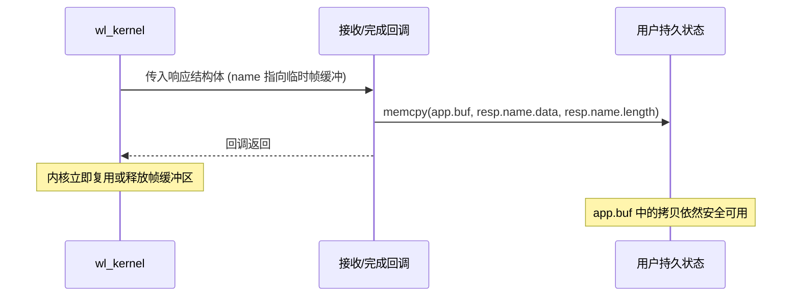

import Checklist from '../../../../components/tutorial/Checklist.astro';
import MultipleChoice from '../../../../components/tutorial/MultipleChoice.astro';

嵌入式通信经常需要传输设备名称、固件版本或原始字节数组。Wirelink 的 `src/` 核心完全不使用 `malloc`、`free` 或 `strdup`，因此变长字段必须严格遵守静态容量上限与所有权边界。

## 为什么不用 `char *` 或堆分配

在 C11 核与端到端通信中，动态堆分配会引入内存碎片与不可预测延迟。Wirelink 在 `.wl` schema 中用 `string<N>` 与 `bytes<N>` 声明静态上限。

`wlc` 生成的字段结构直接把长度和只读视图绑在一起。接收端在解包时只是把切片指针指向内部临时缓冲或线上传输帧，**不会自动帮你拷贝到永久堆内存**。

| `.wl` 类型 | 线上传输格式 | 生成 C 字段类型 | 解码内容存放位置 |
| :--- | :--- | :--- | :--- |
| `string<N>` | UTF-8 长度前缀 + 字节 | `wl_string_view_t`（`data`、`length`） | 指向接收解码缓冲区 |
| `bytes<N>` | 原始长度前缀 + 字节 | `wl_bytes_view_t`（`data`、`length`） | 指向接收解码缓冲区 |

注意 `wl_string_view_t` 与 `wl_bytes_view_t` 都不以 `\0` 结尾，甚至 `bytes<N>` 内部可以合法包含 `\0` 字节。读取数据时必须始终以 `length` 为准，使用 `memcpy` 或带长度参数的函数。

## 生命周期核心原则：回调返回即失效

接收端消息回调（`on_<msg>`）或异步 RPC 完成回调（`done`）收到指针时，指针指向的数据仅在**本次回调函数执行期间**有效。

一旦回调函数 `return`，内核会立即回收当前帧槽位并覆盖缓冲区。如果想在主循环或另一个线程中继续使用设备名称或字节负载，必须在回调结束前主动把数据拷贝到调用方持有的结构体里。



下面的示例来自 [examples/02_device_info/client.c](https://github.com/starwey604/wirelink/blob/main/examples/02_device_info/client.c)。可以看到即使连续发起查询并关闭端点，提前深拷贝出来的数据在端点关闭后依然安全有效，而且连中间嵌入的 `\0` 也完整保留。

{/* [docs:device_info_client] */}
```c
for (unsigned call = 0; call < 8; ++call) {
  info_request_t request = {0}; wl_kernel_call_handle_t handle;
  EXAMPLE_REQUIRE(device_info_kernel_get_info_start(&endpoints[0], &request, pair.now, 500,
    info_completed, NULL, &handle) == WL_OK);
  example_pair_wait(&pair, &info_count, call + 1);
  EXAMPLE_REQUIRE(info_result.outcome == WL_KERNEL_SUCCESS && info_value.query_count == call + 1);
}
example_pair_close(&pair);
EXAMPLE_REQUIRE(info_value.name.length == 11 && memcmp(info_value.name.data, "workbench\0x", 11) == 0);
```

## 发送端同样有借用期限

与接收端相对，发送消息或发起 RPC 时，内核在 `send` 或 `start` 返回之前就已经把消息序列化写入内部发送队列。因此调用 `send` 或 `start` 返回后，你可以立刻销毁、清空或覆盖局部请求结构体，不会破坏正在排队传输的字节流。

<MultipleChoice
  id="q-lesson-04-lifetime"
  question="在 RPC 完成回调之外（例如主循环后续步骤中）想要保留响应中的 string<64> 字段，下列哪项做法是正确的？"
  checkLabel="检查答案"
  emptyFeedback="请先选择一个选项。"
  choices={[
    {
      label: "直接保存 resp->name.data 指针并在主循环里用 printf(\"%s\") 打印",
      correct: false,
      feedback: "不对。回调返回后内核就会回收缓冲区，且 wl_string_view_t 不保证以 \\0 结尾，两种假设都会导致未定义行为。"
    },
    {
      label: "在回调函数内按 resp->name.length 将字节 memcpy 到调用方自带的静态缓冲区，并自己记录长度",
      correct: true,
      feedback: "完全正确。视图只在回调作用域内有效，脱离作用域前必须按 length 完成深拷贝。"
    },
    {
      label: "调用 free(resp->name.data) 接管其内存所有权",
      correct: false,
      feedback: "不对。Wirelink 核心从不调用 malloc，也绝不能对视图指针调用 free。"
    }
  ]}
/>

<Checklist
  id="checklist-lesson-04"
  title="本课检查清单"
  progressTemplate="已完成 {done} / {total} 项"
  items={[
    "理解为何 Wirelink 核心禁用堆分配并用 string<N> / bytes<N> 限定上界",
    "分清发送参数（函数返回即可销毁）与接收视图（仅回调内有效）的生命周期",
    "习惯按照 length 使用 memcpy，不假设字符串自带 \\0 终止符"
  ]}
/>
