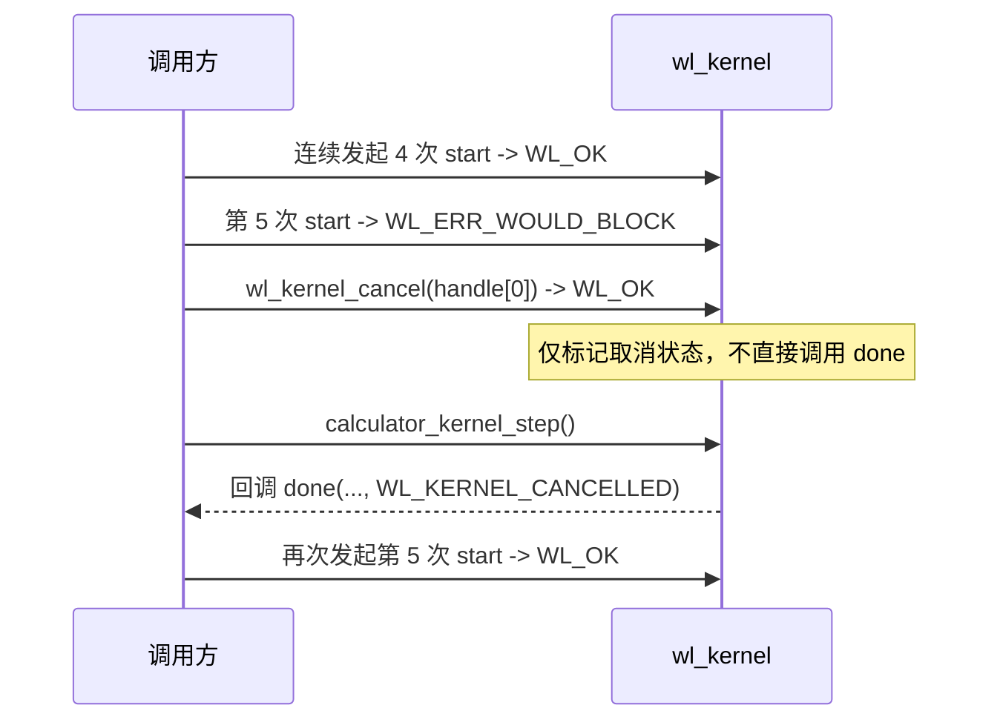

import Checklist from '../../../../components/tutorial/Checklist.astro';
import MultipleChoice from '../../../../components/tutorial/MultipleChoice.astro';

真实系统里传输链路不可能永远瞬间畅通，耗时操作也不能一直阻塞 RPC 句柄。Wirelink 通过固定大小的并发槽位与显式状态返回来控制内存占用，同时把「发送队列满」暴露给上层业务做弹性背压。

## 固定并发槽位与 `WL_ERR_WOULD_BLOCK`

每个 `wl_kernel_t` 在单端点上默认内置 **4 个并发出站 RPC 槽位**（对应内部挂起队列）。当你连续发起第 1 到第 4 个请求时，哪怕底层传输还没有步进消费，内核也会直接接受并返回 `WL_OK`。

一旦调用方准备发起第 5 个在途调用且前 4 个槽位尚未结束，内核不会盲目扩容或阻塞等待，而是立即返回 `WL_ERR_WOULD_BLOCK`。这是设计层面的背压信号，提示上层稍后重试或先推进 `step`。

下面这段异步调用循环来自 [examples/01_rpc/client_async.c](https://github.com/starwey604/wirelink/blob/main/examples/01_rpc/client_async.c)。在连续发出 4 个请求的同时，函数里立即用 `memset` 清空了栈上的局部请求变量，证明请求字节早已序列化进内核队列。

{/* [docs:calculator_async_rpc] */}
```c
void calculator_async_example(calculator_kernel_t *client, calculator_kernel_t *server) {
  /* Four accepted calls coexist; no terminal slot needs inspect/release. */
  (void)server;
  for (int32_t i = 0; i < 4; ++i) {
    add_request_t request = {.has_left = true, .left = i, .has_right = true, .right = 42 - i};
    wl_kernel_call_handle_t handle;
    EXAMPLE_REQUIRE(calculator_kernel_add_start(client, &request, 0, 500, done, NULL, &handle) == WL_OK);
    memset(&request, 0, sizeof(request));
  }
}
```

## 取消与超时的调度语义

当你调用 `wl_kernel_cancel` 或请求到达预设超时时间时，内核**不会在 `cancel` 函数内部直接重入调用你的 `done` 回调**。这样做是为了避免在锁内或深度调用栈中引发重入灾难。

相反，内核只把该槽位标记为取消/超时待通知状态，等待下一次 `wl_kernel_step` 调度时，统一向你的完成回调派发 `WL_KERNEL_CANCELLED` 或 `WL_KERNEL_TIMED_OUT`。



这段生命周期验证来自 [examples/01_rpc/lifecycle.c](https://github.com/starwey604/wirelink/blob/main/examples/01_rpc/lifecycle.c)。注意其中第 5 次调用触发背压后，`wl_kernel_cancel` 返回前 `completed` 计数依然保持为 0。

{/* [docs:calculator_cancel_timeout] */}
```c
for (unsigned i = 0; i < 4; ++i)
  EXAMPLE_REQUIRE(calculator_kernel_add_start(&endpoints[0], &request, 0, 2,
    done, &completions[i], &handles[i]) == WL_OK);
EXAMPLE_REQUIRE(calculator_kernel_add_start(&endpoints[0], &request, 0, 2,
  done, &completions[4], &rejected) == WL_ERR_WOULD_BLOCK);
EXAMPLE_REQUIRE(completed == 0);

/* Hold the transport: one request is leased, the other three stay queued. */
EXAMPLE_REQUIRE(calculator_kernel_step(&endpoints[0], 0) == WL_OK);
EXAMPLE_REQUIRE(wl_kernel_cancel(&endpoints[0].core, handles[0]) == WL_OK);
EXAMPLE_REQUIRE(completed == 0); /* cancel schedules, not invokes, completion. */
```

## 为什么长耗时任务推荐「Ack + 单向通知」

如果固件要执行长达数秒的自检或 Flash 擦除，直接用单个长超时 RPC 卡住调用槽位并不划算。网络抖动会导致超时误判，而且槽位被长期占用会阻塞其他管理请求。

更稳妥的设计是采用 **幂等启动 RPC + 异步进度/结果单向消息**。客户端用带 `job_id` 的 RPC 触发任务并立刻拿回 ACK；服务端在后台推进任务状态，并通过单向流推送进度。即使发送进度帧时碰到 `WL_ERR_WOULD_BLOCK`，服务端也可以保留 `job_pending` 标志，等下一拍有发送空间时再重发，实现零丢失的退避重传。

以下自检轮询逻辑来自 [examples/03_device_service/self_test.c](https://github.com/starwey604/wirelink/blob/main/examples/03_device_service/self_test.c)。

{/* [docs:device_job_poll] */}
```c
void self_test_poll(device_service_t *state, device_kernel_t *endpoint) {
  if (!state->job_pending || (int32_t)(state->now - state->due) < 0) return;
  self_test_progress_t progress = {.has_job_id = true, .job_id = state->job_id,
    .has_observed = true, .observed = state->pattern ^ UINT32_C(0xa5a5)};
  const wl_err_t error = device_kernel_send_self_test_progress(endpoint, &progress);
  if (error == WL_ERR_WOULD_BLOCK) return;
  EXAMPLE_REQUIRE(error == WL_OK);
  state->job_pending = false;
}
```

<MultipleChoice
  id="q-lesson-05-cancel"
  question="在单线程主循环中，调用 wl_kernel_cancel(&core, handle) 返回 WL_OK 后，什么时候才会触发对应的完成回调？"
  checkLabel="检查答案"
  emptyFeedback="请先选择一个选项。"
  choices={[
    {
      label: "在 wl_kernel_cancel 返回前于其内部栈帧立即执行",
      correct: false,
      feedback: "不对。如果在 cancel 内重入回调，很容易打乱调用方持有的状态或引起锁重入死锁。"
    },
    {
      label: "等到下一次调用 wl_kernel_step 或生成的端点 step 函数时统一派发",
      correct: true,
      feedback: "完全正确。cancel 只记录状态，所有完成回调都只在 step 推进周期内派发。"
    },
    {
      label: "直接静默丢弃请求，永远不会调用回调",
      correct: false,
      feedback: "不对。每个返回 WL_OK 的 start 调用都会严格对应一次终态回调。"
    }
  ]}
/>

<MultipleChoice
  id="q-lesson-05-backpressure"
  question="在发送单向进度通知时收到 WL_ERR_WOULD_BLOCK，服务端最恰当的处理方式是？"
  checkLabel="检查答案"
  emptyFeedback="请先选择一个选项。"
  choices={[
    {
      label: "当成致命传输错误并立即关闭端点",
      correct: false,
      feedback: "不对。WL_ERR_WOULD_BLOCK 只是出站队列或端口暂满的背压信号，并不是硬件故障。"
    },
    {
      label: "先不清除 pending 状态标志，等下一轮驱动 step 消费完发送缓冲后再重试发送",
      correct: true,
      feedback: "完全正确。保留业务 pending 标志可以实现无分配、无丢包的弹性背压。"
    }
  ]}
/>

<Checklist
  id="checklist-lesson-05"
  title="本课检查清单"
  progressTemplate="已完成 {done} / {total} 项"
  items={[
    "理解单端点 4 并发槽位与 WL_ERR_WOULD_BLOCK 背压契约",
    "掌握 cancel 延迟到 step 阶段回调以防重入的机制",
    "学会用「短启动 RPC + 单向结果推送 + WOULD_BLOCK 重试」拆分长耗时作业"
  ]}
/>
