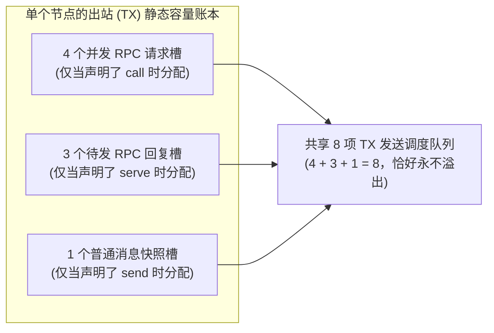

import { Aside, Steps, Tabs, TabItem } from '@astrojs/starlight/components';
import LessonHeader from '../../../../components/tutorial/LessonHeader.astro';
import Challenge from '../../../../components/tutorial/Challenge.astro';
import Checklist from '../../../../components/tutorial/Checklist.astro';
import MultipleChoice from '../../../../components/tutorial/MultipleChoice.astro';

<LessonHeader
  unit={5}
  duration="8 分钟"
  examplePath="examples/03_device_service"
  goals={[
    '摸清节点的静态容量账本：4 个并发调用槽、3 个待发回复槽、1 个普通消息槽',
    '掌握遇到 WL_ERR_WOULD_BLOCK 背压时的两种工程策略：高频周期采样“跳过旧值” vs 关键状态事件“保留 pending 重试”',
    '分清简化调用与 _ex 显式调用的超时起算时机，并理解 cancel() 的防重入延迟派发机制',
  ]}
/>

在零动态分配（0 `malloc`）的嵌入式系统中，节点不可能在发送变慢时无限申请堆内存来排队。因此，**“固定槽位上限 + 显式背压（`WL_ERR_WOULD_BLOCK`）”** 是保证 MCU 永远不会内存溢出的核心防线。

这一课我们就来摸清节点的容量边界、两种背压处理套路，以及并发 RPC 的超时与取消。

---

## 第一步：看清节点的静态容量账本

每个生成的 Wirelink 节点，都会根据它在 `.wl` 里声明的角色（`call` / `serve` / `send` / `recv`）在编译期分配固定数量的静态槽位（没声明的角色分配 **0 字节**）：



### 4 路并发 RPC 调用与第 5 次背压

因为客户端拥有 **4 个并发出站 RPC 请求槽**，你不需要等上一个请求返回，就可以连续发起最多 4 个在途调用（源自 [`examples/01_rpc/client_async.c`](https://github.com/starwey604/wirelink/blob/main/examples/01_rpc/client_async.c)）：

{/* [docs:calculator_async_rpc] */}
```c
wl_err_t calculator_async_example(client_node_t *client) {
  /* Four accepted calls coexist; request values are copied during admission. */
  for (int32_t i = 0; i < 4; ++i) {
    const wl_err_t error = client_call_add(client, &(add_request_t){
        .left = i, .right = 42 - i}, done);
    if (error != WL_OK) return error;
  }
  return WL_OK;
}
```
{/* [/docs:calculator_async_rpc] */}

**如果这 4 个请求都还没收到响应，你立刻发起第 5 个请求会发生什么？**
1. 第 5 次调用会立即返回 **`WL_ERR_WOULD_BLOCK`**，并且节点不会保存你传入的数据，后续也不会为这第 5 次调用触发任何 `done` 回调。
2. **千万不要写 `while (client_call_add(...) == WL_ERR_WOULD_BLOCK) {}` 原地死循环等待！** 因为在单线程模型中，如果你不继续往下走去调用 `client_step()`，前 4 个请求就永远收不到回包、槽位就永远释放不出来！

---

## 第二步：遇到 `WL_ERR_WOULD_BLOCK` 时，到底该丢弃还是重试？

同样，普通单向消息（`send`）只有 **1 个快照槽**：如果上一条消息还没通过 `step()` 发出去，你紧接着调第二次 `send`，就会收到 `WL_ERR_WOULD_BLOCK`。

收到 `WL_ERR_WOULD_BLOCK` 时该怎么写代码？答案取决于**你发的是什么业务数据**。让我们对比第 02 课的自检完成通知与第 04 课的 20ms 周期遥测：

<Tabs>
  <TabItem label="策略 A：关键状态/进度通知 ➔ 保留标志，下次重试">
    在第 02 课的耗时自检服务（[`examples/03_device_service/self_test.c`](https://github.com/starwey604/wirelink/blob/main/examples/03_device_service/self_test.c)）中，`SelfTestProgress` 是通知上位机“自检做完了”的关键事件，**绝对不能因为发送槽恰巧正忙就被静默吞掉**！

    `self_test_poll` 遇到发送缓冲暂满时保留待发结果，下次轮询重试。

    {/* [docs:device_job_poll] */}
    ```c
    wl_err_t self_test_poll(device_service_t *state, device_server_node_t *endpoint) {
      if (!state->job_pending || (int32_t)(state->now - state->due) < 0) return WL_OK;
      self_test_progress_t progress = {.job_id = state->job_id,
        .observed = state->pattern ^ UINT32_C(0xa5a5)};
      const wl_err_t error = device_server_send_self_test_progress(endpoint, &progress);
      if (error == WL_ERR_WOULD_BLOCK) return WL_OK;
      if (error != WL_OK) return error;
      state->job_pending = false;
      return WL_OK;
    }
    ```
    {/* [/docs:device_job_poll] */}

    - 当 `send` 返回 `WL_ERR_WOULD_BLOCK` 时，**直接 `return`，故意不把 `state->job_pending` 置为 `false`**！
    - 等主循环推进 `step()` 把槽位腾空后，下一轮 `self_test_poll` 会自动再次进场，用最新状态把这条完成消息补发出去！
  </TabItem>

  <TabItem label="策略 B：高频周期传感器采样 ➔ 跳过旧值，下周期发最新值">
    反过来，回顾第 04 课 [`examples/05_zephyr_udp/server.c`](https://github.com/starwey604/wirelink/blob/main/examples/05_zephyr_udp/server.c) 里每 20ms 推一次的周期传感器采样：

    ```c
    if ((int32_t)(now - due) >= 0) {
      telemetry_t sample = {.sample = ++sequence};
      const wl_err_t error = udp_server_send_telemetry(&server, &sample);
      if (error != WL_OK && error != WL_ERR_WOULD_BLOCK) { status = 1; break; }
      due = now + 20; /* 即使遇到 WOULD_BLOCK，也直接推进到下一个 20ms 周期！ */
    }
    ```

    - 为什么这里遇到 `WOULD_BLOCK` 直接忽略并把 `due` 推到下一个 20ms？
    - 因为对于高频实时传感器（如温度、电机电流），如果此刻链路拥塞导致上一帧还没发出去，**把过时的旧采样积压下来毫无意义**——直接跳过当前这帧，等 20ms 后发送最新鲜的采样值，反而能保证零排队延迟！
  </TabItem>
</Tabs>

---

## 第三步：简化调用 vs `_ex` 显式超时与主动取消（`cancel`）

在发起 RPC 时，生成的节点为你准备了两个版本的调用函数：**简化调用**（默认最常用）和带 **`_ex`** 后缀的显式扩展调用：

| 对比项 | 简化调用 `<node>_call_<rpc>(self, &req, cb)` | 显式扩展调用 `<node>_call_<rpc>_ex(self, &req, now, timeout, cb, user, &handle)` |
| :--- | :--- | :--- |
| **超时怎么算？** | 使用节点默认 `timeout_ms`（默认 500ms），从**下一次 `<node>_step(self, now)`** 传入的 `now` 开始挂表倒计时 | 从你调用时显式传入的 **`now`** 立即开始倒计时（排队等待 `step` 的时间也计入超时预算） |
| **回调首参是什么？** | 强类型的节点指针 `<node>_node_t *self` | 你本次调用单独传入的 `void *user` 上下文指针 |
| **能否主动取消？** | 不返回句柄，等待自然完成或超时 | 可通过输出参数 `&handle` 拿到句柄，调用 `wl_endpoint_cancel(&self->core, handle)` 主动取消 |

<Aside type="tip" title="为什么简化调用要从“下一次 step(now)”才开始计时？">
因为 Wirelink 核心不自己读取系统时钟！如果你的设备休眠了 10 分钟后被按键唤醒并调用了简化版 `client_call_add()`，假如节点拿 10 分钟前最后一次 `step` 的旧时间戳来算超时，这个请求刚放进去就会被误判为“已超时 10 分钟”。等到下一次 `step(now)` 拿到新鲜时间戳时再启动倒计时，就彻底避免了陈旧时间戳误判！
</Aside>

### 主动取消与完成回调

在 [`examples/01_rpc/lifecycle.c`](https://github.com/starwey604/wirelink/blob/main/examples/01_rpc/lifecycle.c) 中，展示了填满 4 个并发槽、第 5 个返回 `WL_ERR_WOULD_BLOCK`、然后用 `handles[0]` 主动取消第 1 个请求的过程：

{/* [docs:calculator_cancel_timeout] */}
```c
if (wl_endpoint_cancel(&endpoints[0].core, handles[0]) != WL_OK) return 1;
```
{/* [/docs:calculator_cancel_timeout] */}

`wl_endpoint_cancel` 返回 `WL_OK` 后，后续的 `<node>_step()` 会派发 `WL_RPC_CANCELLED` 完成回调。

<Challenge
  title="思考：本地取消 (cancel) 能撤回已经发上线的请求吗？"
  prompt="如果第 1 个请求已经通过串口发给下位机了，这时候你在客户端调用了 cancel(handle)，下位机会停止执行该请求吗？"
>
  **不会！**

  `cancel` 是**本地会话取消**：它让客户端放弃等待回包，并在下一次 `step()` 中以 `WL_RPC_CANCELLED` 终态释放本端的请求槽（如果以后迟到的响应包才回来，会被安全丢弃）。但它不会在线缆上发送“撤销指令”，也无法回滚下位机可能已经执行的动作。
</Challenge>

---

## 本课小测验

<MultipleChoice
  id="lesson-05-backpressure"
  question="在轮询发送“固件自检已完成”这类只发生一次的关键状态消息时，如果 send 返回了 WL_ERR_WOULD_BLOCK，应该怎么处理？"
  checkLabel="检查答案"
  emptyFeedback="请先选择一个选项。"
  choices={[
  {
    "label": "保留待发送状态标志（如 job_pending = true），等主循环推进 step 腾出消息槽后，在下一轮循环重试发送。",
    "correct": true,
    "feedback": "完全正确！返回 WOULD_BLOCK 说明唯一的普通消息槽正忙，节点尚未接纳该数据；保留 pending 标志即可在槽位释放后无损补发。"
  },
  {
    "label": "直接把 job_pending 清为 false，因为节点内部会自动申请新内存帮你排队。",
    "correct": false,
    "feedback": "错误！Wirelink 是零动态分配的，返回 WOULD_BLOCK 时节点没有保存你的数据，直接清除标志会导致该通知丢失。"
  }
]}
/>

<MultipleChoice
  id="lesson-05-cancel"
  question="调用 wl_endpoint_cancel(&node.core, handle) 返回 WL_OK 后，对应的完成回调（outcome = WL_RPC_CANCELLED）会在何时触发？"
  checkLabel="检查答案"
  emptyFeedback="请先选择一个选项。"
  choices={[
  {
    "label": "不会在 cancel() 函数内同步重入触发，而是在下一次主循环执行 step(now) 时统一派发。",
    "correct": true,
    "feedback": "正确！所有终态回调都严格在 step() 中统一派发，杜绝回调重入隐患。"
  },
  {
    "label": "在 cancel() 返回之前立刻在当前调用栈上触发。",
    "correct": false,
    "feedback": "不对。cancel 只标记取消状态，真正的回调由下一次 step() 派发。"
  }
]}
/>

<Checklist
  id="checklist-05"
  title="本课掌握清单"
  progressTemplate="已完成 {done} / {total} 项"
  items={[
    "记清节点的静态容量：4 个并发调用槽、3 个待发回复槽与 1 个普通消息快照槽。",
    "能根据业务语义区分 WOULD_BLOCK 背压策略：周期高频采样“跳过旧值”，关键状态迁移“保留 pending 重试”。",
    "理解简化调用与 _ex 调用的计时差异，以及 cancel 延迟到下一次 step 派发回调的防重入机制。"
  ]}
/>

到这里，日常业务开发 95% 的知识你都已经融会贯通了！最后一课是面向深度嵌入式系统集成的进阶课：**当设备要休眠或重启端口时，怎么安全排空所有状态（`quiescent`）？怎么在 FreeRTOS / Zephyr 里低功耗休眠唤醒？什么时候才需要切换到 `io = external` 对接零拷贝异步 DMA？**

下一课：[06 进阶内核机制：安全停机、RTOS 唤醒与零拷贝 DMA →](/wirelink/zh-cn/learn/06-host-sdk-and-transports/)
