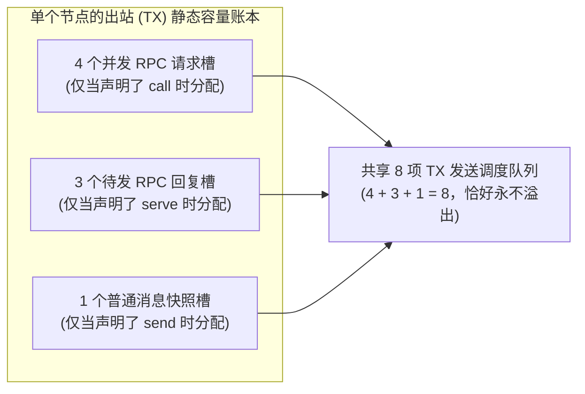

import { Aside, Steps, Tabs, TabItem } from '@astrojs/starlight/components';
import LessonHeader from '../../../../components/tutorial/LessonHeader.astro';
import Challenge from '../../../../components/tutorial/Challenge.astro';
import Checklist from '../../../../components/tutorial/Checklist.astro';
import MultipleChoice from '../../../../components/tutorial/MultipleChoice.astro';

<LessonHeader
  unit={5}
  duration="8 分钟"
  examplePath="examples/03_device_service"
  goals={[
    '记清节点的静态容量账本：4 个并发调用槽、3 个回复槽、1 个普通消息槽',
    '掌握第 5 次并发调用触发 WL_ERR_WOULD_BLOCK 时的处理方式，以及 wl_kernel_cancel 的延迟派发机制',
    '学会嵌入式长耗时任务（如 Flash 擦写、硬件自检）的标准设计模式：短 RPC 领任务号 + 主循环轮询发进度',
  ]}
/>

在零动态分配（0 `malloc`）的嵌入式系统中，**“内存容量上限”就是通信协议契约的一部分**。既然不能无限 `malloc` 排队，我们就必须清楚节点的槽位上限是多少、满了怎么办，以及遇到耗时几百毫秒的硬件操作时如何避免堵死队列。

---

## 第一步：看清节点的静态容量账本

每一个生成的 Wirelink 节点，都会根据它在 `.wl` 里声明的角色（`call` / `serve` / `send` / `recv`）分配固定数量的槽位（没声明的角色分配 **0 字节**）：



### 4 次并发调用与第 5 次背压（`WOULD_BLOCK`）

因为有 **4 个并发出站 RPC 请求槽**，客户端无需等上一个请求返回，就可以连续发起最多 4 个在途调用（出自 [`examples/01_rpc/client_async.c`](https://github.com/starwey604/wirelink/blob/main/examples/01_rpc/client_async.c)）：

{/* [docs:calculator_async_rpc] */}
```c
void calculator_async_example(client_node_t *client) {
  /* Four accepted calls coexist; request values are copied during admission. */
  for (int32_t i = 0; i < 4; ++i) {
    EXAMPLE_REQUIRE(client_call_add(client, &(add_request_t){
        .left = i, .right = 42 - i}, done) == WL_OK);
  }
}
```
{/* [/docs:calculator_async_rpc] */}

**如果这 4 个请求还没收到响应，你立刻发起第 5 个请求会发生什么？**
1. 第 5 次调用会立即返回 **`WL_ERR_WOULD_BLOCK`**。
2. 因为没有被节点接纳，这第 5 次调用**不会产生任何后续的 `done` 完成回调**。
3. **千万不要在主循环里写 `while (call(...) == WL_ERR_WOULD_BLOCK) {}` 原地死等！** 因为你是单线程 Owner，你不继续往下走去调 `client_step()`，前 4 个请求就永远收不到回包、槽位就永远释放不出来！正确做法是记下待发请求，先推进 `step`，等槽位空出来再发。

---

## 第二步：显式时间、取消句柄与防重入保证

当你需要**主动取消一个还没完成的 RPC 请求**，或者需要**为某次调用单独指定超时和上下文 `user`** 时，使用带 `_ex` 后缀的扩展接口。

在高级生命周期测试 [`examples/01_rpc/lifecycle.c`](https://github.com/starwey604/wirelink/blob/main/examples/01_rpc/lifecycle.c) 中，我们演示了填满 4 个槽、第 5 个被拒、然后用句柄 `handles[0]` 取消第 1 个请求的全过程：

{/* [docs:calculator_cancel_timeout] */}
```c
for (unsigned i = 0; i < 4; ++i)
  EXAMPLE_REQUIRE(calculator_call_add_ex(&endpoints[0], &request, 0, 2,
    done, &completions[i], &handles[i]) == WL_OK);
EXAMPLE_REQUIRE(calculator_call_add_ex(&endpoints[0], &request, 0, 2,
  done, &completions[4], &rejected) == WL_ERR_WOULD_BLOCK);
EXAMPLE_REQUIRE(completed == 0);

/* Hold the transport: one request is leased, the other three stay queued. */
EXAMPLE_REQUIRE(calculator_step(&endpoints[0], 0) == WL_OK);
EXAMPLE_REQUIRE(wl_kernel_cancel(&endpoints[0].core, handles[0]) == WL_OK);
EXAMPLE_REQUIRE(completed == 0); /* cancel schedules, not invokes, completion. */
```
{/* [/docs:calculator_cancel_timeout] */}

注意看最后两行的精妙设计：
- 调用 `wl_kernel_cancel`（或节点封装的 `<node>_cancel(&node, handle)`）返回 `WL_OK` 时，**`completed` 依然是 `0`！**
- **为什么不在 `cancel()` 函数内部立刻调用你的 `done()` 回调？** 为了**严格防止回调重入（Anti-Reentrancy）**！如果 `cancel()` 当场在栈上调 `done()`，而你在 `done()` 里又调了别的节点函数，状态机很容易死锁或栈溢出。
- 因此，在 Wirelink 中，**所有的完成回调（成功、拒绝、超时、取消、关闭）100% 只在 `<node>_step()` 内部统一派发**。

---

## 第三步：长耗时任务设计模式（短 RPC 启动 + 异步消息通知）

假设上位机让 MCU 执行一次**硬件自检（Self-Test）**或 **Flash 固件校验**，这个操作在硬件上需要 **20 毫秒甚至 2 秒**。

- ❌ **错误做法**：在 `device_server_on_self_test()` 函数里写 `delay_ms(20)` 死等硬件做完再 return。这会直接卡死你的单线程主循环，导致这期间所有的串口收包和别的心跳全部瘫痪！
- ✅ **Wirelink 标准工程模式**（源自 [`examples/03_device_service/`](https://github.com/starwey604/wirelink/tree/main/examples/03_device_service)）：
  1. **用短 RPC 启动任务**：客户端调 `StartSelfTest`，服务端在微秒级内检查自己忙不忙，分配一个 `job_id` 并记下到期时间 `due`，立刻返回 `job_id`（如果正忙就返回非零拒绝码 `DEVICE_BUSY`）。
  2. **在主循环里轮询进度**：主循环每次看时间到了没；到了就通过普通消息 `send_self_test_progress` 把结果发出去。

点击下方标签页查看 [`examples/03_device_service/self_test.c`](https://github.com/starwey604/wirelink/blob/main/examples/03_device_service/self_test.c) 的真实源码：

<Tabs>
  <TabItem label="1. 短 RPC 立即受理 (device_server_on_start_self_test)">
    {/* [docs:device_job_start] */}
    ```c
    int32_t device_server_on_start_self_test(device_server_node_t *self, const start_self_test_request_t *request,
                         start_self_test_response_t *response) {
      device_service_t *state = self->user;
      if (state->job_pending || state->next_job == UINT32_MAX) return DEVICE_BUSY;
      state->job_id = ++state->next_job;
      state->pattern = request->pattern;
      state->due = state->now + 20U;
      state->job_pending = true;
      response->job_id = state->job_id;
      return 0;
    }
    ```
    {/* [/docs:device_job_start] */}

    你看，这个 RPC handler 不做任何耗时等待：如果已经有任务在做（`state->job_pending`），立刻返回非零错误码 `DEVICE_BUSY` 拒绝；否则登记任务并立刻返回 `0` 和 `job_id`。
  </TabItem>

  <TabItem label="2. 主循环轮询并优雅处理背压 (self_test_poll)">
    当 20ms 到期后，主循环调用 `self_test_poll` 发送完成进度消息：

    {/* [docs:device_job_poll] */}
    ```c
    void self_test_poll(device_service_t *state, device_server_node_t *endpoint) {
      if (!state->job_pending || (int32_t)(state->now - state->due) < 0) return;
      self_test_progress_t progress = {.job_id = state->job_id,
        .observed = state->pattern ^ UINT32_C(0xa5a5)};
      const wl_err_t error = device_server_send_self_test_progress(endpoint, &progress);
      if (error == WL_ERR_WOULD_BLOCK) return;
      EXAMPLE_REQUIRE(error == WL_OK);
      state->job_pending = false;
    }
    ```
    {/* [/docs:device_job_poll] */}

    **注意看第 6~8 行的背压处理范式**：
    - 如果此刻普通消息槽正好被上一条遥测占着（返回 `WL_ERR_WOULD_BLOCK`），我们**直接 `return`，不把 `state->job_pending` 清为 `false`**！
    - 这样在下一次主循环 `step` 把旧消息发走后，`self_test_poll` 会自动再次尝试发送这条自检结果，绝不会因为本地队列暂满而把关键的任务完成通知弄丢！
  </TabItem>
</Tabs>

<Aside type="note" title="本地背压不丢 != 物理掉线不丢">
上面保留 `job_pending` 的做法解决了**本端发送槽暂满（本地背压）**的问题。但如果你的物理线缆（如无线 UDP 或受干扰串口）在路上把这帧 `SelfTestProgress` 丢了，由于普通消息没有内置重传，对于需要 100% 确认最终结果的业务，你还可以额外提供一个 `QueryJobResult(job_id)` 的查询 RPC 作为兜底。
</Aside>

---

## 本课小测验

<MultipleChoice
  id="lesson-05-cancel"
  question="当你调用 cancel(&node, handle) 并返回 WL_OK 后，对应的 RPC 完成回调（outcome = WL_KERNEL_CANCELLED）会在什么时候执行？"
  checkLabel="检查答案"
  emptyFeedback="请先选择一个选项。"
  choices={[
  {
    "label": "不会在 cancel() 内部立即重入执行，而是等到下一次主循环调用 step(now) 时统一派发。",
    "correct": true,
    "feedback": "完全正确！Wirelink 严格保证防重入，所有终态通知都由 owner 在 step() 中统一派发。同时要注意：本地取消不能撤销远端可能已经执行的业务副作用。"
  },
  {
    "label": "在 cancel() 函数返回之前立即在当前调用栈上执行。",
    "correct": false,
    "feedback": "不对。为了避免回调重入导致的状态机混乱，cancel 只标记取消状态，真正的回调由后续 step 派发。"
  }
]}
/>

<MultipleChoice
  id="lesson-05-backpressure"
  question="在轮询发送长任务进度通知时，如果 send 返回了 WL_ERR_WOULD_BLOCK，应该怎么处理？"
  checkLabel="检查答案"
  emptyFeedback="请先选择一个选项。"
  choices={[
  {
    "label": "保留任务待发送标志（如 job_pending = true），等推进 step 释放消息槽后再重试发送。",
    "correct": true,
    "feedback": "正确！WOULD_BLOCK 说明本端唯一的普通消息槽正忙，节点尚未接纳该消息；保留 pending 标志即可在下次循环无损重试。"
  },
  {
    "label": "直接把 job_pending 置为 false，因为内核已经帮你把这条消息缓存进队列了。",
    "correct": false,
    "feedback": "不对。返回 WOULD_BLOCK 时节点没有保存你的输入数据，直接清除标志会导致该通知彻底丢失。"
  }
]}
/>

<Checklist
  id="checklist-05"
  title="本课掌握清单"
  progressTemplate="已完成 {done} / {total} 项"
  items={[
    "清楚节点的固定容量：4 个并发调用槽、3 个待发回复槽与 1 个普通消息快照槽。",
    "知道 cancel 只标记状态并由下一次 step 派发回调，且取消或超时不代表远端没有执行。",
    "掌握“短 RPC 分配 job_id + 轮询发送进度（遇 WOULD_BLOCK 保留 pending 重试）”的长任务模式。"
  ]}
/>

恭喜你，C11 节点的核心内功你已经全部掌握了！最后一课，我们要把节点真正接到**串口字节流（UART `cobs_crc16`）**和**UDP 网络**上，并用 `wlc sdk` 一键生成上位机 **Python / C++20 客户端**。

下一课：[06 上位机 SDK 与多传输接入 →](/wirelink/zh-cn/learn/06-host-sdk-and-transports/)
