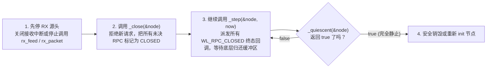

import { Aside, Steps, Tabs, TabItem } from '@astrojs/starlight/components';
import LessonHeader from '../../../../components/tutorial/LessonHeader.astro';
import Challenge from '../../../../components/tutorial/Challenge.astro';
import Checklist from '../../../../components/tutorial/Checklist.astro';
import MultipleChoice from '../../../../components/tutorial/MultipleChoice.astro';

<LessonHeader
  unit={6}
  duration="8 分钟"
  examplePath="examples/bare_metal_loopback.c"
  goals={[
    '掌握安全停机与节点复用的标准流程：先停 RX ➔ 调用 close() ➔ 推进 step() 直到 quiescent() 返回 true',
    '了解 RTOS 线程如何利用 wl_endpoint_ready 实现零空转的精确休眠与事件唤醒',
    '看懂何时需要从默认 io = embedded 切换到高级 io = external 模式以对接异步零拷贝 DMA 驱动',
  ]}
/>

在前五课中，我们一直使用最省心的默认节点配置（`io = embedded; handlers = static;`），它已经能覆盖 90% 以上的裸机与 RTOS 应用开发。

作为系列教程的压轴课，我们将深入底层系统工程的三个进阶主题：**安全停机排空（`quiescent`）**、**RTOS 低功耗休眠唤醒**，以及专门为**异步零拷贝 DMA 驱动**准备的 **`io = external`** 模式。

---

## 第一部分：安全停机与内存复用（`close` $\rightarrow$ `quiescent`）

在嵌入式设备中，当你需要切换波特率、关闭通信端口进入深度休眠、或者重新初始化节点结构体时，**绝对不能直接用 `memset(&node, 0, sizeof(node))` 暴力清零！**

为什么？因为此刻可能还有 2 个在途的 RPC 请求正在等回调通知上层业务释放资源，或者底层的 DMA 控制器还在直接读取节点内部的发送缓冲区！

Wirelink 提供了严谨的**两阶段安全停机**机制：



当 `<node>_quiescent(&node)` 返回 `true` 时，代表**所有在途 RPC 的终态回调都已派发完毕、所有底层缓冲区借用都已彻底归还**，此时你可以 100% 安全地复用或销毁这块内存。

---

## 第二部分：裸机主循环 vs RTOS 低功耗休眠唤醒

Wirelink 节点既能跑在最简单的裸机 `while (1)` 里，也能在 FreeRTOS / Zephyr 任务中实现**平时挂起省电、有包或超时到期才唤醒**。

<Tabs>
  <TabItem label="1. 裸机主循环 (Superloop)">
    在裸机下，主循环只需不断把当前毫秒时间戳 `board_millis()` 传给 `<node>_step()`：

    ```c
    for (;;) {
      /* 1. 从串口环形缓冲喂数据（若有） */
      poll_uart_rx_into_node(&device);

      /* 2. 驱动节点状态机（单次最多处理 16 个内部事件，绝不饿死其他任务） */
      device_step(&device, board_millis());

      /* 3. 执行你的其他裸机任务 */
      app_task_poll();
    }
    ```
  </TabItem>

  <TabItem label="2. RTOS 信号量精确休眠唤醒">
    在 RTOS 专属通信线程中，为了避免死循环空转耗电，可以利用 `wl_endpoint_ready` 查询下一次最近的 RPC 超时时刻 `deadline`，然后让线程在信号量上精确挂起：

    ```c
    for (;;) {
      uint32_t now = rtos_millis();
      device_step(&device, now);

      /* 查询当前是否还有待处理事件，或下一次 RPC 超时的到期时刻 deadline */
      int has_deadline = 0;
      uint32_t deadline = 0;
      now = rtos_millis();
      if (wl_endpoint_ready(&device.core, now, &has_deadline, &deadline) != 0) {
        continue; /* 还有活没干完，跳过休眠继续 step */
      }

      /* 计算最多可以睡多少毫秒（若没有在途 RPC，则可无限期等待新数据包唤醒） */
      uint32_t sleep_ms = has_deadline
          ? ((int32_t)(deadline - now) > 0 ? (deadline - now) : 0)
          : RTOS_WAIT_FOREVER;

      /* 在信号量上挂起休眠；当 UART/网络中断收到新包或发送完成时 give 信号量即可立刻唤醒！ */
      rtos_sem_take(&io_wake_sem, sleep_ms);
    }
    ```
  </TabItem>
</Tabs>

---

## 第三部分：什么时候才需要 `io = external`？（零拷贝异步 DMA）

回顾前五课使用的默认 `io = embedded` 模式：当节点调用你的 `<node>_tx_write(self, data, len)` 时，要求你在函数返回 `WL_OK` 前把这帧字节同步发完，或者 `memcpy` 进你自己的驱动环形缓冲区。

但如果你在写一个追求极致性能的 **零拷贝异步 UART/SPI DMA 驱动**——你不想再额外分配一块驱动发送缓冲区做 `memcpy`，而是希望 **直接把 Wirelink 节点内部缓冲区的指针 `data` 交给硬件 DMA 控制器去慢慢发，等几毫秒后 DMA 发送完成中断触发时，再通知 Wirelink 释放那块内存**——这时候就该用 `io = external;` 了！

### 跑通内置的 `external` 内核级回环示例

仓库根目录的 [`examples/bare_metal_loopback.c`](https://github.com/starwey604/wirelink/blob/main/examples/bare_metal_loopback.c)（对应 [`examples/endpoint/demo.wl`](https://github.com/starwey604/wirelink/blob/main/examples/endpoint/demo.wl)）正是演示 `io = external; handlers = dynamic;` 完整租约生命周期的基准程序。你可以直接编译并运行它：

```sh
cmake -S . -B build/core -DCMAKE_BUILD_TYPE=Release
cmake --build build/core --parallel
./build/core/examples/wirelink_bare_metal_loopback
```

输出：

```text
6 bidirectional RPC completions, 2 telemetry messages; both endpoints quiescent
```

来看看在 `io = external; handlers = dynamic;` 模式下，应用是如何手动初始化外部端口 `wl_packet_port_t` 与回调表 `demo_handlers_t` 的：

{/* [docs:loopback_setup] */}
```c
wl_packet_config_t config = {.instance = 1001U + side,
    .rx_storage = &receive_storage[side][0][0], .rx_unit_size = 256U,
    .rx_storage_size = sizeof(receive_storage[side]),
    .submit = wl_packet_loopback_submit, .notify = wl_packet_loopback_notify,
    .user = &transport.directions[side]};
require(wl_packet_init(&ports[side], &config) == WL_OK);
demo_handlers_t handlers = {.on_execute = execute, .on_event = received};
require(demo_init(&endpoints[side], &ports[side], &handlers, NULL) == WL_OK);
```
{/* [/docs:loopback_setup] */}

### `external` 模式的物理租约（Token Lease）是如何保护 DMA 的？

在 `external` 模式下，当节点要发包时，会调用 `wl_packet_config_t.submit(user, data, size, token)` 并传入一个唯一租约令牌 **`token`**：
1. 你的 DMA 驱动直接把 `data` 指针配置给 DMA 寄存器启动异步发送，然后立刻返回 **`WL_PACKET_STARTED`**。
2. 只要你返回了 `WL_PACKET_STARTED`，**哪怕这个 RPC 请求在上层已经超时或被取消了，Wirelink 内核也绝不会覆盖或复用这块物理缓冲区**！
3. 直到你的 DMA 发送完成中断调用 **`wl_packet_tx_publish(port, token, WL_PACKET_DRAINED)`** 归还该 `token` 后，这块物理槽位才真正回到空闲池。这从根本上杜绝了异步 DMA 读到半新半旧脏数据的恶性 Bug！（完整驱动编写细节详见[驱动移植指南](/wirelink/zh-cn/how-to/custom-drivers/)。）

<Challenge
  title="选型自测：embedded 还是 external？"
  prompt="如果你正在给一块 STM32 或 ESP32 写串口通信，你的串口驱动已经有了一个 512 字节的软件发送 RingBuffer（或者使用阻塞/FIFO 写入），你应该选默认的 io = embedded 还是 io = external？"
>
  **直接用默认的 `io = embedded` 就够了！**

  只要你的 `tx_write` 函数能把整帧字节一次性拷进你自己的驱动 RingBuffer（或者塞进外设 FIFO）并立刻返回 `WL_OK`，不在返回后继续抓着 `data` 指针不放，`io = embedded` 就是代码量最少、最不容易出错的选择。只有当你想省掉那次向驱动队列的 `memcpy`、让硬件 DMA 直接长时间借用节点内部缓冲区指针时，才需要上 `io = external`。
</Challenge>

---

## 本课小测验

<MultipleChoice
  id="lesson-06-shutdown"
  question="在关闭通信端口或销毁/重置节点内存之前，正确的安全停机步骤是什么？"
  checkLabel="检查答案"
  emptyFeedback="请先选择一个选项。"
  choices={[
  {
    "label": "先停止 RX 数据源，再调用 <node>_close(&node)，并继续调用 <node>_step(&node, now) 直到 <node>_quiescent(&node) 返回 true。",
    "correct": true,
    "feedback": "完全正确！只有当 quiescent() 返回 true 时，所有在途 RPC 的终态回调和底层缓冲区租约才全部安全收尾。"
  },
  {
    "label": "直接调用 memset(&node, 0, sizeof(node)) 清零结构体即可。",
    "correct": false,
    "feedback": "危险！直接清零会导致在途 RPC 永远收不到完成回调，且若底层异步 DMA 仍在读取缓冲区会导致内存损坏。"
  }
]}
/>

<Checklist
  id="checklist-06"
  title="本课掌握清单"
  progressTemplate="已完成 {done} / {total} 项"
  items={[
    "掌握停止 RX ➔ close() ➔ 循环 step() 直至 quiescent() 为真的安全停机四步曲。",
    "理解 RTOS 任务如何通过 wl_endpoint_ready 获取最近超时时间并配合信号量实现低功耗按需唤醒。",
    "清楚默认 io = embedded 与进阶 io = external（零拷贝异步 DMA 物理租约）的适用边界。"
  ]}
/>

---

## 🎉 恭喜你通关全部 6 节实战教程！

你已经从零走完了 **编写 `.wl` 打通上下位机** $\rightarrow$ **设计 Telemetry 与 RPC 协同架构** $\rightarrow$ **使用有界字符串与安全生命周期** $\rightarrow$ **接入 UART 串口与 UDP 上位机 SDK** $\rightarrow$ **掌控并发与背压** $\rightarrow$ **深入安全停机与底层 DMA** 的完整进阶之路！

在接下来的实际项目开发中，你可以随时查阅右侧的专题参考手册：

- 📐 **[.wl 语法手册](/wirelink/zh-cn/concepts/schema-language/)**、**[节点配置指南](/wirelink/zh-cn/concepts/nodes/)** 与 **[WLC / CMake 集成](/wirelink/zh-cn/concepts/wlc-and-cmake/)**
- 🔌 **[物理链路驱动移植指南](/wirelink/zh-cn/how-to/custom-drivers/)**、**[裸机 / RTOS 执行模型](/wirelink/zh-cn/how-to/execution-models/)** 与 **[Python / C++20 上位机 SDK](/wirelink/zh-cn/how-to/host-sdks/)**
- 📖 **[C11 节点 API 速查表](/wirelink/zh-cn/reference/endpoint-api/)**、**[状态码参考](/wirelink/zh-cn/reference/status-codes/)**、**[二进制线协议规范](/wirelink/zh-cn/reference/wire-format/)** 与 **[静态 Flash / RAM 体积账本](/wirelink/zh-cn/reference/footprint-and-benchmarks/)**
