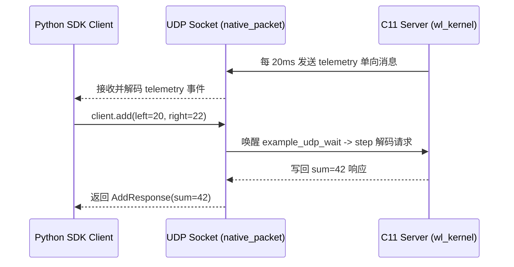

import Checklist from '../../../../components/tutorial/Checklist.astro';
import MultipleChoice from '../../../../components/tutorial/MultipleChoice.astro';

前面 5 课的所有逻辑都运行在内存环回上。要真正连接外部设备或上位机，你无需修改一行业务代码：在固件侧把传输绑定从内存换成真实串口或网卡，而在上位机侧直接加载由同一份 `.wl` 生成的 Python 或 C++20 SDK 即可。

## 两种封装载体：`native_packet` 与 `cobs_stream`

Wirelink 在绑定配置（`.bind.wl`）中支持按物理介质特性选择不同的线缆成帧策略：

| 传输属性 | `native_packet` | `cobs_stream` | `bus_length16` |
| :--- | :--- | :--- | :--- |
| 适用物理层 | UDP、USB Bulk、共享内存队列 | UART、RTT、USB CDC ACM 字节流 | SPI、I2C 等长度受控块总线 |
| 边界感知 | 传输层原生保留帧边界 | 无原生边界，需字节流切帧 | 2 字节大端长度头 + 负载 |
| 线缆开销 | 0 字节额外成帧开销 | `0x00` 哨兵 + COBS + CRC-16/CCITT | 2 字节长度头（无内建 CRC） |
| 典型下位机接口 | `wl_packet_port_t` | `wl_byte_fifo_t` + `wl_packet_stream_t` | `wl_packet_stream_t` |

无论是哪一种物理通道，只要底层的 `packet_port` 把收到的 Wire v2 报文递交给 `wl_kernel_t`，业务层发送与接收的 API 形态完全一致。

## 上位机一步直连：`wlc sdk` Python 绑定

利用 `wlc sdk` 命令，编译器能直接根据 `.wl` 与 `.bind.wl` 生成包含 C++20 与 Python 客户端的完整 SDK 工程（内置同步 `Client` 与异步 `AsyncClient`）。如果服务端以 `WL_KERNEL_REJECTED` 拒绝了请求，Python SDK 会自动将错误码映射成 `RejectedError` 异常并透传 `error.status`。

以下代码来自 [examples/06_bindings/tests/check_wheel.py](https://github.com/starwey604/wirelink/blob/main/examples/06_bindings/tests/check_wheel.py)，演示了通过 UDP 连接设备、完成正常加法 RPC，以及捕获整数溢出拒绝异常的完整过程：

{/* [docs:python_sdk_client] */}
```python
with Client.connect(Udp(peer=('127.0.0.1', port))) as client:
    saved = client.add(left=20, right=22)
    assert saved.sum == 42
    try:
        client.add(left=2**31 - 1, right=1)
    except RejectedError as error:
        assert error.status == 1
```

## 固件端的阻塞等待与定时推送

在真机主循环或 POSIX / Zephyr 服务线程中，端点不仅要响应上位机 RPC，还需要周期性向外推送遥测。标准主循环遵循「步进内核 → 检查业务定时发送 → 计算下一次最近截止时间并休眠等待」的节拍，避免空转占满 CPU。

以下 UDP 服务端循环来自 [examples/05_zephyr_udp/server.c](https://github.com/starwey604/wirelink/blob/main/examples/05_zephyr_udp/server.c)：

{/* [docs:udp_server_loop] */}
```c
while (example_running()) {
  uint32_t now = example_now_ms();
  if (example_udp_step(udp, &server.core, now) != WL_OK) { status = 1; break; }
  if ((int32_t)(now - due) >= 0) {
    telemetry_t sample = {.has_sample = true, .sample = ++sequence};
    const wl_err_t error = udp_demo_kernel_send_telemetry(&server, &sample);
    if (error != WL_OK && error != WL_ERR_WOULD_BLOCK) { status = 1; break; }
    due = now + 20;
  }
  now = example_now_ms();
  uint32_t wait = (int32_t)(due - now) > 0 ? due - now : 0;
  if (example_udp_wait(udp, &server.core, wait) != WL_OK) { status = 1; break; }
}
```



<MultipleChoice
  id="q-lesson-06-framing"
  question="打算让 MCU 通过无帧边界的裸 UART（只有字节收发中断）与上位机通信时，应优先选用哪种封装配置？"
  checkLabel="检查答案"
  emptyFeedback="请先选择一个选项。"
  choices={[
    {
      label: "native_packet",
      correct: false,
      feedback: "不对。native_packet 不插入任何定界符或 CRC，只能在 UDP、USB Bulk 这类原生支持分组边界的传输上使用。"
    },
    {
      label: "cobs_stream",
      correct: true,
      feedback: "完全正确。cobs_stream 用 0x00 定界并在帧尾附带 CRC-16/CCITT，能在任意断包与粘包的串口流中可靠还原帧。"
    }
  ]}
/>

<Checklist
  id="checklist-lesson-06"
  title="本课检查清单"
  progressTemplate="已完成 {done} / {total} 项"
  items={[
    "分清 native_packet（分组传输）与 cobs_stream（字节流传输）的适用场景",
    "了解 wlc sdk 如何通过 UDP 或串口把服务端直接暴露给 Python/C++20 调用方",
    "掌握 step -> 定时发送 -> wait 的零空转事件循环节拍"
  ]}
/>
