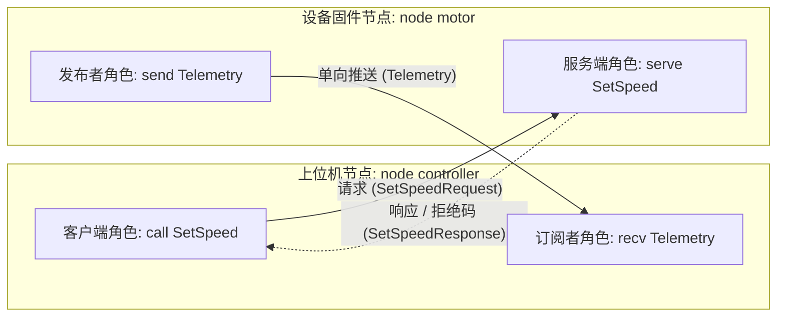
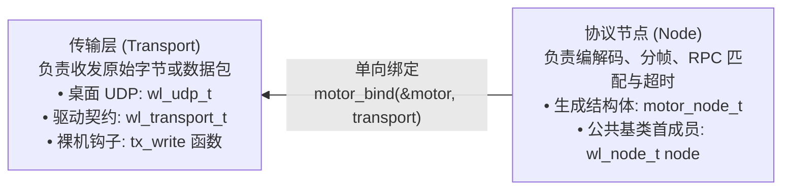

import { Aside, Card, CardGrid } from '@astrojs/starlight/components';

在进入代码和教程之前，花 3 分钟建立 Wirelink 的整体心智模型会让后续所有概念水到渠成。

Wirelink 刻意将概念收敛到最小集合：
- **协议层（`.wl` 文件）**：`message`、`rpc` 与 `node`（承载 4 种收发角色）。
- **运行时层（C11 代码）**：`Transport`（传输）与 `Node`（节点）。

---

## 一、什么是 `Node`？它和 Publisher / Server 有什么关系？

在许多通信框架（如 ROS 2、iceoryx2）中，程序会先创建一个参与者实体，再在上面挂载发布者、订阅者、客户端或服务端。Wirelink 采用了相似但更适合单片机的静态设计：

- **`Node`（节点）**：代表通信链路**某一端的完整通信实体**——例如一块电机控制板固件、一个传感器节点，或者电脑上的上位机工具。
- **角色（Role）**：不是单独创建、层层嵌套的对象，而是**直接声明在 `node { ... }` 内部的能力清单**。Wirelink 支持两种通信模式，对应 4 个角色关键字：

| 通信模式 | 发起方角色 | 接收/响应方角色 | 行为特点 | 典型场景 |
| :--- | :--- | :--- | :--- | :--- |
| **单向消息（Publish / Subscribe）** | **发布者** `send <Msg>` | **订阅者** `recv <Msg>` | 单向推送，发出即完成，不等待对端应答 | 周期上报传感器采样（Telemetry）、异步状态/告警通知 |
| **双向调用（Request / Response）** | **客户端** `call <Rpc>` | **服务端** `serve <Rpc>` | 一问一答，必有明确终态：成功响应、业务拒绝码或超时 | 下发控制命令、修改参数、查询设备信息 |

### 一个 `Node` 可以同时承担多种角色

在实际嵌入式设备里，同一块 MCU 往往既要接收上位机的控制命令，又要周期性上报传感器数据。你不需要为它们分别创建多个节点对象，只需在同一个 `node` 中组合声明即可：



对应的 `.wl` 协议只有十几行：

```wl
message SetSpeedRequest @id(1) { int32 rpm @id(1); }
message SetSpeedResponse @id(2) { int32 applied_rpm @id(1); }
message Telemetry @id(3) { int32 actual_rpm @id(1); }

rpc SetSpeed(SetSpeedRequest) -> SetSpeedResponse;

node controller { call SetSpeed; recv Telemetry; }
node motor      { serve SetSpeed; send Telemetry; }
```

<Aside type="note" title="按角色裁剪：没声明的角色占 0 字节内存">
使用 `wlc compile app.wl --node motor` 编译电机端固件时，编译器**只会为 `motor` 声明的 `serve` 和 `send` 生成代码和静态缓冲区**，不会混入 `controller` 的代码，也不会为未使用的出站 RPC 客户端分配任何 RAM。
</Aside>

---

## 二、运行时只有两层：`Transport ← Node`

传统通信库常常引入中间层（Broker 守护进程、独立 I/O 适配对象、多线程队列等），导致启动和关闭路径复杂。Wirelink 的 C11 运行时只有两个扁平概念，并且是**单向绑定**关系：



1. **传输（Transport）只管搬运字节**：它不关心消息字段，也不关心 RPC 超时。在桌面联调时它是官方 UDP 适配器（`<wirelink/udp.h>`）；在 RTOS 上它是串口/USB 驱动；在裸机 MCU 上它甚至只需要你提供一个同步发包函数 `tx_write`。
2. **节点（Node）只管协议与业务**：你把节点单向绑定到传输上后，应用主循环只与节点打交道——推进状态机、发起发送/调用、等待事件和关闭停机。更换底层物理链路时，业务回调一行也不用改。

### 看懂代码中的三类函数前缀

为了避免不同节点生成一堆难以辨认的杂乱符号，Wirelink 将函数前缀严格划分为三类：

| 前缀 | 来源 | 职责举例 |
| :--- | :--- | :--- |
| **`wl_udp_*`**（或板级驱动） | `<wirelink/udp.h>` 等传输头 | 打开、配置与关闭物理传输（`wl_udp_open`、`wl_udp_transport`、`wl_udp_close`） |
| **`wl_node_*`** | 核心库 `<wirelink/node.h>` | 所有节点共用的运行时操作，传入基类成员 `&self.node`。常规主循环用 `wl_node_poll` 驱动收发，退出时用 `wl_node_close` 关闭节点。 |
| **`<node>_*`** | `wlc` 根据 `.wl` 节点名生成 | 仅包含本节点专属的类型、绑定入口与业务收发（如 `motor_node_t`、`motor_bind`、`motor_send_telemetry`、`motor_on_set_speed`） |

---

## 三、数据在主循环中的流转方式（单所有权步进）

一个节点由同一个主循环或 RTOS 任务驱动。常规循环调用 `wl_node_poll`，它先按需等待工作，再采样时钟并推进一次状态机。

```mermaid
sequenceDiagram
  participant Wire as 物理链路 / Transport
  participant Loop as 应用主循环 (单所有权 Owner)
  participant Node as 节点 (wl_node_t)

  Loop->>Node: 1. 绑定传输 (<node>_bind / <node>_bind_sync)
  loop 主循环
    Wire-->>Node: 收到数据帧（存入双 RX 缓冲槽）
    Loop->>Node: 2. wl_node_poll(&n.node, clock, max_wait_ms)
    activate Node
    Node->>Loop: 解码并顺序触发业务回调 (<node>_on_*)
    Node->>Wire: 编码并经传输层写出消息或响应
    deactivate Node
  end
```

裸机循环若需持续处理其他外设，可直接用 `wl_node_step` 推进一次。自定义调度器可用 `wl_node_readiness` 查询就绪状态和最近截止时间，或用 `wl_node_wait` 单独等待。

1. **业务回调在同一上下文顺序执行**：数据可以在 UART 中断或网络线程到达，`on_<msg>` / `on_<rpc>` 由驱动节点的主循环在步进时调用。
2. **内存与流控显式可控**：节点内部在编译期固定分配了静态槽位（例如 4 路并发出站 RPC、1 个单向消息缓冲槽）。发送过快或链路暂忙时，API 不会偷偷 `malloc` 也不会卡死，而是立即返回 **`WL_ERR_WOULD_BLOCK`**，把决策权（下轮重试还是丢弃旧采样）明确交给应用层。
3. **分帧与业务完全正交**：在 UDP 或 USB Bulk 等自带包边界的链路上使用默认 `framing = native;`；换成 UART 串口字节流时，只需在 `node` 中加一行 **`framing = cobs_crc16;`**，业务消息和回调函数完全不变。

---

## 下一步

建立好这套心智模型后，接下来的学习路线会非常顺畅：

<CardGrid>
  <Card title="快速开始" icon="rocket">
    3 分钟构建核心库、编译器 wlc 与内置示例，验证本地环境。[前往快速开始 →](/wirelink/zh-cn/overview/quick-start/)
  </Card>
  <Card title="第 01 课：单向消息（发布与订阅）" icon="open-book">
    从最简单的发布者与订阅者开始，亲手编写并运行第一个双进程通信示例。[进入第 01 课 →](/wirelink/zh-cn/learn/01-publish-subscribe/)
  </Card>
</CardGrid>
