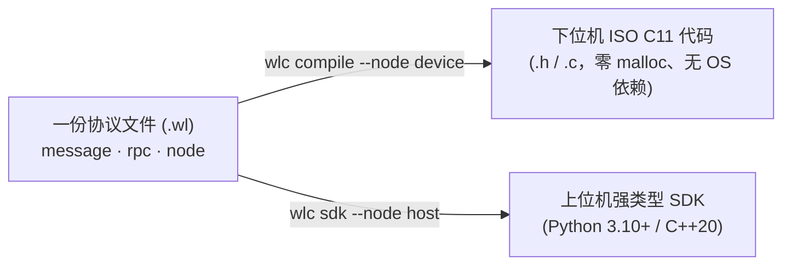

import { Card, CardGrid } from '@astrojs/starlight/components';

在嵌入式开发中，下位机（MCU）与上位机（PC 工具、边缘主机或另一块控制器）之间的通信通常面临两类重复工作：

- **手写通信协议**：需要自行处理串口粘包与断包、字节序转换、CRC 校验，以及请求与响应的匹配和超时逻辑。随着接口增多，状态管理会逐渐变得难以维护。
- **单独使用序列化库（如 Protobuf / Nanopb）**：序列化库只解决数据结构与字节流之间的编解码，不包含链路分帧、RPC 会话匹配、业务错误码与超时控制，这些部分仍需应用层自行拼接。

**Wirelink** 将协议定义、二进制编解码、链路分帧以及通信状态管理整合为一套统一的工具链。你只需维护一份 `.wl` 协议文件，通过编译器 `wlc` 即可分别生成两端代码：

---

## 核心特性

| 维度 | 设计取舍 |
| :--- | :--- |
| **零堆分配（0 `malloc`）** | 所有收发缓冲、RPC 请求槽与字符串存储都在编译期静态定长；未声明的角色不占内存。 |
| **零 OS 与硬件绑定** | `src/` 核心是纯 ISO C11，不创建后台线程，也不调用系统时钟或特定芯片寄存器，适用于裸机主循环、FreeRTOS、Zephyr 与 Linux/Windows。 |
| **两层运行时模型** | 应用代码只需面对**传输（Transport）**与**节点（Node）**两个概念，更换 UART、USB 或 UDP 链路无需修改业务代码。 |
| **端到端类型一致** | 同一份 `.wl` 同时生成下位机 C 结构体与上位机 Python / C++20 客户端，字段号、枚举值与长度上限在编译期强制校验。 |

---

## 下一步

<CardGrid>
  <Card title="核心心智模型" icon="puzzle">
    在动手写代码之前，先理清 Node、4 种通信角色以及 Transport ← Node 的协作方式。[阅读核心心智模型 →](/wirelink/zh-cn/overview/mental-model/)
  </Card>
  <Card title="快速开始" icon="rocket">
    配置本地工具链，编译并运行仓库中的内置示例。[前往快速开始 →](/wirelink/zh-cn/overview/quick-start/)
  </Card>
</CardGrid>
