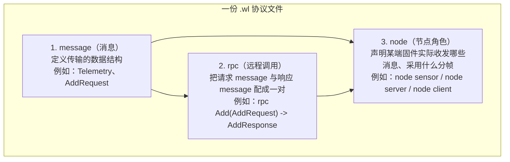
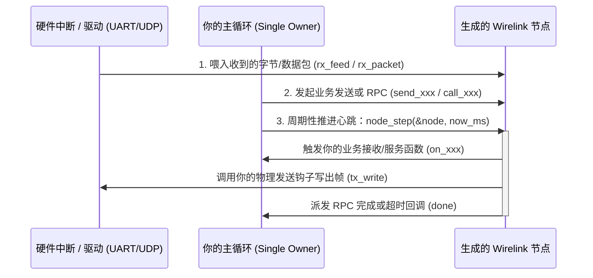

import { Aside, Card, CardGrid } from '@astrojs/starlight/components';

在嵌入式开发中，让 MCU（裸机、FreeRTOS 或 Zephyr）和上位机（PC、边缘主机或另一块 MCU）稳定通信，往往会陷入两难：

- **自己手写结构体强转或简易串口协议**：一开始很快，但只要遇到**跨平台字节序/对齐差异**、**串口粘包断包**、**需要等待对端应答（RPC 超时与重试）**或者**协议升级加字段**，代码就会迅速膨胀成难以维护的状态机泥潭。
- **引入通用序列化库（如 Protobuf / Nanopb）**：它们只解决了“结构体 $\leftrightarrow$ 字节数组”的编解码，却**不管通信生命周期**——你依然要自己写请求 ID 匹配表、超时定时器、发送队列背压、串口 COBS/CRC 分帧，更要小心翼翼地避开动态内存分配（`malloc`）。

**Wirelink 正是为了填补这块空白而生。** 它把**类型安全的二进制编解码器**、**固定容量的 RPC/消息微内核**以及**字节流分帧器**打包成一个**零堆分配（0 `malloc`）的纯 ISO C11 核心**。

---

## 核心心智模型：只要记住 3 个词

在 Wirelink 中，所有的协议和角色都写在同一份 `.wl` 文件里，围绕三个核心概念展开：

1. **`message`（消息数据）**：定义在线路上传输的数据字段。Wirelink 采用**默认必选（Required by default）**设计——生成的 C 结构体干干净净，直接读写 `msg.temperature`，不再需要满屏设置 `msg.has_temperature = true`（只有显式标记为 `optional` 的字段才带 `has_*`）。
2. **`rpc`（一问一答）**：把一个请求 `message` 和一个响应 `message` 绑定成一次远程过程调用。内核会自动为你管理会话 ID、超时倒计时、主动取消以及远端业务拒绝码（`Rejected`）。
3. **`node`（节点角色）**：这是 Wirelink 最独特的设计。你在 `.wl` 里直接声明每个角色用到了哪些能力（`send`、`recv`、`call`、`serve`）以及物理分帧方式（如串口用的 `framing = cobs_crc16;`）。编译器 `wlc` 会**按角色精确裁剪生成的 C 代码和静态缓冲区**——只发遥测的传感器节点，绝不会浪费哪怕 1 字节的 RPC 请求池内存！

---

## 它是怎么跑起来的？单线程 `step(now)` 模型

Wirelink 的 C11 核心**不创建线程、不使用互斥锁、不调用系统时钟 API，也不直接绑死任何硬件外设寄存器**。它的运行方式极其纯粹，就像一个状态机齿轮：

- **单一所有者（Single Owner）**：无论是裸机 `while (1)` 主循环，还是 RTOS 里的一个专属通信线程，所有对节点的业务操作（`init`、`send`、`call`、`step`、`close`）都在这同一个上下文里顺序执行。
- **确定性容量与显式背压**：每个启用 RPC 的节点固定拥有 **4 个并发出站调用槽**、**3 个待发回复槽**、**1 个普通消息快照槽** 和 **8 项 TX 调度队列**。当槽位满或外设忙时，API 不会偷偷丢数据，而是立即返回 `WL_ERR_WOULD_BLOCK`，让你决定是保留状态下次重试，还是跳过旧采样。

---

## 职责边界：Wirelink 做什么 vs 应用做什么？

为了让核心在任何 MCU 上都能保持零依赖和可预测性，Wirelink 划分了非常清晰的责任边界：

| 维度 | Wirelink 自动帮你搞定的事 | 留给你的应用 / 硬件驱动的事 |
| :--- | :--- | :--- |
| **编码与校验** | 字段 TLV / Positional 编解码、小端字节序、UTF-8 与长度越界检查、COBS 转义与 CRC16 校验 | 选择合适的 `framing`（串口选 `cobs_crc16`，UDP/数据包选 `native`） |
| **物理收发** | 打包完整的线缆帧，在需要发送时调用你的 `tx_write` 钩子；从 `rx_feed` 字节流中自动拼包 | 把 `tx_write` 的字节写进 UART/USB/UDP，把硬件收到的字节喂给 `rx_packet` 或 `rx_feed` |
| **状态与超时** | 维护 4 路并发 RPC 请求的会话匹配、截止时间检查、取消通知与业务拒绝码透传 | 周期性向 `<node>_step(&node, now_ms)` 传入当前单调递增的毫秒数 |
| **业务可靠性** | 报告本地队列背压（`WOULD_BLOCK`）与 RPC 超时（`TIMED_OUT`） | **普通消息不自动重传，RPC 不自动去重**。超时后是否重试、业务操作是否幂等由应用层决定 |

<Aside type="tip" title="RAM 占用有多小？">
在 GCC `-Os` 下，一个包含双向 RPC 和遥测的完整节点装配（含节点、端口及双 RX 接收缓冲），使用 `native` 分帧仅占 **790 字节 RAM**，使用 `cobs_crc16`（含字节 FIFO）仅占 **1,054 字节 RAM**。如果节点只声明了单向 `send`，未使用的请求和回复缓冲区会被直接裁剪为 0。详见[静态资源与体积账本](/wirelink/zh-cn/reference/footprint-and-benchmarks/)。
</Aside>

---

## 下一步去哪？

<CardGrid>
  <Card title="⚡ 5 分钟快速上手" icon="rocket">
    先在本地跑通免硬件回环，再动手编译你的第一个 `.wl` 协议文件。[前往快速上手 →](/wirelink/zh-cn/overview/quick-start/)
  </Card>
  <Card title="📖 第 01 课：跑通第一个本地回环节点" icon="open-book">
    跟随 6 节互动教程，从零掌握单向遥测、RPC、字符串生命周期、背压与上位机 SDK。[开始第 01 课 →](/wirelink/zh-cn/learn/01-loopback-endpoint/)
  </Card>
</CardGrid>
