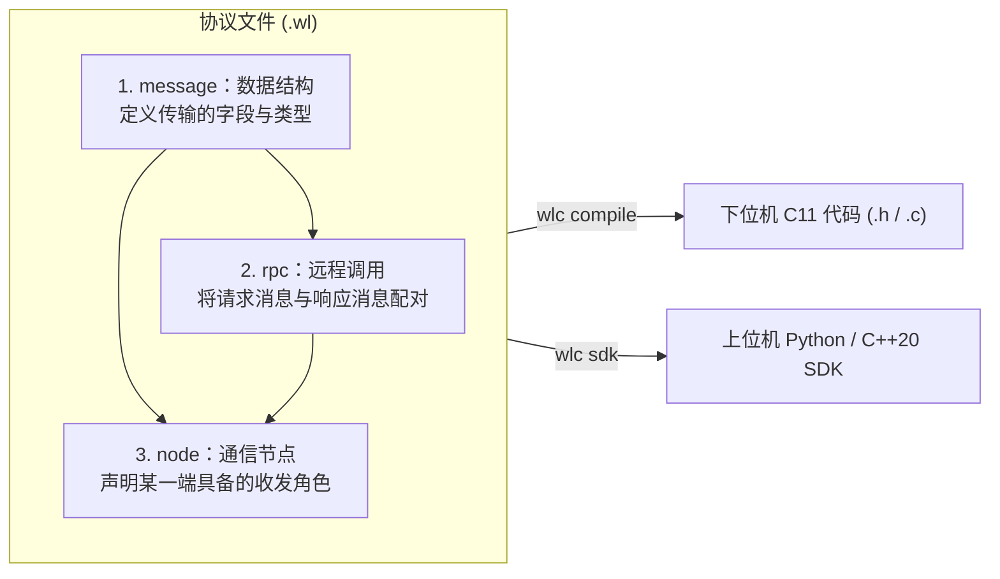

import { Card, CardGrid } from '@astrojs/starlight/components';

在嵌入式开发中，下位机（MCU）与上位机（PC 工具、边缘主机或另一块控制器）之间的通信通常面临两类重复工作：

- **手写通信协议**：需要自行处理串口粘包与断包、字节序转换、校验和，以及请求与响应的匹配和超时逻辑。随着接口增多，状态管理会逐渐变得难以维护。
- **单独使用序列化库（如 Protobuf）**：序列化库只解决数据结构与字节流之间的编解码，不包含链路分帧、会话匹配与超时控制，这些部分仍需应用层自行实现。

**Wirelink** 将协议定义、二进制编解码、链路分帧以及通信状态管理整合为一套统一的工具链。你只需维护一份 `.wl` 协议文件，通过编译器 `wlc` 即可分别生成：

- **下位机 C11 代码**：不依赖操作系统、线程、时钟 API 或 `malloc`，可直接集成到裸机主循环、FreeRTOS 或 Zephyr 工程中。
- **上位机客户端 SDK**：生成带完整类型定义的 Python 与 C++20 客户端，用于控制、测试或与设备联调。

---

## `.wl` 协议中的三个基本概念

一份 `.wl` 文件围绕三个概念描述通信契约：



1. **`message`（消息）**：定义传输的数据结构，包含整型、浮点、枚举、定长数组、有界字符串等字段。
2. **`rpc`（远程过程调用）**：将一个请求 `message` 与一个响应 `message` 绑定为一对调用，由 Wirelink 负责请求匹配、超时与错误码传递。
3. **`node`（节点）**：声明通信中某一方的角色，即它负责发送、接收、发起调用还是提供服务。

---

## 两种通信模式

在同一个节点上，你可以根据业务需要自由组合以下两种通信模式：

| 通信模式 | 行为特点 | 典型场景 |
| :--- | :--- | :--- |
| **双向调用（RPC）** | 一问一答。调用方会明确收到成功响应、业务拒绝状态码或超时错误。 | 下发控制指令、修改设备参数、查询设备状态 |
| **单向消息（Telemetry）** | 单向推送，不等待对端确认，开销更低。 | 周期上报传感器读数、推送异步事件或后台任务进度 |

---

## 运行时模型：Transport 与 Node

Wirelink 生成的 C11 代码不会在后台创建线程，也不直接操作特定芯片的硬件寄存器。无论目标平台是桌面 UDP、Zephyr RTOS 还是裸机主循环，运行时都只围绕两个概念展开：

- **传输（Transport）**：负责收发原始字节或数据包，例如官方 UDP 适配器（`<wirelink/udp.h>`）、平台串口/USB 驱动，或者裸机工程里的单个同步发送函数。
- **节点（Node）**：由 `wlc` 根据 `.wl` 生成的协议实体（`<node>_node_t`），内嵌公共基类 `wl_node_t node`。应用通过 `<node>_bind` 或 `<node>_bind_sync` 把节点单向挂载到传输上，之后统一使用 `wl_node_*` 驱动收发与关闭。

```mermaid
sequenceDiagram
  participant Link as 传输层 (Transport / 硬件驱动)
  participant App as 应用主循环
  participant Node as Wirelink 节点 (wl_node_t)

  App->>Node: 1. 绑定传输 (<node>_bind / <node>_bind_sync)
  App->>Node: 2. 定期调用 wl_node_step(&n.node, now_ms)
  activate Node
  Link-->>Node: 读入到达的数据帧
  Node->>App: 解码并调用业务回调 (<node>_on_*)
  Node->>Link: 编码并经传输层写出响应/消息
  deactivate Node
  App->>Node: 3. 可选：wl_node_wait(&n.node, now_ms, max_ms) 等待事件
```

这一分层把底层收发和协议业务彻底隔离开：更换物理链路时，只需替换挂载的传输对象，业务代码无需改动。

---

## 下一步

<CardGrid>
  <Card title="快速开始" icon="rocket">
    在本地构建并运行第一个示例，体验用 wlc 编译 .wl 文件。[前往快速开始 →](/wirelink/zh-cn/overview/quick-start/)
  </Card>
  <Card title="第 01 课：编写第一个 .wl 并运行服务" icon="open-book">
    从定义协议开始，一步步看懂生成的 C 头文件并完成首次调用。[进入第 01 课 →](/wirelink/zh-cn/learn/01-loopback-endpoint/)
  </Card>
</CardGrid>
