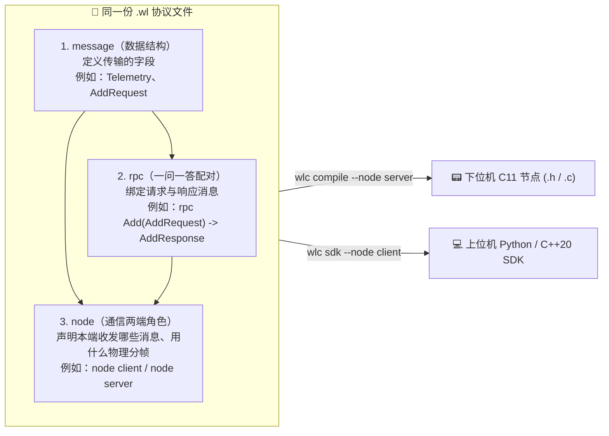
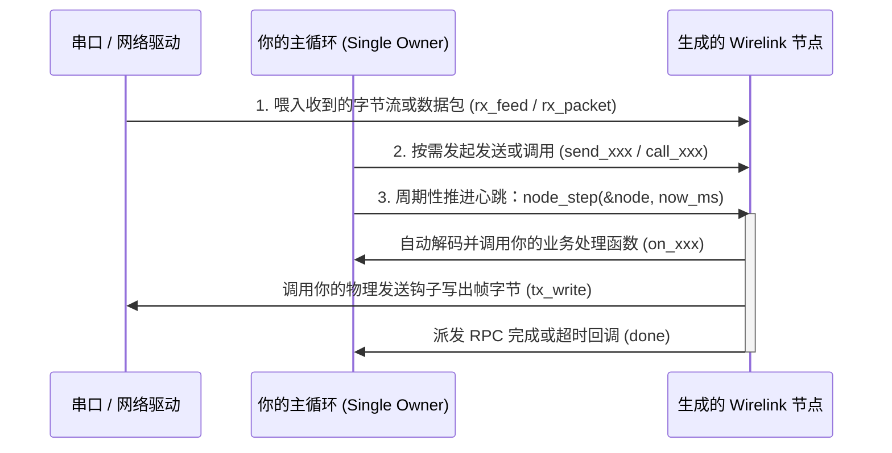

import { Aside, Card, CardGrid } from '@astrojs/starlight/components';

在嵌入式系统中，下位机（运行在裸机、FreeRTOS 或 Zephyr 上的 MCU）与上位机（PC 端 Python/C++ 程序、边缘主机或另一块主控板）之间的通信，通常面临两类麻烦：

- **自己手写串口协议与状态机**：一旦涉及**串口粘包断包**、**跨平台字节序与对齐**、**等待对端应答（超时与错误码）**，代码很快就会演变成难以维护的 `switch-case` 和全局变量泥潭。
- **只用纯序列化库（如 Protobuf / Nanopb）**：它们只负责“结构体 $\leftrightarrow$ 字节流”的转换，却**不管通信过程**——你仍然得自己写请求会话匹配、超时定时器、发送队列流控和串口 COBS/CRC 分帧。

**Wirelink 为嵌入式上下位机提供了一套完整的端到端方案**：你只需要写一份 `.wl` 协议文件，就能同时生成**零动态内存分配（0 `malloc`）的纯 ISO C11 节点代码**与**上位机 Python / C++20 客户端 SDK**。

---

## 一、 一份 `.wl` 文件里的三个核心概念

Wirelink 的协议定义非常直观，所有内容都围绕三个概念展开：

1. **`message`（消息数据）**：定义数据包里的字段（如整型、浮点数、枚举、有界字符串 `string<31>`、有界字节数组 `bytes<64>`）。字段默认是必选的，直接对应 C 结构体中的普通成员；需要可选字段时加上 `optional` 即可。
2. **`rpc`（远程过程调用）**：把一个请求 `message` 和一个响应 `message` 配成一对。Wirelink 会自动帮你管理请求会话 ID、超时倒计时、主动取消以及服务端的业务拒绝码。
3. **`node`（节点角色）**：声明通信中的某一方（如下位机 `device` 或上位机 `controller`）具体拥有哪些收发能力（`send`、`recv`、`call`、`serve`）以及物理链路分帧方式（如串口用的 `framing = cobs_crc16;`）。编译器会**按角色精确生成代码并分配静态缓冲区**——一个只负责上报数据的传感器节点，不会分配任何多余的 RPC 缓冲区。

---

## 二、 两种通信模式：Telemetry 与 RPC 如何配合？

在真实的嵌入式设备中，上下位机交互可以归结为两种基本模式，你在 `.wl` 的 `node` 里可以把它们自由组合：

| 通信模式 | `.wl` 节点关键字 | 交互特点 | 典型工程场景 |
| :--- | :--- | :--- | :--- |
| **单向消息（Telemetry / Event）** | 发送方写 **`send`** 接收方写 **`recv`** | **单向推送、无内置 ACK 等待**：发送方把数据编码进内部快照槽即可继续干活，吞吐高、开销极小 | • 传感器周期上报温度、姿态、电压 • 设备异步上报状态变化或长任务进度 |
| **双向调用（RPC）** | 调用方写 **`call`** 服务方写 **`serve`** | **一问一答、明确终态**：调用方必然得到“成功响应（`SUCCESS`）”、“业务拒绝（`REJECTED` + 状态码）”或“超时（`TIMED_OUT`）” | • 上位机下发控制指令、修改配置参数 • 查询设备信息、启动自检并获取任务号 |

<Aside type="tip" title="实战黄金搭档：用 RPC 下发指令，用 Telemetry 推送高频状态与长任务进度">
在很多设备里，这两种模式是协同工作的：
- 上位机通过 **`call`** 下发控制命令（必须确认 MCU 是否接受，比如设备忙时 MCU 直接返回非零拒绝码）；
- MCU 在后台执行任务，并通过 **`send`** 周期性向上位机推送实时遥测或任务完成进度（避免上位机阻塞死等耗时硬件操作）。我们在**第 02 课**会深入剖析这套协同设计。
</Aside>

---

## 三、 下位机怎么跑起来？单线程 `step(now_ms)` 模型

Wirelink 的 C11 核心**不创建线程、不使用互斥锁、不调用系统时钟 API，也不绑死任何芯片的寄存器**。无论你用的是裸机 `while (1)` 主循环还是 RTOS 任务，驱动一个节点只需要三步：

- **单一执行上下文（Single Owner）**：一个节点的所有业务操作（`init`、`send`、`call`、`step`、`close`）都在同一个主循环或同一个专属任务中串行调用，彻底省去加锁开销。
- **固定容量与显式流控**：所有缓冲区大小在编译期完全确定（单个节点最多支持 4 路并发出站 RPC、3 个待发回复、1 个普通消息发送槽）。当发送槽满或外设暂忙时，API 立即返回 `WL_ERR_WOULD_BLOCK`，绝不静默丢包或动态扩容。

---

## 四、 下一步去哪？

<CardGrid>
  <Card title="⚡ 5 分钟快速上手" icon="rocket">
    3 步走完从编写 `.wl` 到生成 MCU 固件代码与上位机 Python 客户端的完整闭环。[前往快速上手 →](/wirelink/zh-cn/overview/quick-start/)
  </Card>
  <Card title="📖 第 01 课：编写 .wl 并打通上下位机通信" icon="open-book">
    进入 6 节循序渐进的互动式教程，边看真实可编译源码、边做思考题掌握每一个核心能力。[开始第 01 课 →](/wirelink/zh-cn/learn/01-loopback-endpoint/)
  </Card>
</CardGrid>
